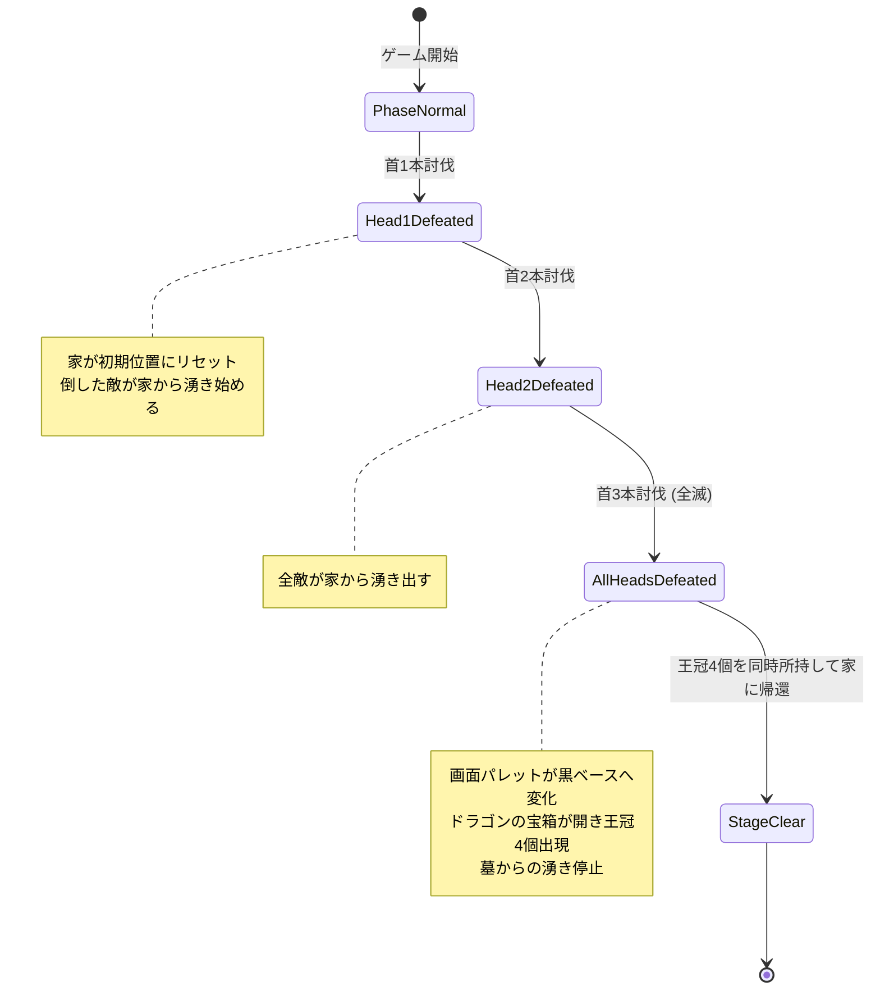
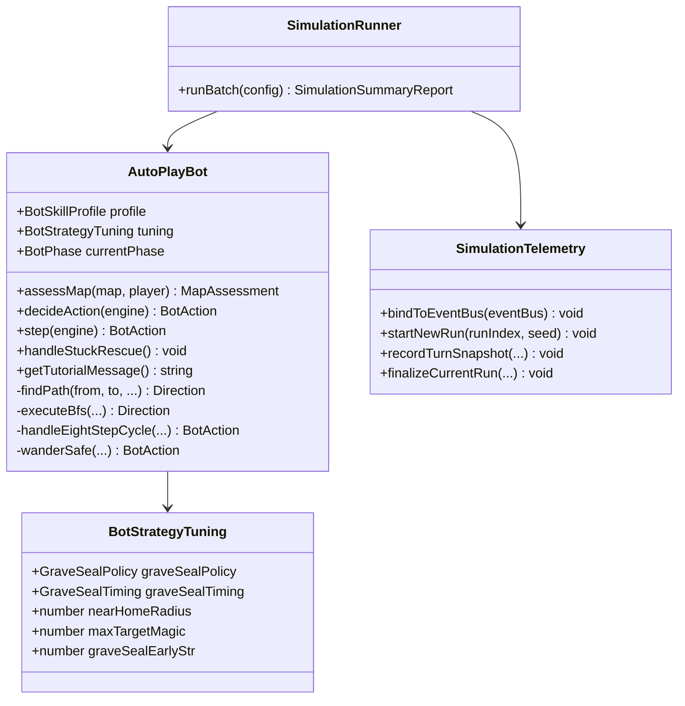
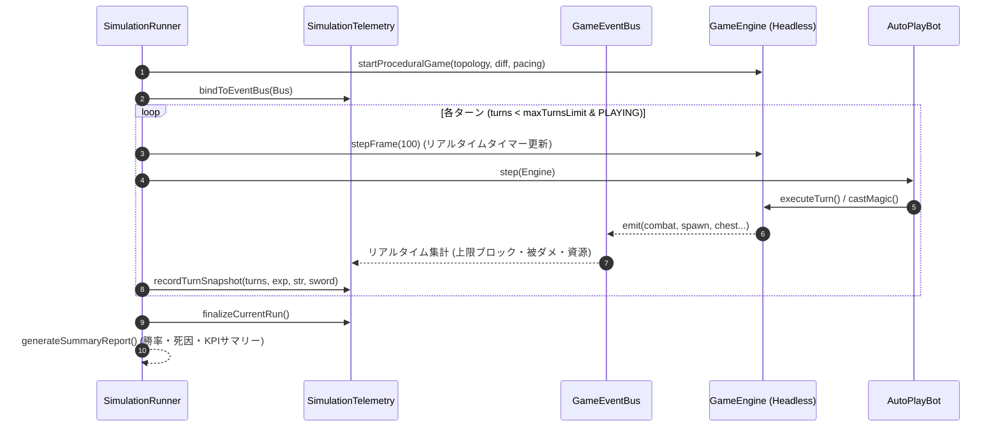
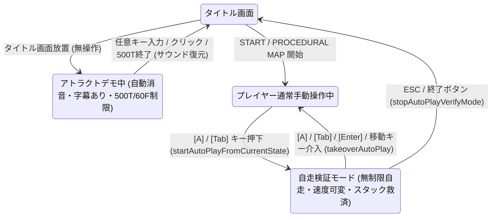

# 『DS1ish』 技術設計書 (Technical Architecture & Design)

本書は、1984年 PC-8801版『ドラゴンスレイヤー (Level 2.0)』のコアメカニクスをベースにしつつ、プロシージャルダンジョン生成とモダンQoLを統合した拡張Web実装『DS1ish』(Dragon Slayer-like Action-Puzzle RPG) の技術アーキテクチャおよびシステム設計書である。

---

## 1. 技術スタック & 実行環境

| レイヤー | 技術選定 | 選定理由・役割 |
| :--- | :--- | :--- |
| **開発言語** | **TypeScript (Strict mode)** | 型安全性、エネミー・アイテム等の複雑なデータモデルの整合性担保 |
| **ビルド / 開発環境** | **Vite** | 超高速なHMR、軽量なバンドル、迅速なプロトタイピング |
| **描画エンジン** | **HTML5 Canvas 2D Context** | レトロPC（PC-8801風）のピクセルアート・グリッド単位スクロール・パレット切り替えの正確な再現 |
| **オーディオ** | **Web Audio API (Synthesizer)** | PSG音源（矩形波・ノイズ）ライクなBGM・効果音のプログラマブル生成 |
| **データ永続化** | **Web Storage (LocalStorage / IndexedDB)** | SAVE魔法およびハイスコア・進行フェーズのローカル永続化 |

---

## 2. システムアーキテクチャ全体図

本システムは、責務の分離とパフォーマンスを重視した**コンポーネント指向 / MVCハイブリッドアーキテクチャ**を採用する。

```mermaid
flowchart TD
    subgraph View ["View / Presentation"]
        CanvasRenderer["CanvasRenderer<br/>(Map, Entities, HUD, FX)"]
        AudioManager["AudioManager<br/>(PSG Synth BGM/SE)"]
        UIOverlay["UIOverlay<br/>(MiniMap, Dialogs)"]
    end

    subgraph Controller ["Controller / Input"]
        InputManager["InputManager<br/>(Keyboard / Virtual Pad)"]
        GameLoop["GameLoop<br/>(requestAnimationFrame)"]
    end

    subgraph Core ["Core / State Machine"]
        GameEngine["GameEngine<br/>(State Coordinator)"]
        TurnManager["TurnManager<br/>(Indicator & Step Timer)"]
    end

    subgraph Systems ["Logic Systems"]
        MovementSystem["Movement & Push System"]
        CombatSystem["Bump Combat System"]
        MagicSystem["Magic Execution System"]
        EnemyAISystem["Enemy AI & Spawn System"]
        ItemChestSystem["Chest & 8-Step System"]
    end

    subgraph Model ["Model / World State"]
        WorldMap["WorldMap (Grid / Tiles)"]
        PlayerEntity["PlayerEntity (Stats, Inventory)"]
        EntityManager["EntityManager (Enemies, Objects)"]
    end

    InputManager -->|Action Events| GameEngine
    GameLoop -->|Tick (DeltaTime)| GameEngine
    GameEngine --> TurnManager
    TurnManager --> Systems
    Systems <--> Model
    Model --> CanvasRenderer
    Model --> UIOverlay
    Systems -->|Trigger SE| AudioManager
```

---

## 3. ディレクトリ & モジュール構造

```
src/
├── core/                  # ゲーム基盤
│   ├── GameEngine.ts      # ファサード・オーケストレーター
│   ├── engine/            # 単一責務サブコントローラー群
│   │   ├── TargetTrackingController.ts  # 交戦・近접敵の追跡管理
│   │   ├── TurnExecutionController.ts   # 手番実行・戦闘・移動・スポーン調停
│   │   ├── DemoAndAutoPlayController.ts # デモモード＆AI自走検証・操作引き継ぎ
│   │   ├── SessionController.ts         # ゲーム開始・プリセット起動・セーブ/ロード
│   │   └── EngineUIAndInputBinder.ts    # DOM UIイベント＆キーボード入力バインド
│   ├── GameLoop.ts        # requestAnimationFrame 管理
│   ├── TurnManager.ts     # インジケーター・ターン進行ロジック
│   ├── SeedRandom.ts      # Mulberry32 決定論的擬似乱数生成器
│   ├── GameEventBus.ts    # 型安全Pub/Subイベントバス
│   └── GameEvents.ts      # ドメインイベント定義
├── config/                # 定数・パラメータ定義
│   ├── Constants.ts       # 画面サイズ、タイル解像度、パレット定数
│   ├── EnemyTable.ts      # 全32種＋ドラゴン生パラメータテーブル
│   ├── MagicTable.ts      # 魔法の消費コスト・必要EXP定義
│   └── TuningPresetResolver.ts # 54通りトポロジー連動パラメータ＆アーキタイプ合成
├── models/                # データモデル
│   ├── Types.ts           # 共通型定義 (Direction, Position, State等)
│   ├── Player.ts          # プレイヤークラス (HP, STR, EXP, アイテム)
│   ├── Enemy.ts           # 敵クラス (一般敵、特殊敵、ドラゴン部位)
│   ├── Dragon.ts          # ドラゴンボス・火炎弾弾道力学
│   ├── Ghost.ts           # ゴースト滑空エンティティ
│   └── WorldMap.ts        # 64×64 トーラス3層グリッドマップ、動的アンカー座標管理
├── systems/               # ゲームロジック処理
│   ├── MovementSystem.ts  # 移動・指輪押し・衝突判定・ワープ
│   ├── CombatSystem.ts    # 体当たりダメージ計算・経験値/攻撃力吸収
│   ├── MagicSystem.ts     # 魔法発動・効果適用
│   ├── EnemyAISystem.ts   # 敵の移動AI・墓からのスポーン管理
│   ├── GhostAISystem.ts   # ゴースト等速直線飛行・アイテム吸引・強奪
│   ├── SpawnSystem.ts     # 首討伐後家湧き枠・最遠敵パージ
│   ├── ThreatEvaluator.ts # 攻防2軸タクティカル脅威度評価
│   ├── ProceduralMapGenerator.ts # 全域9セクター動的配置・6大トポロジープロシージャル生成
│   └── ChestSystem.ts     # 宝箱開封・8歩周期パワーストーン判定
├── ai/                    # 自律攻略AIエージェント
│   ├── AutoPlayBot.ts     # フェーズ駆動型攻略ボット (オーケストレータ)
│   ├── BotNavigator.ts    # トーラスBFS経路探索・連続ワープ・危険回避
│   ├── EightStepController.ts # 8歩周期確定開錠チェーン制御
│   ├── BotTypes.ts        # AIフェーズ・戦略チューニング型定義
│   └── tactics/           # 高度戦術モジュール
│       ├── GraveSealTactics.ts      # 十字架・岩・氷像による墓封鎖戦術
│       └── HomeRelocationTactics.ts # ドラゴン近傍への我が家プッシュ引越し戦術
├── simulation/            # ヘッドレスシミュレーション基盤
│   ├── SimulationRunner.ts    # 高速バッチ実行オーケストレータ
│   └── SimulationTelemetry.ts # イベント駆動型定量KPI集約・レポート生成
├── services/              # 外部入出力・ストレージ
│   ├── MapPresetManager.ts    # おすすめプリセット・ローカル保存・DS1MAP共有コード管理
│   ├── SaveManager.ts         # ゲーム状態シリアライズ／デシリアライズ
│   └── SaveStorageDriver.ts   # LocalStorage / InMemory 抽象化ドライバ
├── view/                  # 描画・表示
│   ├── CanvasRenderer.ts  # メインマップ・エンティティ描画
│   ├── DOMUIManager.ts    # HUD・オーバーレイ・モーダル・自走速度制御
│   ├── InspectorModal.ts  # ダンジョン構造＆成長曲線リアルタイム解析モーダル
│   ├── TileGraphics.ts    # ドット絵グラフィック描画
│   ├── MonsterGraphics.ts # 32種モンスタースプライトシート
│   └── PaletteManager.ts  # レトロカラーパレット・赤/黒反転管理
├── audio/                 # 音響
│   └── PSGAudio.ts        # 矩形波/ノイズ発振器によるレトロSE/BGM
└── index.ts               # エントリーポイント

scripts/
├── simulate.ts            # ヘッドレスバッチシミュレーションCLI
└── evaluate-params.ts     # 戦略パラメータ比較評価スクリプト
```

---

## 4. データモデル & TypeScript型定義

### 4.1 基本型・列挙型
```typescript
export type Direction = 'UP' | 'DOWN' | 'LEFT' | 'RIGHT' | 'UP_LEFT' | 'UP_RIGHT' | 'DOWN_LEFT' | 'DOWN_RIGHT';

export interface Position {
  x: number;
  y: number;
}

export type TileType = 
  | 'EMPTY'        // 通行可能マス
  | 'WALL_STATIC'  // 破壊不可の外壁
  | 'BLOCK'        // 破壊/移動可能ブロック
  | 'GRAVE'        // 墓（敵スポーン地点）
  | 'HOME'         // 我が家
  | 'CHEST'        // 宝箱（未開封）
  | 'CHEST_DRAGON' // ドラゴンの宝箱
  | 'WARP'         // ワープゾーン
  | 'SWORD' | 'COIN' | 'POTION' | 'POWER_STONE' | 'CROSS' | 'KEY' | 'RING' | 'DEATH' | 'CROWN';

export type HoldItemType = 'NONE' | 'POWER_STONE' | 'CROSS' | 'KEY' | 'RING';

export type MagicType = 
  | 'JUMP' | 'RETURN' | 'MAP' | 'BREAK' | 'KICK' 
  | 'FREEZE' | 'FLASH' | 'FLY' | 'SAVE';
```

### 4.1.2 マップ多層レイヤー構造 (`WorldMap`)
1マス1要素の重複禁止と、地形（base）・オブジェクト（object）・床上アイテム（item）の独立管理のため、多層レイヤーアーキテクチャを採用する。

```typescript
export class WorldMap {
  private baseTiles: TileType[][];              // 地形下地 (EMPTY, WALL_STATIC, GRAVE, WARP, HOME)
  private objectTiles: (TileType | 'NONE')[][]; // 可動岩・宝箱 (NONE, BLOCK, CHEST, CHEST_DRAGON)
  private itemTiles: (TileType | 'NONE')[][];   // 床上アイテム (NONE, SWORD, COIN, POTION, POWER_STONE, CROSS, KEY, RING, DEATH, CROWN)
  private underHomeBaseTile: TileType = 'EMPTY';// 家が通過したワープゾーン等の下地タイル一時退避・完全復元用
}
```

### 4.2 プレイヤーモデル (`Player`)
```typescript
export interface PlayerState {
  pos: Position;
  dir: Direction;
  
  // パラメータ
  hp: number;           // 現在HP (0でゲームオーバー)
  maxHp: number;        // 最大HP (EXPERIENCE基準 + GOLD上乗せ)
  strength: number;     // 攻撃力 (パワーストーンで上昇)
  experience: number;   // 経験値 (HP上限 & 防御力)
  gold: number;         // 所持コイン数
  magic: number;        // 魔法の壺ストック (魔力)
  crowns: number;       // 所持クラウン数 (0〜4)
  
  // 状態フラグ
  hasSword: boolean;    // 剣所持 (false時はダメージ10固定)
  holdItem: HoldItemType; // 携帯アイテム (1個のみ保持)
  isFlying: boolean;    // FLY魔法中
  flyTimer: number;
  hasDeath: boolean;    // 死神憑依中 (魔法禁止)
  canDiagonal: boolean; // 斜め移動習得済みか
}
```

### 4.3 敵モデル (`Enemy`)
```typescript
export interface EnemyConfig {
  id: number;
  name: string;
  hp: number;
  atk: number;
  def: number;
  drainAtk?: number;     // 攻撃力吸収量 (dora, knight: 3000)
  drainExp?: boolean;    // 経験値吸収フラグ (rich, crownload)
  stealPotion?: boolean; // 魔法の壺強奪 (monstir)
}

export interface EnemyInstance {
  id: string;
  typeId: number;
  name: string;
  pos: Position;
  hp: number;
  atk: number;
  def: number;
  frozenTimer: number;   // FREEZE中カウント
  isAlive: boolean;
}
```

---

## 5. コアシステム詳細設計

### 5.1 ターン制御 & インジケーター (`TurnManager`)
- **仕様**: 画面右下に時間制限インジケーター（ステップゲージ）を常時表示。
- **アルゴリズム**:
  1. フレーム毎に `indicatorGauge += deltaTime * speedRate` を加算。
  2. プレイヤーが移動または行動を入力した場合：
     - 即座にプレイヤーターンを実行。
     - インジケーターを 0 にリセット。
     - 敵ターンを実行。
  3. プレイヤーが無入力のままインジケーターが最大値に達した場合：
     - プレイヤーは「待機（パス）」とみなす。
     - インジケーターを 0 にリセット。
     - 敵ターンを実行。
  4. ※ゴースト（おばけ）のみ、インジケーターに関係なく独立したリアルタイムタイマーで高速徘徊。

### 5.2 移動・押し引き判定 (`MovementSystem`)
```typescript
function tryMove(player: Player, dir: Direction, map: WorldMap): boolean {
  const targetPos = getNextPosition(player.pos, dir);
  const targetTile = map.getTile(targetPos);

  // 1. 壁・進入不可判定
  if (targetTile === 'WALL_STATIC') return false;

  // 2. 十字架・アイテム上
  if (targetTile === 'CROSS' && player.hasDeath) {
    player.hasDeath = false; // 死神消滅 (Level 2.0)
  }

  // 3. 可動オブジェクト（ブロック / 家）の押し判定
  if (targetTile === 'BLOCK' || targetTile === 'HOME') {
    if (player.holdItem !== 'RING') {
      return false; // 指輪がないと押せない
    }
    const pushPos = getNextPosition(targetPos, dir);
    if (!map.isPassable(pushPos)) {
      return false; // 押し出し先が塞がっている
    }
    // オブジェクトを押し出し移動
    map.moveTile(targetPos, pushPos);
    if (targetTile === 'HOME') {
      map.setRealHomePos(pushPos); // 最後に動かした家が本物になる
    }
  }

  // 4. プレイヤー移動確定
  player.pos = targetPos;
  player.dir = dir;
  return true;
}
```

### 5.3 体当たり戦闘計算式 (`CombatSystem`)
プレイヤーが敵の存在するマスへ移動を試みた場合、体当たり戦闘が発生する。

```typescript
function resolveBumpCombat(player: Player, enemy: EnemyInstance): CombatResult {
  // 1. プレイヤー攻撃力判定 (剣がないと10固定)
  const effectivePlayerAtk = player.hasSword ? player.strength : 10;
  
  // 2. プレイヤーの防御力は EXPERIENCE
  const playerDef = player.experience;

  // 3. ダメージ算出 (0未満は1に補正)
  const damageToEnemy = Math.max(1, effectivePlayerAtk - enemy.def);
  const damageToPlayer = Math.max(0, enemy.atk - playerDef);

  // 4. 減算処理
  enemy.hp -= damageToEnemy;
  if (!player.hasCross) { // 十字架所持時は被ダメージ完全無効
    player.hp -= damageToPlayer;
  }

  // 5. 特殊吸い取り効果
  if (enemy.hp > 0) {
    if (enemy.drainAtk) player.strength = Math.max(0, player.strength - enemy.drainAtk);
    if (enemy.drainExp) player.experience = Math.max(0, player.experience - 1000);
    if (enemy.stealPotion && player.magic > 0) player.magic -= 1;
  }

  // 6. 敵撃破判定
  if (enemy.hp <= 0) {
    enemy.isAlive = false;
    // Level 2.0 では経験値取得量が半分
    const expGain = Math.floor(enemy.baseDef / 2) + 50;
    player.experience += expGain;
  }

  return { damageToEnemy, damageToPlayer, enemyKilled: !enemy.isAlive };
}
```

### 5.4 宝箱 & 8歩周期カウンター (`ChestSystem`)
- **8歩周期仕様**:
  - パワーストーンが宝箱から出現した際、`powerStoneStepCounter = 0` にセット。
  - プレイヤーが1歩移動する毎に `powerStoneStepCounter++`。
  - カウンターがちょうど `8` の時に宝箱を開けた場合、**100%の確率でパワーストーンを排出**。
  - それ以外の場合は、通常の確率テーブル（1/8の確率でパワーストーン、その他コイン、壺、死神等）に従う。

### 5.5 ドラゴン・フェーズ進行管理


---

## 6. 画面描画 & レトロ演出設計 (`CanvasRenderer`, `DOMUIManager`)

### 6.1 画面構成 & 解像度（純マップ化 ＆ DOM UI集約）
- **Canvas純マップ解像度**: `480 x 352` ピクセル（15×11マス、1マス `32 x 32` 高精細ピクセルアート）
- プレイヤーを常に画面中央 `(7, 5)` に固定したスムーズなグリッドスクロール。
- **DOM UI分離集約**: ステータス、インジケーター、対峙モンスターパネル、所持アイテムストリップ、メッセージログをDOMレイヤーへ集約し、画面のガタつき（Layout Shift）を完全解消。
- 拡大表示: CSSの `image-rendering: pixelated;` によりレトロなドット絵を鮮明にスケール。

### 6.2 パレット切り替え
1. **通常パレット**:
   - フィールド: グリーン / 暗緑色ベース、壁・オブジェクト: 鮮明なレトロパレット
2. **ピンチパレット (HP < 500)**:
   - 全画面のベースカラーが**レッド（警告色）**に置換され、DOM UIのテーマも同期。
3. **終盤パレット (ドラゴン首全討伐後)**:
   - フィールドが**ブラック（闇）**に置換され、クライマックスの緊張感を演出。

---

## 7. プロシージャル生成・プリセット共有・バランス機構 (Phase 6〜12)

### 7.1 ゴースト滑空AI (`GhostAISystem`)
- **ベクトル滑空エンジン**:
  - タイル単位のランダムウォークを廃止し、方向ベクトル `(vx, vy)` による等速直線飛行を実装。
  - アイテム運搬スロット `carriedItem` を保持し、通過床アイテムを吸引して壁内（`BLOCK` のマス）や隔離領域を含む座標へランダムドロップ。

### 7.2 シード＆設定プリセット共有管理 (`MapPresetManager`)
- **メタデータによる決定論的マップ再現**:
  - 固定ステージデータや4,096マスのタイル配列を保存する代わりに、「乱数シード値 (`seed`) ＋ トポロジー (`topology`) ＋ 難易度 (`difficulty`) ＋ ペース (`pacing`) ＋ アーキタイプ (`archetype`) ＋ プレハブ種別 (`dragonPrefab`, `homePrefab`)」のみを `MapPresetData` として管理。
- **1行共有コード (`DS1MAP:...`)**:
  - JSONペイロードを Base64 エンコードしたコンパクトな1行テキストでエクスポート／インポートでき、同じシード・設定から同一の64×64迷宮を100%再現可能。

### 7.3 インフレ成長バランス適正化 (`CombatSystem`, `Player`, `TuningPresetResolver`)
- パワーストーン奉納時のSTR成長式を現在値に応じた倍率インフレ曲線に調整。
- ドラゴン首への攻撃ダメージ計算と成長ペースの整合性を検証・自動テスト化。

---

## 8. 自律攻略AI ＆ ヘッドレスシミュレーション基盤アーキテクチャ (`src/ai/`, `src/simulation/`)

詳細なアルゴリズム仕様・全パラメータ表・運用知見については、決定版ドキュメントである [自律攻略AI (AutoPlayBot) ＆ ヘッドレスシミュレーション仕様書 (`docs/autoplay_and_simulation_spec.md`)](../autoplay_and_simulation_spec.md) を参照。

### 8.1 AutoPlayBot のモジュール設計

`AutoPlayBot` は、完全ヘッドレスな自律探索エージェントとして設計されており、ゲームエンジンのインターフェース（`GameEngine`）のみを通じて盤面情報を取得し、手番アクション（`BotAction`）を返却する。



#### コアアルゴリズム
1. **フェーズ駆動型ステートマシン**:
   `BOOTSTRAP`（剣・鍵初期確保） → `GRAVE_SEAL`（墓完全密閉） → `POWER_RUSH`（8歩開錠・石奉納） → `DRAGON_SLAY`（首斜め討伐） → `CROWN_ESCAPE`（王冠4個歩行脱出）。
2. **8歩周期宝箱開錠チェーン**:
   `findNearbyChestForEightStepCycle()` により、石排出直後に近傍（距離2〜6）の未開封宝箱を全探索。パリティ調整可能なピボット／待機マス間を往復して正確に8歩目で踏み込み、100%石確定排出を連続チェーン化。
3. **アイテム持ち替え制御 (Hands-Free Rule)**:
   鍵一時ドロップ（`tempDroppedKeyPos`）→ 石回収（`itemToPickupPos`）→ 帰還奉納 → 鍵再回収の遷移と、10ターン安全弁タイムアウト（`MAX_ITEM_SWAP_TURNS`）。
4. **多層スタック・逡巡防止機構**:
   - 宝箱用／アイテム用の目標分離ロック＆ヒステリシス（`-3` 距離ボーナス）。
   - 孤立目標の即時ブラックリスト化（`unreachableTargets`）と上位5候補走査（BFS Early Exit）。
   - ワープタブーリスト（`recentWarpTiles`）による逆戻りピンポン遮断（コスト `+500`）。
   - 危険ゾーン境界での進退ループ解消（`recentEvadedTile` ペナルティ ＋ `FREEZE`/`FLASH` 能動突破）。
   - 振動検知（`oscillationCount >= 3`）と安全徘徊（直進慣性ボーナス `-2`、袋小路緊急脱出魔法）。

---

### 8.2 ヘッドレス・バッチシミュレーションデータフロー



---

### 8.3 インゲーム連携モード（アトラクトデモ＆自走検証）



- **シームレス操作権引き継ぎ (Takeover)**: プレイヤーが手動操作中に行き詰まった際や、AIの攻略手順を確認したい際に、その場のマップ・HP・所持品を完全保持したまま自走を開始・解除可能。
- **スタック救済 (`handleStuckRescue`)**: 自走検証中に身動き不能（同一座標20フレーム連続）となった場合、目標ロック・ブラックリスト・持ち替え状態をリセットし、強制安全徘徊へ移行して自力脱出する。
