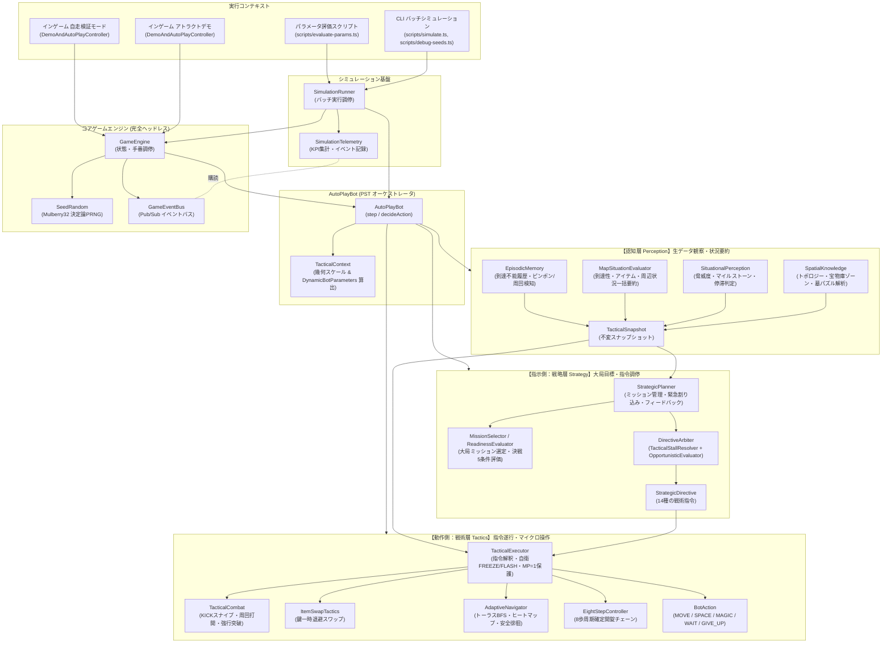
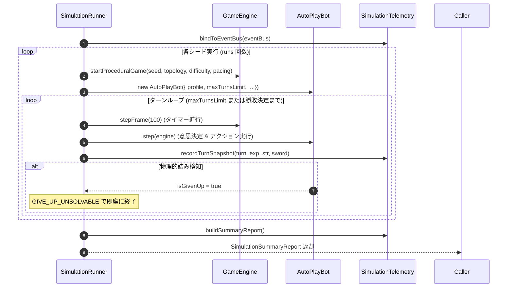

# 自律攻略ボット (AutoPlayBot) ＆ ヘッドレスシミュレーション仕様書

> [!NOTE]
> 本書で扱う `AutoPlayBot` およびシミュレーション基盤は、生成AIや深層学習モデルではなく、**PST（Perception / Strategy / Tactics）3層アーキテクチャ・トーラス空間BFS経路探索・ミッション駆動プランニング・タクティカルヒューリスティックに基づく完全オフライン・決定論的（Deterministic）なルールベースアルゴリズム**です。外部API通信や非決定論的推論を行わず、同一シード値において100%同一のゲーム展開をミリ秒単位で高速再現・検証します。

本書は、『DS1ish』(Dragon Slayer Level 2.0 Web拡張版) における**自律攻略ボット（`AutoPlayBot`）**、**ヘッドレス・バッチシミュレーション基盤（`SimulationRunner` / `SimulationTelemetry`）**、および**インゲーム連携モード（アトラクトデモ／自走検証モード）**の包括的な仕様・アルゴリズム・パラメータ・運用基準を定義する仕様書である。

---

## 1. 概要とアーキテクチャ設計

### 1.1 目的と背景
本作は1984年の古典的アクション・パズルRPG『ドラゴンスレイヤー』のコアメカニクスに、プロシージャルダンジョン生成と多彩なトポロジーを統合した作品である。
多種多様なランダムダンジョンにおいて「クリア可能性（Solvability）」と「ゲームバランス（適度な緊張感とインフレの爽快感）」を客観的・定量的に保証するため、以下の3つの役割を果たすボット・シミュレーション基盤を構築している。

1. **定量バランス評価**: 人間が数十時間プレイすることなく、数千ターンのバッチシミュレーションを数秒〜数十秒で実行し、勝率・死因・成長曲線を分析する。
2. **アトラクションデモ**: タイトル画面で放置された際に、初心者に向けたゲームルール・攻略セオリーを実演・提示する。
3. **自走検証（インゲームAuto-Play）**: 任意の生成マップやプレイヤーのプレイ途中状態からボットに自走させ、アルゴリズムの挙動確認や特定シチュエーションの検証、プレイヤー手動操作とのシームレスな相互乗り換えを可能にする。

### 1.2 レイヤー分離とモジュラー設計 (PST 3層アーキテクチャ)

ボットおよびシミュレーション基盤は、描画（DOM / Canvas）や音声（Web Audio API）から完全に疎結合された純粋なTypeScriptロジックとして設計されている。
現行アーキテクチャでは、肥大化・層間癒着を防ぎ適応力を最大化するため、**PST（認知 Perception / 戦略 Strategy / 戦術 Tactics）の3層構造**を採用し、**指示側（Strategy）と動作側（Tactics）の厳格な主従関係**を確立している。

#### 指示側と動作側の階層規律
1. **認知層（Perception）**:
   - マップ・敵・プレイヤー・生成時メタデータ（`MapTacticalMetadata`）を走査・要約し、1ターン分の客観的事実を `TacticalSnapshot`（および `MapSituationSummary`）として生成する。
   - 戦略層・戦術層が生マップ走査や重複BFSを行うことを防ぐ単一の観測窓口として機能する。
2. **指示側（戦略層 Strategy）**:
   - `snapshot.params` の動的パラメータ（`targetStr`, `targetDefenseExp`, `stoneSearchDist` 等）および `snapshot.milestones` / `threats` / `situation` に基づき、大局目標（`IStrategicMission`）を選定・維持する。
   - 戦術層に対して意図が明確なディレクティブ（`UNLOCK_CHEST_8STEP`, `UNLOCK_CHEST_RAPID`, `NAVIGATE_TO_POSITION`, `CAST_MAGIC` 等）を発行する。
3. **動作側（戦術層 Tactics）**:
   - 戦略層から与えられたディレクティブを忠実に遂行し、具体的な `BotAction`（移動・SPACE・魔法・待機・ギブアップ）を生成する。
   - 実行結果のステータス（`SUCCESS` / `PATH_BLOCKED` / `STALLED`）を戦略層（`StrategicPlanner.recordExecutionResult`）へフィードバックし、連続遮断時のターゲットブラックリスト化や作戦切替を促す。

- **決定論的再現性 (`SeedRandom`)**: Mulberry32アルゴリズムに基づく擬似乱数生成器を使用し、シード値（`seed`）が同一であればマップ生成から敵の思考・ボットの全手番挙動が100%同一に再現される。
- **ドメインイベント駆動 (`GameEventBus`)**: エンジン内で発生する事象（戦闘ダメージ、スポーン成否、宝箱開錠、ゴースト干渉等）は型安全なイベントとして発行され、シミュレータはエンジンに介入することなく統計データを収集する。

---

## 2. AutoPlayBot のアーキテクチャとアルゴリズム仕様

`AutoPlayBot`（`AdaptiveAutoPlayBot` は後方互換エイリアス）は、プレイヤースキル水準（`NOVICE`, `STANDARD`, `EXPERT`）およびマップ環境に応じ、序盤のアイテム収集からドラゴンスレイ、王冠4個の運搬脱出までを自律完遂するPST 3層型エージェントである。

### 2.1 認知層 (Perception)

毎ターン `AutoPlayBot.decideAction` の先頭で、`TacticalContext` による動的パラメータ更新に続いて以下の認知ユニットが評価を実行する。

| モジュール | 主な責務と出力 |
| :--- | :--- |
| **`SpatialKnowledge`** | `MapTacticalMetadata` を統合し、宝物庫ゾーン（`TreasureZoneState`）、開削ショートカット（`BreachShortcutState`）、墓パズル（`GravePuzzleState`）、ドラゴン巣様式（`DragonLairStyle`）、前線移転推奨アンカーを管理。さらにドラゴンの生存首ごとにブレス射線・体パーツ・壁を除外した斜め安全攻撃マス（`calculateHeadAttackSpots`）を算出する。 |
| **`SituationalPerception`** | ① `evaluateMilestones`: 剣所持、`canBreak`（`!hasDeath && MP>=1 && EXP>=4000`）、`canDiagonal`（`EXP>=12000`）、目標STR/EXP到達、MP充足度を評価。 ② `evaluateThreats`: 緊急HP（`hp < maxHp * emergencyHpRatio`）、直角隣接する即死級敵（`isLethalDanger`）、ドラゴンブレス射線上の有無を評価。 ③ `evaluateStagnation`: ヒートマップ・未踏ターン数から停滞（`isStagnated`）、安全床3マス以下の完全拘束（`isPhysicallyTrapped`）、剣未所持時の序盤詰み（`isEarlySwordTrapped`）を評価。 |
| **`MapSituationEvaluator`** | `evaluate` により毎ターンのマップ状況を一括要約（`MapSituationSummary`）しキャッシュする（`_stateKey` による差分検知）。 ・`homeReachability`: 我が家到達性（王冠所持時/手ぶら時）、閉塞原因（`NONE` / `DANGEROUS_ENEMY` / `BLOCK` / `SEALED`）、最初の開削対象ブロック座標（`CostMinHeap` による高速BFS。BFSを伴う到達性フィールドは getter により遅延評価・メモ化され、未参照ターンではBFSを実行しない）。 ・`items`: 1-pass Dial法BFSによる到達可能実距離ベースのアイテム一覧（王冠候補・剣・鍵・ポーション・金貨・パワーストーン・指輪・宝箱）、8歩チェーン継続可否（`shouldContinueChestChain`）、動線ついで拾い最良候補（`bestOpportunisticItem`）。 ・`surroundings`: 足元アイテム、隣接ブロック/敵、安全退避方向（`safeEvadeDir`）、絶望的状況の緊急脱出方向（`desperateEscapeAction`）。 |
| **`EpisodicMemory`** | 過去30ターンの移動履歴、訪問回数、期限付き到達不能ターゲット/ゾーンのブラックリスト（`markTargetUnreachable` / `markZoneUnreachable`）、2マス往復（`pingPongCount`）および3マス周回（`oscillationCount`）を管理する。 |
| **`TacticalSnapshot`** | 上記認知結果とプレイヤー/ドラゴン/生存敵の客観状態をまとめたイミュータブルなスナップショット。 |

---

### 2.2 戦略層 (Strategy)

戦略層は「**中長期ミッションのコミット**」と「**毎ターンの指令調停**」の2段構成で意思決定を行う。

#### 1. `StrategicPlanner` のターン処理フロー
1. **最優先割り込み判定**:
   - **ドラゴン全首撃破完了**: 即座に `CrownEscapeMission` へ切り替え、以降は他ミッションによる上書きを禁止（絶対維持）。
   - **緊急危機介入**: `threats.isLethalDanger` または `threats.isPinchHp` の場合、`EmergencyEvacuateMission` へ割り込み切替。
   - **決戦・準備移行割り込み**: 育成・探索系ミッション中に `canDamageDragon`（目標STR到達）または宝箱・石枯渇、あるいは `MissionSelector.isReadyForDragon` を満たした場合、`MissionSelector.selectDragonPrepMission` へ委譲し、`SlayDragonMission` / `PrepareDragonAssaultMission` / `CashInGoldMission` / `RelocateHomeMission` 等へ移行する。
2. **現行ミッションのコミットメント評価**:
   - `activeMission.evaluateStatus()` が `'ACTIVE'` であれば `generateDirective()` を呼び出し、`DirectiveArbiter.arbitrate()` を経て戦術指令を返す。
   - `'COMPLETED'` / `'FAILED'` / `'ABORTED'` となった場合、`missionHistory` へ記録し、`NO_PROGRESS_TIMEOUT` / `NO_PROGRESS_BLOCKED` 時は該当ミッションにクールダウン（15〜80ターン）を設定して無限再選択を防止する。
3. **次期ミッション選定 (`MissionSelector.selectNextMission`)**:
   - アクティブなミッションがない場合、以下の優先順位で次期ミッションを選定する：
     1. ドラゴン全首撃破済み → `CrownEscapeMission`
     2. 剣未所持 → `BootstrapSwordMission`
     3. パワーストーン所持中（または足元に石があり8歩チェーン継続不要）→ `HarvestPowerStoneMission`
     4. STR未達時: 序盤BREAK習得（`EarlyBreakUnlockMission`） / マイルストーン到達または大量金貨の換金（`CashInGoldMission`） / 鍵所持中または宝箱攻略（`ClearTreasureZoneMission`） / 近傍石回収（`HarvestPowerStoneMission`）
     5. STR達成後または宝箱・石枯渇時（決戦準備）: `ReadinessEvaluator.evaluateDragonReadiness` に基づき、EXP < 12,000 解消・MP >= 3 確保・ポーション/コイン回収（`PrepareDragonAssaultMission`）、金貨換金（`CashInGoldMission`）、拠点引越し（`RelocateHomeMission`）、全5条件達成で `SlayDragonMission`
     6. 防御EXP不足時の安全敵狩り → `EarlyBreakUnlockMission`
     7. フォールバック → `ExploreWanderMission`
4. **戦術フィードバック (`recordExecutionResult`)**:
   - 戦術層から `PATH_BLOCKED` が返った場合、同一ターゲット座標で2ターン連続遮断されると `EpisodicMemory` へ30ターンブラックリスト登録し、現行ミッションを `ABORTED` (`NO_PROGRESS_BLOCKED`) として即座に転進する（王冠脱出中および我が家座標はブラックリスト除外）。

#### 2. `ReadinessEvaluator` の決戦準備評価
`SlayDragonMission` 起動前に、以下の5条件を総合評価する：
1. **攻撃力**: `hasSword` かつ `STR >= targetStr`（生存首の最大DEF + 1000）
2. **斜め移動**: `EXP >= 12,000`（`canDiagonal`）
3. **BREAK習得**: `!hasDeath && MP >= 1 && EXP >= 4,000`
4. **戦闘MP**: `MP >= 3`（近傍ポーション枯渇時は `MP >= 1`）
5. **HP・防御EXP**: `HP >= maxHp * 0.50`（または `>= 15,000`）、および `EXP >= targetDefenseExp`（`prepTurns >= 25` 等で緩和バイパスあり）
- 準備ターンが35ターンを超過した場合は `isTimeoutBypass` により最低条件（斜め・BREAK・最小MP）のみで決戦へフォールスルーする。

#### 3. `DirectiveArbiter` による毎ターン指令調停
1. `CROWN_ESCAPE` 中は汎用調停をスキップし、王冠運搬サブモード（閉塞開拓・敵スタン）を尊重する。
2. **`TacticalStallResolver.resolveIncarceration`**: 四方が壁・岩・倒せない敵・即死マスに囲まれた袋小路拘束、または `isPhysicallyTrapped` を検知した場合、最優先（priority 94〜100）で `RETURN` → `JUMP` → `BREAK` → `FREEZE`/`FLASH`（MP=1温存考慮）→ 強行突破攻撃 → `GIVE_UP` を発行する。
3. **`OpportunisticEvaluator`**: `EMERGENCY_EVACUATE` / `SLAY_DRAGON` 等や8歩開錠・スワップ・墓封鎖中でない場合、動線上のついで拾い（足元 `COIN`/`POTION`: priority 92、近傍1〜4マス: `90 - dist`）および安全敵のワンパン撃破（距離1: priority 80、距離2: priority 74）を割り込み提案する。

#### 4. ミッション一覧と `BotPhase` 同期
`AutoPlayBot` は表示・チュートリアル字幕・テレメトリ互換のため、`syncPhaseFromMission()` によりアクティブミッションIDを従来の6つの `BotPhase` にマッピングしている。

| ミッションID (`IStrategicMission`) | `maxTurns` | 同期される `BotPhase` | 主な役割 |
| :--- | :---: | :--- | :--- |
| `BOOTSTRAP_SWORD` | 120 | `BOOTSTRAP` | 剣の回収、到達不能時の物理的詰み早期検知 (`GIVE_UP`) |
| `SEAL_GRAVE`（※注） | 60 | `GRAVE_SEAL` | 墓出口封鎖・岩押し・十字架設置（※現在 `MissionSelector` からは未接続・休止中） |
| `HARVEST_POWER_STONE` | 120 | `RESOURCE_FARM` | パワーストーン回収と我が家への奉納（STR倍化＆HP全快） |
| `CLEAR_TREASURE_ZONE` | 75 | `RESOURCE_FARM` | 鍵回収、宝物庫ゾーン/残存宝箱の8歩周期開錠・コイン/ポーション回収 |
| `EARLY_BREAK_UNLOCK` | 35 | `RESOURCE_FARM` | 安全な敵を撃破してBREAK (EXP 4,000)・斜め (12,000)・防御EXPを稼ぐ |
| `CASH_IN_GOLD` | 100 | `RESOURCE_FARM` | 我が家への帰還によるコイン換金（EXP加算＋オーバーヒール） |
| `PREPARE_DRAGON_ASSAULT` | 120 | `RESOURCE_FARM` | 決戦前のコイン・ポーション回収、HP回復、最終調整 |
| `EXPLORE_WANDER` | 20 | `RESOURCE_FARM` | ターゲット不在時の安全徘徊探索 |
| `RELOCATE_HOME` | 45 | `RELOCATE_HOME` | 指輪 (`RING`) で我が家を `recommendedRelocateAnchors` へ押し運び移転 |
| `SLAY_DRAGON` | 800 | `DRAGON_SLAY` | ブレス射線を回避しつつ斜め安全攻撃マスからドラゴン各首を討伐 |
| `CROWN_ESCAPE` | 3000 | `CROWN_ESCAPE` | 魔法封印下での王冠4個運搬・我が家脱出（閉塞時 `BREAK` / `FLASH` 連携） |
| `EMERGENCY_EVACUATE` | 30 | (直前フェーズ維持) | HPピンチまたは即死敵隣接時の退避・`RETURN`・自衛回復 |

---

### 2.3 戦術層 (Tactics)

戦術層は `StrategicDirective`（14種: `NAVIGATE_TO_POSITION`, `BREACH_SHORTCUT`, `UNLOCK_CHEST_8STEP`, `UNLOCK_CHEST_RAPID`, `PICKUP_ITEM`, `DROP_HOLD_ITEM`, `SWAP_KEY_FOR_ITEM`, `SEAL_GRAVE_STEP`, `ATTACK_TARGET`, `CAST_MAGIC`, `EVADE_DANGER`, `WANDER_SAFELY`, `GIVE_UP`）を受け取り、以下の優先パイプラインで1手の `BotAction` を決定する。

1. **アイテム一時置きスワップ継続 (`ItemSwapTactics`)**:
   - 宝箱開錠直後などに鍵を安全床へ一時置きし、パワーストーン等を回収してから鍵を拾い直すマイクロ手順を遂行（16ターンで安全タイムアウト）。
2. **8歩周期チェーン継続 (`EightStepController`)**:
   - `UNLOCK_CHEST_8STEP` 遂行中、現在位置と対象宝箱の距離・`stepCountSinceStone`（8歩周期）に基づき、ピボット／待機マス間を往復して正確に8歩目で宝箱を踏み込む。
3. **緊急自衛 `FREEZE` / `FLASH` (`TacticalExecutor`)**:
   - 直角隣接に即死級または高ダメージの敵がいる場合（一撃必殺攻撃対象を除く）、我が家近傍（チェビシェフ距離 <= 2）または `disallowFreezeNearHome` 指定時は `FLASH`、それ以外は `FREEZE` で無力化する（BREAK用 `MP=1` リザーブ保護あり）。
4. **周回ループ打開・強行突破 (`TacticalCombat`)**:
   - `nav.oscillationCount >= 2` または `memory.pingPongCount >= 2` の膠着時（王冠脱出中・一撃必殺攻撃中を除く）に、`tryBreakCirclingLoop`（岩越し `KICK` スナイプ、岩 `BREAK`、墓周回 `FREEZE`/`FLASH`、冷涼ゾーン離脱）または `tryBreakthroughCombat`（`turnsToKill <= 5` の安全敵撃破）を実行する。
5. **個別ディレクティブ遂行 & MP=1リザーブ保護**:
   - `CAST_MAGIC` 時、EXP >= 4,000 かつ MP <= 1 の場合は `BREAK` / `RETURN` / 緊急優先度（`priority >= 95`）を除き詠唱を見送り、壁破壊用MPを死守する。
   - 最終出力が `MOVE` で移動先が `BLOCK` の場合、戦術層出口（`TacticalExecutor.execute`）の `resolveMoveOrBreak` が `BREAK`（不可なら `KICK`）魔法詠唱へ自動変換する（`SEAL_GRAVE_STEP` のブロック押し出し時は `skipMoveOrBreak` で抑止）。

---

### 2.4 幾何スケール連動と動的パラメータ (`TacticalContext`)

マップの幾何解像度（32x32〜64x64等）、トポロジー（`mazeIndex` 等）、生成器メタデータ（`MapTacticalMetadata`）、およびチューニング設定（`ResolvedDungeonTuningParams`）から、戦術パラメータを動的に算出する。

#### マップ幾何スケール (`TacticalScale`)
トーラス最大距離 $L_{\max} = \lfloor\frac{W + H}{2}\rfloor$ を基準とし、マップサイズに比例した距離スケールを正規化定義：
- `immediateRadius`: 至近距離 ($\max(2, \text{round}(0.05 \times L_{\max}))$)
- `nearRadius`: 近傍半径 ($\max(4, \text{round}(0.15 \times L_{\max}))$)
- `midRadius`: 中距離半径 ($\max(8, \text{round}(0.35 \times L_{\max}))$)
- `farRadius`: 遠征限界 ($\max(16, \text{round}(0.70 \times L_{\max}))$)

#### 動的戦術パラメータ (`DynamicBotParameters`)
- **目標STR (`targetStr`)**: ドラゴンの生存首の最大DEF $+ 1,000$（ドラゴン未指定時はクラシック `11,000` / 拡張 `401,000`）。
- **目標防御EXP (`targetDefenseExp`)**: クラシック `15,000` / 拡張 `35,000` を基準とし、周囲12マス以内の敵最大ATKが上回る場合は `maxNearEnemyAtk + 2,000` へ動的引き上げ。
- **目標MP (`maxTargetMagic` / `minDragonMagic`)**: `maxTargetMagic` は `NOVICE: 8` / `STANDARD, EXPERT: 14`（`minDragonMagic` は `2` / `3`）。
- **探索半径連動**: `stoneSearchDist = max(12, nearRadius)`、`potionSearchDist` はSTR達成後かつ目標MP未達時に `max(20, farRadius)` へ拡大、`keySearchDist` / `coinSearchDist` も達成状況に応じて `immediateRadius`〜`farRadius` で伸縮。
- **敵狩り許容距離 (`huntDistance`)**: BREAK未習得（`EXP < 4,000`）かつ鍵非所持時のみ `immediateRadius` を許可し、EXP 4,000以降は強敵湧き（キルランク上昇）を防ぐため `0` に固定。
- **BFS探索設定**: `allowBreakAsRoad`（`!hasDeath && MP>=1 && EXP>=4000`）、`breakCostMultiplier`（`mazeIndex > 0.5` なら `1.1`、それ以外 `1.6`）、`maxBfsSteps`（`clamp(W * H * 2, 3000, 6000)`）。

---

### 2.5 主要な打開・安全アルゴリズム

1. **訪問ヒートマップによる周回検知と能動打開 (`AdaptiveNavigator` / `TacticalCombat`)**:
   - プレイヤーがマスを踏むたびに熱量 $+10.0$、ターン経過で減衰率 $0.85$ を適用。
   - `curHeat >= 12` かつ近傍熱量 `>= 35` で障害物周回（`detectObstacleCircling`）を検知し、岩周回なら直線上の敵へ `KICK` スナイプまたは岩 `BREAK`、墓周回なら `FREEZE` 氷像バリケード化を実行する。
2. **MP=1 セーフティリザーブ保護 (`TacticalExecutor` / `TacticalStallResolver`)**:
   - `BREAK`（EXP 4,000到達で習得）は「MP 1以上で消費コスト0」の特性を持つため、習得後は残りMPが1のときに他魔法（`FREEZE`, `FLASH` 等）でMPを0に枯渇させることを抑止し、壁破壊能力を死守する（退避不可の即死危機や `RETURN` / 高優先度打開を除く）。
3. **序盤の物理的詰み（剣到達不可）早期検知 (`AdaptiveNavigator.detectEarlySwordTrap`)**:
   - 初期状態で剣への到達経路が完全に封鎖されているシードをヒートマップ飽和と静的到達性から検知し、即座に `{ type: 'GIVE_UP' }` を発行して評価を高速化する。
4. **十字架「設置⇔回収」無限ループ防止 (`AdaptiveNavigator.isProtectedGraveBlock`)**:
   - 墓の隣接マス等に設置された十字架・封鎖用ブロックを保護対象として扱い、破壊や無意味な回収チャタリングを遮断する。
5. **王冠脱出時の閉塞開拓・スタン連携 (`CrownEscapeMission`)**:
   - 魔法封印下や敵/ブロックによる帰還路閉塞時に `MapSituationEvaluator.homeReachability` の閉塞原因を参照し、`BLOCK` 閉塞時は `BREAK`、`DANGEROUS_ENEMY` 閉塞時は `FLASH` スタン（スタン中は再詠唱を抑止して即運搬）で脱出路を切り開く。

---

## 3. ヘッドレス・シミュレーション基盤 (`SimulationRunner`)

`SimulationRunner` は、ヘッドレス環境で `GameEngine` と `AutoPlayBot` を結合し、高速バッチ実行を行う。

### 3.1 評価指標 (KPI)
- **勝率 (Win Rate)**: 全試行におけるステージクリア達成率。
- **平均クリアターン数 (Avg Clear Turns)**: クリア時の所要ターン数。
- **死因内訳 (Death Causes)**: `MONSTER_DAMAGE`, `DRAGON_BREATH`, `GIVE_UP_UNSOLVABLE`, `TIMEOUT_LIMIT` 等。
- **成長マイルストーン達成率**: 剣入手、BREAK解禁、斜め移動解禁、ドラゴン首撃破、王冠運搬。

---

## 4. インゲーム連携モード

### 4.1 アトラクトデモモード (Attract Demo Mode)
タイトル画面で放置された際に、初心者に向けたゲームルール・攻略セオリーを実演する。
- チュートリアル字幕オーバーレイ（`getTutorialMessage()`）によるリアルタイム解説。
- プレイヤーの任意の操作（キー入力、クリック）で即座にタイトル画面へ復帰。

### 4.2 自走検証モード (Auto-Play Verify Mode)
- **ワンキー操作権引き継ぎ**: プレイ中 `[A]` または `[Tab]` キーで、現在の状態を維持したままAI自走を開始／手動操作へ即時復帰。
- **可変速制御**: `1x`, `2x`, `5x`, `Pause (0x)` によるリアルタイム検証。
- **スタック自動救出 (`handleStuckRescue`)**: 身動き不能検知時に連続安全徘徊（`triggerRescue(4)`）を発動して自力脱出。

---

## 5. 関連ファイル・モジュール構成一覧

| モジュールパス | 主な責務・実装内容 |
| :--- | :--- |
| `src/ai/AutoPlayBot.ts` | PST 3層オーケストレータ本体（`AdaptiveAutoPlayBot.ts` から再エクスポート）。 |
| `src/ai/BotTypes.ts` | ボット関連の型定義（`BotPhase`, `BotAction`, `DynamicBotParameters`, `TacticalScale` 等）。 |
| `src/ai/TacticalContext.ts` | 動的戦術コンテキスト。マップ幾何スケール連動、動的パラメータ導出。 |
| `src/ai/AdaptiveNavigator.ts` | トーラス空間BFS探索（`CostMinHeap` による $O(N \log N)$ 実装）、スタック・ピンポン追跡、訪問ヒートマップ、安全徘徊（`BotNavigator.ts` から再エクスポート）。 |
| `src/ai/utils/MinHeap.ts` | 挿入順タイブレーク付き Binary Min-Heap（`CostMinHeap`）。BFS の同コスト FIFO 順序を保証。 |
| `src/ai/EightStepController.ts` | 8歩周期パワーストーン確定排出の歩数調整および近傍宝箱連続開錠チェーン制御。 |
| `src/ai/perception/SpatialKnowledge.ts` | トポロジー・宝物庫ゾーン・開削点・墓パズル・ドラゴン安全攻撃マスの構造化知識。 |
| `src/ai/perception/SituationalPerception.ts` | マイルストーン進捗、脅威分布、ヒートマップ停滞・拘束・序盤詰みの認知評価。 |
| `src/ai/perception/MapSituationEvaluator.ts` | 1-pass Dial法BFSによるアイテム到達性、我が家到達性、周辺状況の一括要約。 |
| `src/ai/perception/EpisodicMemory.ts` | 移動履歴、期限付き到達不能ブラックリスト、ピンポン/周回カウント管理。 |
| `src/ai/perception/TacticalSnapshot.ts` | 認知層が生成する不変スナップショット型定義。 |
| `src/ai/strategy/StrategicPlanner.ts` | 戦略司令塔。ミッション選定・コミット・緊急割り込み・実行結果フィードバック調停。 |
| `src/ai/strategy/StrategicMission.ts` | `IStrategicMission` インターフェースおよび完了理由型定義。 |
| `src/ai/strategy/StrategicDirective.ts` | 戦術層への14種の指令定義（`DirectiveType`, `StrategicDirective`）。 |
| `src/ai/strategy/evaluators/MissionSelector.ts` | 成長・空間・脅威に基づく大局ミッション選定ロジック。 |
| `src/ai/strategy/evaluators/ReadinessEvaluator.ts` | ドラゴン決戦前の5条件・準備度評価。 |
| `src/ai/strategy/arbitration/DirectiveArbiter.ts` | 袋小路打開と並行基本行動（ついで拾い・ワンパン）の指令調停。 |
| `src/ai/strategy/arbitration/OpportunisticEvaluator.ts` | 動線上の金貨/壺ついで拾いおよび安全敵ワンパン撃破評価。 |
| `src/ai/strategy/arbitration/TacticalStallResolver.ts` | 袋小路拘束・敵封鎖の検知と緊急打開（RETURN/JUMP/BREAK/FREEZE/突破/GIVE_UP）。 |
| `src/ai/strategy/missions/*.ts` | 12種の作戦ミッション実装（`BootstrapSword`, `HarvestPowerStone`, `ClearTreasureZone`, `EarlyBreakUnlock`, `CashInGold`, `PrepareDragonAssault`, `ExploreWander`, `RelocateHome`, `SlayDragon`, `CrownEscape`, `EmergencyEvacuate`, `SealGrave`）。 |
| `src/ai/tactics/TacticalExecutor.ts` | 戦術実行ユニット。ディレクティブ解釈、緊急自衛、MP=1リザーブ保護、`resolveMoveOrBreak` 解決。 |
| `src/ai/tactics/TacticalCombat.ts` | KICKスナイプ、ヒートマップ周回ループ打開、強行突破戦闘。 |
| `src/ai/tactics/ItemSwapTactics.ts` | 鍵の一時置き退避と有益アイテム回収・再回収スワップ戦術。 |
| `src/simulation/SimulationRunner.ts` | ヘッドレスバッチシミュレータ。高速バッチ実行調停。 |
| `src/simulation/SimulationTelemetry.ts` | イベント駆動型テレメトリ集計器。マイルストーン・KPIレポート生成。 |
| `src/core/engine/DemoAndAutoPlayController.ts` | デモモードおよび自走検証モード・リアルタイム操作権引き継ぎコントローラー。 |
| `test/test-ai-perception-strategy.ts` | 認知層・戦略層（PST分離・指令調停・フィードバック）のユニット/結合テスト。 |
| `test/test-autoplay-v2-integration.ts` | 自律攻略ボットの包括的統合テストスイート。 |
| `test/test-autoplay-stagnation.ts` | 停滞・袋小路・周回ループ打開の検証テスト。 |
| `test/test-autoplay-verify.ts` | インゲーム自走検証モードの動作テスト。 |
