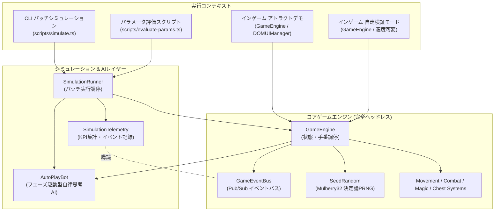
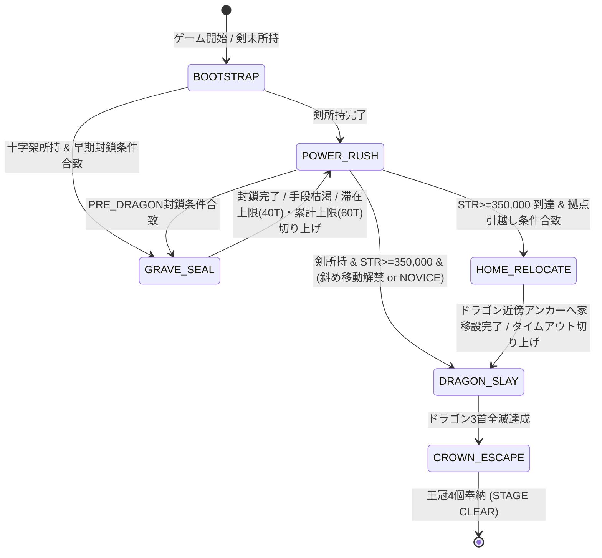
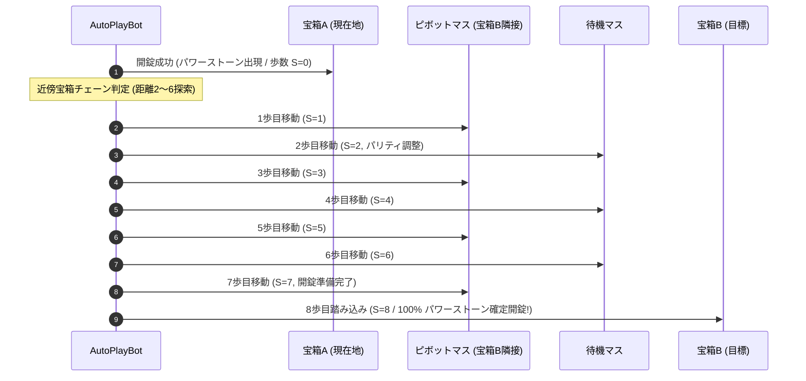
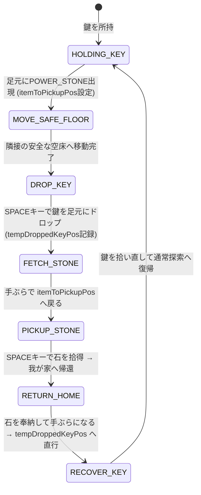
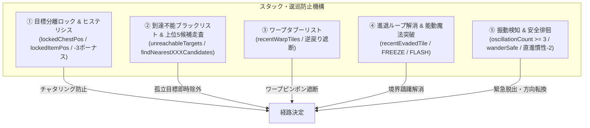
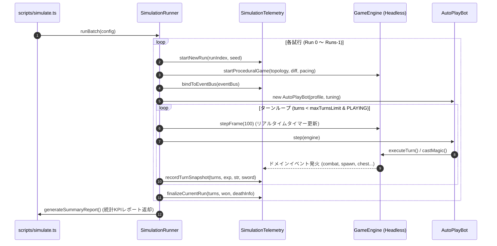
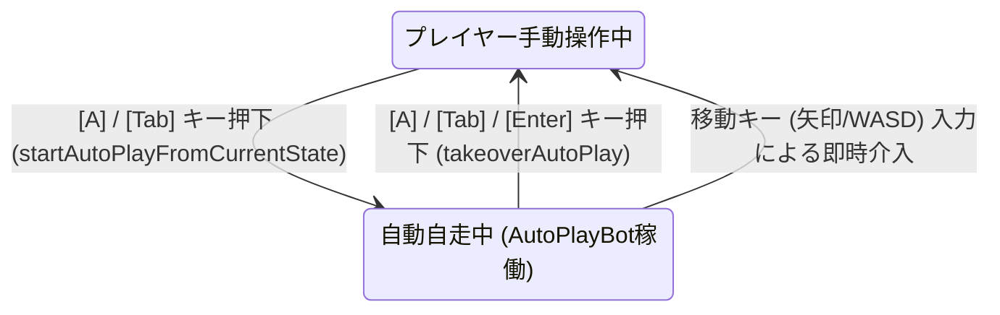

# 自律攻略AI (AutoPlayBot) ＆ ヘッドレスシミュレーション仕様書

本書は、『DS1ish』(Dragon Slayer Level 2.0 Web拡張版) における**自律攻略AIエージェント（`AutoPlayBot`）**、**ヘッドレス・バッチシミュレーション基盤（`SimulationRunner` / `SimulationTelemetry`）**、および**インゲーム連携モード（アトラクトデモ／自走検証モード）**の包括的な仕様・アルゴリズム・パラメータ・運用基準を定義する決定版ドキュメントである。

---

## 1. 概要とアーキテクチャ設計

### 1.1 目的と背景
本作は1984年の古典的アクション・パズルRPG『ドラゴンスレイヤー』のコアメカニクスに、プロシージャルダンジョン生成と多彩なトポロジーを統合した作品である。
多種多様なランダムダンジョンにおいて「クリア可能性（Solvability）」と「ゲームバランス（適度な緊張感とインフレの爽快感）」を客観的・定量的に保証するため、以下の3つの役割を果たすAI・シミュレーション基盤を構築している。

1. **定量バランス評価**: 人間が数十時間プレイすることなく、数千ターンのバッチシミュレーションを数秒〜数十秒で実行し、勝率・死因・成長曲線を分析する。
2. **アトラクションデモ**: タイトル画面で放置された際に、初心者に向けたゲームルール・攻略セオリーを実演・提示する。
3. **自走検証（インゲームAuto-Play）**: 任意の生成マップやプレイヤーのプレイ途中状態からAIに自走させ、アルゴリズムの挙動確認や特定シチュエーションの検証、プレイヤー手動操作とのシームレスな相互乗り換えを可能にする。

### 1.2 レイヤー分離と決定論性 (Passive View & Headless Pureness)
AIおよびシミュレーション基盤は、描画（DOM / Canvas）や音声（Web Audio API）から完全に疎結合された純粋なTypeScriptロジックとして設計されている。



- **決定論的再現性 (`SeedRandom`)**: Mulberry32アルゴリズムに基づく擬似乱数生成器を使用し、シード値（`seed`）が同一であればマップ生成から敵の思考・ボットの全手番挙動が100%同一に再現される。
- **ドメインイベント駆動 (`GameEventBus`)**: エンジン内で発生する事象（戦闘ダメージ、スポーン成否、宝箱開錠、ゴースト干渉等）は型安全なイベントとして発行され、シミュレータはエンジンに介入することなく統計データを収集する。

---

## 2. AutoPlayBot のアーキテクチャとアルゴリズム仕様 (`src/ai/AutoPlayBot.ts`)

`AutoPlayBot` は、プレイヤースキル水準（`NOVICE`, `STANDARD`, `EXPERT`）および戦略チューニングに応じ、序盤のアイテム収集からドラゴンスレイ、王冠4個の運搬脱出までを自律完遂するフェーズ駆動型エージェントである。

### 2.1 フェーズ駆動型ステートマシン

ボットはゲームの進行度とプレイヤーステータスに基づき、6つのフェーズ（拠点引越し戦術 `HOME_RELOCATE` を含む）を動的に遷移する。



#### 各フェーズの役割と行動優先順位

| フェーズ | 役割 | 主な行動優先順位 |
| :--- | :--- | :--- |
| **`BOOTSTRAP`** | 序盤の装備基盤確保 | 1. 足元の剣（SWORD）拾得<br>2. 足元の鍵（KEY）拾得（手ぶら時）<br>3. 足元の壺（POTION）/コイン（COIN）拾得<br>4. 最寄りの剣探索（上位5候補走査＋BFS）<br>5. 手ぶら時のPOTION優先回収（MP < maxTargetMagic 時）<br>6. 最寄りの鍵探索（上位5候補走査）<br>7. 安全徘徊（`wanderSafe`） |
| **`GRAVE_SEAL`** | 墓の8方向完全封鎖による敵湧き無力化 | 1. 滞在上限（40手）または累計上限（60手）到達時のスマート切り上げ（`abortGraveSeal`）<br>2. 周囲1マスへの `FREEZE` 詠唱（永久氷像バリケード化）<br>3. 十字架（CROSS）所持時の未封鎖墓枠への設置運搬<br>4. 指輪（RING）所持時のブロック押し（Sokoban）による開口部埋め<br>5. 手ぶら時の未設置十字架回収<br>6. 道具枯渇時のスマート切り上げ → `POWER_RUSH` |
| **`POWER_RUSH`**<br>(旧 `FARMING`) | 8歩周期宝箱開錠とSTR爆速育成 | 1. パワーストーン所持時の即座帰還（`RETURN` 魔法優先、無ければ歩行）<br>2. 8歩周期宝箱開錠モード中（`eightStepTargetChestPos`）の歩数調整・開錠<br>3. アイテム持ち替え制御（Hands-Free Rule: 鍵一時ドロップ・石回収）<br>4. 8歩周期での宝箱開錠（5〜7歩時は隣接安全床で歩数稼ぎ）<br>5. 周囲の安全な敵（`ONE_SHOT`）迎撃 & 包囲時の `FREEZE`/`FLASH`<br>6. 必須特技解禁狩り（STR>=1,000でRETURN習得、STR>=255,000で斜め移動習得）<br>7. 鍵所持時の最寄り宝箱探索（上位5候補走査）<br>8. 手ぶら時の床パワーストーン / POTION / KEY 回収<br>9. 安全徘徊 |
| **`HOME_RELOCATE`** | ドラゴン近傍への我が家（HOME）引越し移設 | 1. 指輪（RING）を確保し、ドラゴン要塞近傍の安全な引越し先アンカー（火炎弾射線外・距離4〜8）を選定<br>2. 押し出し経路上の障害ブロックを `BREAK` 魔法で事前除去<br>3. 我が家の背後へ回り込み、指輪でアンカー座標までプッシュ運搬（首討伐後の王冠脱出距離を大幅短縮 & 初期位置の家からの敵湧きと帰還拠点を分離） |
| **`DRAGON_SLAY`** | ドラゴン要塞進軍と安全マス首討伐 | 1. 要塞開削・突入用 MP確保（MP < 2 時の POTION 回収）<br>2. 生存首へのトーラス斜め1マスからの直接体当たり攻撃（反撃ダメージ0）<br>3. 最寄り首の安全な斜め外周攻撃マスへの経路探索（`BREAK` 壁破壊ナビ）<br>4. 安全徘徊 |
| **`CROWN_ESCAPE`** | 全魔法封印下での王冠4個歩行運搬脱出 | 1. 手ぶら時: 周囲の危険敵（`LETHAL`/`DANGER`）への `FREEZE`/`FLASH` 事前露払い、直角隣接 `ONE_SHOT` 敵の先制撃破<br>2. 王冠所持時: 即死級敵の接近に対する緊急回避（`findEvadeDirection`）または緊急ドロップ、我が家への歩行運搬<br>3. 足元の王冠回収（周囲安全確認後、危険時は先に魔法無力化）<br>4. 不要道具の手放し<br>5. 手ぶら時の魔力補給（MP=0時は最優先、MP<3時は広域回収）<br>6. 床の王冠探索・回収<br>7. ゴースト運搬中等の床王冠不在時は我が家近傍での待機・魔力補充 |

#### マップ静的構造評価 (`assessMap` / `MapAssessment`)
ボットは初回起動時（またはマップ切替時）に `assessMap()` を実行し、マップ全体のオブジェクトと墓の密集度を走査する。

```typescript
export interface MapAssessment {
  totalGraves: number;        // 総墓数
  openGraves: number;         // 未封鎖墓数
  nearHomeGraves: number;     // 我が家近傍の墓数 (距離 nearHomeRadius 以内)
  totalChests: number;        // 総宝箱数
  totalPotions: number;       // 総ポーション数
  totalCrosses: number;       // 総十字架数
  totalBlocks: number;        // 総ブロック数
  recommendedPolicy: GraveSealPolicy; // 推奨ポリシー ('NONE' | 'NEAR_HOME' | 'ALL')
}
```

- **自動ポリシー選定アルゴリズム**:
  - `nearHomeGraves === 0 || totalCrosses === 0` → `'NONE'`（封鎖する墓が無い、または十字架が無い場合は一切墓封鎖を行わず最速育成へ）
  - `totalGraves <= 6 && totalCrosses >= 2` → `'ALL'`（少数の墓地構成で十字架が潤沢なら完全封鎖）
  - それ以外 → `'NEAR_HOME'`（拠点近傍の墓のみ封鎖して安全圏を確保）

#### 戦略チューニングパラメータ (`BotStrategyTuning`)

| パラメータ名 | 型 | デフォルト値 | 説明 |
| :--- | :---: | :---: | :--- |
| `graveSealPolicy` | `GraveSealPolicy` | `'AUTO'` | 墓封鎖の対象範囲。`'AUTO'` (マップ評価依存), `'NONE'`, `'NEAR_HOME'`, `'ALL'`。 |
| `graveSealTiming` | `GraveSealTiming` | `'EARLY'` | 墓封鎖を行うタイミング。<br>・`'EARLY'`: 序盤のSTR閾値到達時<br>・`'PRE_DRAGON'`: ドラゴン突入直前の安全確保時<br>・`'IMMEDIATE'`: 剣取得後即座 |
| `nearHomeRadius` | `number` | `12` | 我が家周辺とみなすマンハッタン距離。 |
| `maxTargetMagic` | `number` | `5` | POTION回収目標MPストック数（最大5）。 |
| `graveSealEarlyStr` | `number` | `30000` | `'EARLY'` 時に墓封鎖を開始する最小STR基準。 |

---

### 2.2 リソース回収・育成・開錠戦術

#### 8歩周期宝箱開錠（8-Step Cycle）と近傍チェーン
本作の原作仕様として、**前回のパワーストーン出現からちょうど8歩目（`stepCountSinceStone === 8`）に宝箱を開錠すると100%確実にパワーストーンが出現する**という決定論的ルールが存在する。

1. **基本開錠歩数調整**:
   - 宝箱マスに乗り、`stepCountSinceStone === 8` の場合はその場で開錠（SPACE）。
   - 歩数が5〜7歩（8に近い）で周囲が安全な場合、隣接する安全な空床へ1歩出て戻ることで歩数を8に調整してから開錠する（歩数0〜4歩での無駄な待機ロスを回避）。
2. **近傍宝箱への連続8歩開錠チェーン (`findNearbyChestForEightStepCycle`)**:
   - 宝箱を開錠して足元にパワーストーンが出現した瞬間（`stepCountSinceStone === 0` にリセット）、足元の石をあえて拾わず、マンハッタン距離2〜6マス以内にある未開封宝箱を全探索。
   - 7歩以内で到達可能で、余り歩数 `(7 - pathLength) % 2 === 0`（偶数パリティ）を満たす宝箱・ピボットマス（`pivotPos`）・待機マス（`waitPos`）の組み合わせを算出。
   - `handleEightStepCycle()` により、ピボットマスと待機マスを往復して正確に7歩目をピボットマスで迎え、8歩目で対象宝箱へ踏み込んで即時開錠。これにより**パワーストーンの連続確定排出チェーン**を実現する。



#### アイテム持ち替え制御 (Hands-Free Rule)
本作ではプレイヤーはアイテムを1つしか持てず、鍵（`KEY`）を持ったままでは床のパワーストーン（`POWER_STONE`）を拾えない。



- **タイムアウト安全弁 (`MAX_ITEM_SWAP_TURNS = 10`)**: 細い通路でモンスターに退路を塞がれたり、岩に阻まれて鍵のドロップ・再回収がループした場合、10ターンで持ち替えシーケンスを強制リセットし、通常移動へ復帰してスタックを防止する。

#### 魔力（POTION）管理と必須スキル解禁
- **RETURN魔法（EXP 2,000, MP 1）の最速解禁**:
  - STR >= 1,000 に達した時点で、距離12以内の安全な敵（`ONE_SHOT`）を倒して最速で EXP 2,000（RETURN習得）を達成する。石回収後の瞬時帰還・全快が可能となり、運搬リスクをゼロ化する。
- **斜め移動（EXP 12,000）の解禁**:
  - STR >= 255,000 に達した時点で、距離15以内の敵を一撃瞬殺して斜め移動を解禁。ドラゴンの首への斜め攻撃体制を整える。
- **POTION優先回収**:
  - POTIONは拾った瞬間にMP+1となり、手持ちアイテム枠を消費しない（手ぶら維持）。そのため、手ぶら時はKEYよりもPOTIONを優先して拾い、MPを常時ストック（`maxTargetMagic = 5`）する。

---

### 2.3 経路探索（BFS Pathfinding）と脅威回避

経路探索は `findPath()` および `executeBfs()` によってトーラス（上下左右ループ）空間上で行われる。

#### コスト設計とナビゲーション優先度

| タイル / 状況 | コスト / 判定 | 設計意図 |
| :--- | :---: | :--- |
| **通常空床** | コスト `1` | 最短基本経路。 |
| **BREAK 掘削ブロック** | コスト `6` | 通常床ルートが無い場合のみ、`BREAK` 魔法による壁破壊経路を自動探索。 |
| **RING ブロック押し** | コスト `3` | 指輪所持時、ブロックの押し出し先が有効な場合のみ通過可能。押せないブロックは通過不可。 |
| **ワープゾーン (WARP)** | コスト `+20` / `+500` | 意図しないワープ踏み込みを抑制するため通常ルートを優先。直近通過したワープ（タブー）は `+500` で逆戻りを完全遮断。 |
| **危険敵の周囲1マス (Danger Zone)** | コスト `+300` / `+2000` | `LETHAL` / `DANGER` 敵の周囲マスへの進入を回避。第1歩目での踏み込みは完全進入禁止。王冠運搬中は極限回避（`+2000`）。 |
| **直前手・2手前のマス (Recent Positions)** | コスト `+20` / `+10` | 直近の移動マスへの逆戻りピンポンを抑制。 |
| **退避元タイル (`recentEvadedTile`)** | コスト `+400` / `+800` | 危険回避で離脱したマスへの即座の逆戻り（進退ループ）を遮断。 |

#### ドラゴンの完全回避
- **ドラゴンの全部位回避**: 本体（`BODY`）、尻尾（`TAIL`）、生存首（`HEAD`）の全マスは進入不可。
- **直角隣接マスの進入禁止**: 生存首の上下左右4方向（マンハッタン距離1）は、敵手番で反撃大ダメージを受けるため進入禁止。
- **火炎弾正面射線回避 (`isDragonFireLine`)**: 生存首が向いている直線方向は、一撃即死の火炎弾が飛来するため完全進入禁止。
- **飛翔中火炎弾の未来位置予測**: 火炎弾の現在地および次ターンの飛翔先マスへの踏み込みを回避。

---

### 2.4 スタック・ピンポン往復・長考（逡巡）防止機構

AutoPlayBotが迷宮内でスタック・無限ループに陥るのを防ぐため、多層防御機構が組み込まれている。



#### 1. 目標ロック＆ヒステリシス (Target Lock & Hysteresis)
- 宝箱用（`lockedChestPos`）とアイテム用（`lockedItemPos`）を**完全分離**して保持。
- ターゲット候補の評価時、現在ロック中の目標に対してマンハッタン距離 `-3` のヒステリシスボーナス（優遇）を付与。1歩動くたびに最寄り目標が目まぐるしく入れ替わるチャタリング現象を防止。
- 目標到達時、目標消滅時、または上限ターン（20ターン）経過時に自動解除。

#### 2. 到達不能ターゲットのブラックリスト (Unreachable Blacklist) と複数候補走査
- 岩や壁で密閉された孤立エリア内の宝箱・アイテムに対してBFSを実行して到達不能と判明した場合、即座に対象座標をブラックリスト（`unreachableTargets`）へ登録（デフォルト30ターン除外）。
- 次手番以降、BFSの実行前に `isTargetUnreachable(to)` で即時判定（O(1)）し、探索コストを完全ゼロ化（Early Exit）。
- 目標走査時、最寄り1件だけでなく上位5候補（`findNearestXXXCandidates`）を取得し、到達可能な目標が見つかるまで同一ターン内で順次フォールバック。
- **リセット条件**: `BREAK` 魔法による壁破壊時、ワープゾーン通過時、およびフェーズ遷移時にブラックリストを全クリア（経路が開通した可能性があるため）。

#### 3. ワープタブーリスト (`recentWarpTiles`)
- ワープゾーン通過時、ワープ元およびワープ先の座標をタブーリストへ登録（有効期間12ターン）。
- ワープ直後に元のワープゾーンへ逆戻りするピンポン往復をコスト `+500` の重ペナルティで遮断。

#### 4. 危険ゾーン境界での進退ループ（Flinching）解消
- 危険な敵の射程境界で「前進 → 危険検知して後退 → 再度前進」を繰り返す進退ループを検知。
- 退避元タイルを `recentEvadedTile` として記憶し、再進入にペナルティ（+400〜+800）を付与。
- 振動検知時、周囲に未凍結の強敵がいれば後退ではなく `FREEZE` または `FLASH` 魔法を詠唱して敵を無力化し、能動的に突破する。

#### 5. 振動検知 (`oscillationCount`) と安全徘徊 (`wanderSafe`)
- 直近4手の移動履歴に現在地が含まれる場合、振動カウンタをインクリメント。
- `oscillationCount >= 3` に達した場合、目標ロック・8歩状態・持ち替え状態を全リセットし、`wanderSafe()` による安全徘徊へ強制移行。
- **安全徘徊の設計**:
  - 訪問履歴ペナルティ（直近に訪れたマスほど高いペナルティ）。
  - 直進慣性ボーナス（直前と同じ向きへの前進に `-2` ペナルティ付与し、壁際での細かな反転を防止）。
  - 完全な袋小路に追い込まれた場合は、`RETURN` / `JUMP` / `FREEZE` / `FLASH` 魔法による緊急脱出。

---

## 3. ヘッドレス・バッチシミュレーション＆テレメトリ基盤 (`src/simulation/`, `scripts/`)

### 3.1 シミュレータの構造 (`SimulationRunner.ts`, `SimulationTelemetry.ts`)

`SimulationRunner` は、ヘッドレス環境で `GameEngine` と `AutoPlayBot` を結合し、高速バッチ実行を行う。



#### 収集されるテレメトリKPI

```typescript
export interface SimulationSummaryReport {
  overall: {
    winRate: number;                  // クリア率 (0.0 〜 1.0)
    avgClearTurns: number;            // クリア時平均ターン数
    medianClearTurns: number;         // 中央値ターン数
    estimatedPlayTimeMinutes: number; // 人間推定プレイ時間 (1ターン約0.7秒換算)
    milestoneReachRates: {
      gotSword: number;               // 剣入手率
      unlockedBreakMagic: number;     // BREAK解禁率 (EXP>=1,000)
      unlockedDiagonalMove: number;   // 斜め移動解禁率 (EXP>=12,000)
      killedHead1: number;            // 第1首討伐率
      killedAllHeads: number;         // 3首全滅達成率
      deliveredAtLeastOneCrown: number;// 王冠1個以上運搬率
    };
    deathCauses: Record<string, number>; // 死因内訳
  };
  homeSpawnMetrics: {
    totalHomeSpawnAttempts: number;   // 拠点スポーン試行数
    homeSpawnSuccessRate: number;     // 拠点スポーン成功率 (%)
    blockedByGlobalCapRate: number;   // グローバル上限ブロック率 (%)
    evictedDistantEnemyCount: number; // 最遠敵パージ数
  };
  progressionMetrics: {
    maxSingleKillExpJump: number;     // 1撃最大獲得EXP
    combatOutcomeDistribution: {
      zeroDamageTakenRatio: number;   // 被ダメゼロ戦闘率
      moderateDamageRatio: number;     // 軽微被ダメ戦闘率 (<300)
      lethalOneShotDeathRatio: number;// 即死被弾率
    };
  };
  resourceAndGhostMetrics: {
    avgItemsSpawnedPerRun: Record<string, number>; // アイテム平均出現数
    chestCapFallbackCount: number;    // 上限到達による宝箱フォールバック数
    ghostInteractions: {
      itemsPickedUp: number;          // ゴースト床回収数
      itemsStolenFromPlayer: number;  // プレイヤー強奪数
    };
  };
}
```

---

### 3.2 CLIツールとパラメータ評価スクリプト

#### 1. 高速バッチシミュレーション (`scripts/simulate.ts`)
任意のトポロジー、難易度、ペーシング、試行回数でシミュレーションを実行するCLIツール。

```bash
# 基本実行 (5回試行, 最大1200ターン, 標準設定)
npx tsx scripts/simulate.ts

# 詳細パラメータ指定実行
npx tsx scripts/simulate.ts --runs=20 --turns=3000 --topology=MULTI_SECTOR --difficulty=NORMAL --pacing=STANDARD

# 戦略チューニングの指定
npx tsx scripts/simulate.ts --runs=10 --turns=2500 --graveSealPolicy=AUTO --graveSealTiming=EARLY --maxTargetMagic=5
```

##### コマンドライン引数一覧
- `--runs`, `-r`: 試行回数（デフォルト: `5`）
- `--turns`, `-t`: 1試行あたりの最大ターン上限（デフォルト: `1200`）
- `--topology`: ダンジョン構造（`STANDARD_ROOMS`, `MULTI_SECTOR`, `PILLAR_GRID`, `NARROW_MAZE`, `SPIRAL_LABYRINTH`, `FORTRESS_ARENA`）
- `--difficulty`: 難易度（`EASY`, `NORMAL`, `HARD`）
- `--pacing`: 進行ペース（`BLITZ`, `STANDARD`, `ENDURANCE`）
- `--botProfile`: ボットスキル（`NOVICE`, `STANDARD`, `EXPERT`）
- `--graveSealPolicy`: 墓封鎖ポリシー（`AUTO`, `NONE`, `NEAR_HOME`, `ALL`）
- `--graveSealTiming`: 封鎖タイミング（`EARLY`, `PRE_DRAGON`, `IMMEDIATE`）
- `--maxTargetMagic`: 目標MPストック数（デフォルト: `5`）
- `--seed`: 基準シード値

#### 2. 戦略パラメータ比較評価 (`scripts/evaluate-params.ts`)
複数のボット戦略設定（ベースライン、ポーション強化、墓封鎖タイミング、自動マップ評価）を一括実行し、勝率・マイルストーン達成率・死因を比較表形式で出力する。

```bash
npx tsx scripts/evaluate-params.ts
```

---

### 3.3 クリア所要ターン数の理論値と評価基準の知見

ゲーム全行程における各ステップの理論ターン数およびシミュレーション推奨ターン数の根拠は以下の通りである。

#### 理論所要ターン数の内訳 (NORMAL難易度・標準マップ)

```text
行程1: 初期確保 (SWORD & KEY & 初期POTION)               :    30 〜    80 ターン
行程2: パワーストーン育成 (石12〜16個奉納 & STR 35万到達)  :   500 〜   900 ターン
       - 8歩調整開錠 + RETURN帰還 (約40〜60T / 1サイクル)
行程3: 経験値稼ぎ & 特技解禁 (EXP 12,000 / 斜め移動)      :    50 〜   150 ターン
行程4: ドラゴン要塞進軍 & 3首討伐                         :   100 〜   250 ターン
行程5: 王冠4個の歩行運搬・脱出 (全魔法封印下)             :   700 〜 1,600 ターン
       - 家と各首の往復歩行 (約150〜350T / 1個 × 4往復)
--------------------------------------------------------------------------------
合計理論クリア所要ターン数                              : 1,380 〜 2,980 ターン
```

#### 推奨ターン上限 (`maxTurnsLimit: 3000`) の根拠
- 行程1〜4（ドラゴン全首討伐まで）は通常 **700〜1,400ターン** で達成可能。
- 討伐後の行程5（`CROWN_ESCAPE`）は、**全魔法封印下で広大な迷宮を4往復歩行運搬する**必要があり、最短経路でも600〜1,200ターンを要する。
- したがって、シミュレータのターン上限が 1,200〜1,500 ターンでは、ドラゴン全首撃破後の王冠運搬中に時間切れ（`TIMEOUT_STALL`）となり正当な勝率を計測できない。
- **完全クリアを評価するシミュレーションでは、`maxTurnsLimit = 3000` を推奨基準値とする**。

#### 現在の到達性能と今後の改善課題
- **現在の到達性能**:
  - 剣入手率: **100%**
  - 第1首討伐率: **80〜100%**
  - ドラゴン3首全滅率: **70〜90%**
- **終盤（`CROWN_ESCAPE`）における課題**:
  - ドラゴン全滅後は暗黒パレット化し、高火力モンスター（dora, knight, rich等）が全土にリポップする。
  - 王冠所持中はすべての魔法（RETURN, FLY, FREEZE, FLASH）が封印されるため、敵との遭遇を物理的な歩行迂回のみで回避しなければならない。
  - **今後の改善課題**: A* / 距離場（Distance Field）を用いたモンスター動的ステルス迂回ナビゲーションの導入、およびゴーストによる王冠運搬先への先回り待機ロジックの強化。

---

## 4. インゲーム連携モード仕様 (`src/core/GameEngine.ts`, `src/view/DOMUIManager.ts`)

ゲームエンジンには、Webブラウザ上で実際にAIの動作を可視化・検証できる2つのインゲーム連携モードが統合されている。

### 4.1 アトラクションデモモード (Attract Demo Mode)
プレイヤーがタイトル画面で一定時間操作を行わなかった場合、自動的にゲームプレイの実演を開始するアーケードスタイルのデモ機能。

1. **自動開始と初期化**:
   - タイトル画面放置で自動発火（またはデバッグ用ショートカット）。
   - デモ専用のテンポの良い設定（`STANDARD_ROOMS` / `EASY` / `BLITZ`）でゲームを開始。
2. **サウンド退避と自動消音**:
   - 開始時にプレイヤーの元のサウンドミュート状態を退避し、デモ中は自動消音（Mute）。
   - 終了時に元のミュート状態を完全復元（タイトル画面ではBGM停止維持、ゲーム本編開始時はBGM再開）。
3. **チュートリアル字幕オーバーレイ**:
   - `AutoPlayBot.getTutorialMessage()` により、ボットの現在フェーズ（ブートストラップ、墓封鎖、石奉納、ボス討伐、王冠脱出）に応じた解説テキストを画面上部にリアルタイム表示。
4. **終了・割り込み復帰条件**:
   - プレイヤーの任意のキー入力（矢印、SPACE、ENTER、ESC等）または画面クリックで**即座に中断しタイトル画面へ復帰**。
   - 最大ターン制限（500ターン）到達時のタイムオーバー終了。
   - 身動き不能（同一座標スタックが60フレーム連続）時のスタックタイムオーバー終了。
   - ゲームオーバー／ステージクリア時は約2秒（12フレーム）演出を見せてからタイトル画面へ自動復帰。

---

### 4.2 自走検証モード (Auto-Play Verify Mode) ＆ リアルタイムAI切り替え
開発者およびプレイヤーが任意のマップでAIの挙動を検証し、いつでも手動操作と切り替えられる高度な検証機能。



#### 1. 速度切り替えと一時停止
自走検証オーバーレイ上のUIボタンおよびキーボード入力により、実行速度を動的に変更可能。
- `1x`: 標準速度（約180ms/ターン）
- `2x`: 高速（約90ms/ターン）
- `5x`: 超高速（約36ms/ターン）
- `Pause (0x)`: 一時停止（盤面とステータスを静止して熟考・確認可能）

#### 2. ターン上限撤廃とスタック救済 (`handleStuckRescue`)
- 自走検証モードではデモモードと異なり、**ターン数上限（500T制限）を完全撤廃（無制限自走）**。
- 身動き不能（同一座標20フレーム連続）を検知した場合、強制終了させるのではなく、ボットの `handleStuckRescue()` を呼び出す：
  - 目標ロック解除（`clearTargetLock`）
  - 到達不能ブラックリスト解除（`clearUnreachableTargets`）
  - 8歩調整状態クリア（`clearEightStepState`）
  - 持ち替え状態クリア（`itemToPickupPos = null`）
  - 次手番強制安全徘徊フラグ（`forceWanderNextTurn = true`）
  これにより、AIが自力でスタック状態から脱出して探索を再開する。

#### 3. シームレスな操作権の相互引き継ぎ (Seamless Takeover)
- **手動操作から自走へ (`startAutoPlayFromCurrentState`)**:
  - プレイ中、`[A]` または `[Tab]` キーを押すことで、現在のプレイヤー座標・HP・所持品・マップ状態を完全に維持したまま `AutoPlayBot` インスタンスを生成し、その場から自走を開始。
- **自走から手動操作へ (`takeoverAutoPlay`)**:
  - 自走中、`[A]`、`[Tab]`、`[Enter]`、または移動キーを押した瞬間にAIループを安全に停止し、プレイヤー手動操作へ即座に引き継ぐ。
  - サウンド状態を復元し、BGMを再開。HUDログに切り替え通知を表示。

---

## 5. 関連ファイル・モジュール構成一覧

| モジュールパス | 主な責務・実装内容 |
| :--- | :--- |
| `src/ai/AutoPlayBot.ts` | 自律攻略AIエージェント本体（オーケストレータ）。フェーズ遷移、アイテム持ち替え制御、目標ロック、スタック回避。 |
| `src/ai/BotNavigator.ts` | トーラス空間BFS経路探索、連続ワープ探索、危険射線回避、到達不能ブラックリスト、ワープタブー管理。 |
| `src/ai/EightStepController.ts` | 8歩周期パワーストーン確定排出の歩数調整および近傍宝箱連続開錠チェーン制御。 |
| `src/ai/tactics/GraveSealTactics.ts` | 十字架・岩・FREEZE氷像を用いた墓の包囲封鎖戦術モジュール。 |
| `src/ai/tactics/HomeRelocationTactics.ts` | 指輪で「我が家」をドラゴン近傍アンカーへ押し運ぶ拠点引越し戦術モジュール。 |
| `src/simulation/SimulationRunner.ts` | ヘッドレスバッチシミュレータ。設定生成、乱数制御、ターン進行ループ、KPI集約サマリー生成。 |
| `src/simulation/SimulationTelemetry.ts` | イベント駆動型テレメトリ集計器。ドメインイベント購読、マイルストーン判定、成長・戦闘・資源統計の算出。 |
| `scripts/simulate.ts` | シミュレーション実行CLI。引数パース、バッチ実行、コンソールKPIレポート出力。 |
| `scripts/evaluate-params.ts` | 戦略パラメータ比較スクリプト。複数ケースの比較表・死因分析出力。 |
| `src/core/engine/DemoAndAutoPlayController.ts` | デモモードおよび自走検証モード・リアルタイム操作権引き継ぎの統括コントローラー。 |
| `src/view/DOMUIManager.ts` | デモ字幕オーバーレイ、自走検証オーバーレイ（速度変更・一時停止ボタン・ステータス表示）、トグルボタン制御。 |
