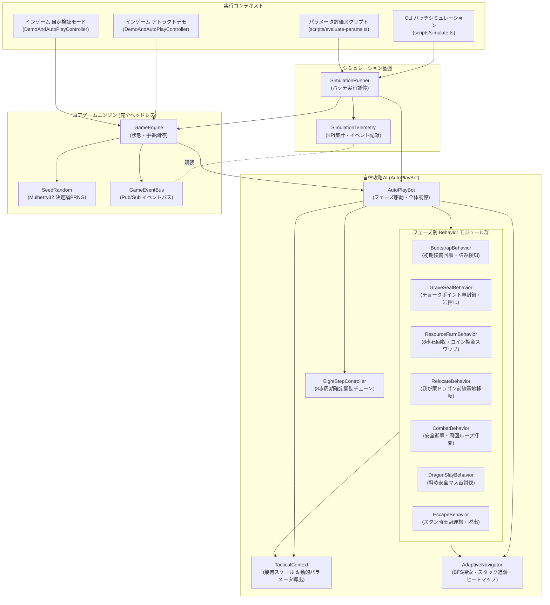
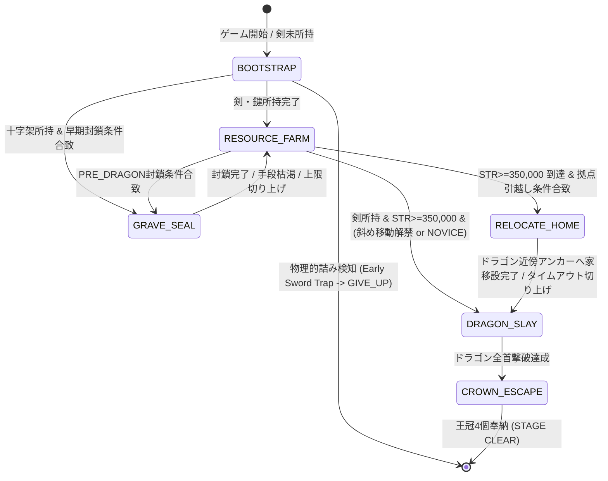
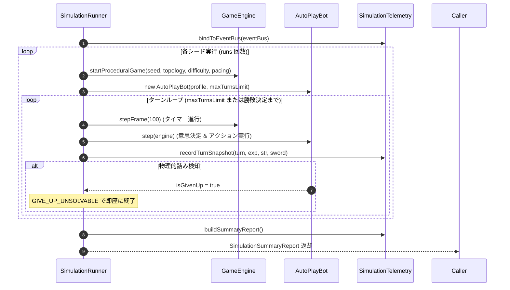

# 自律攻略AI (AutoPlayBot) ＆ ヘッドレスシミュレーション仕様書

本書は、『DS1ish』(Dragon Slayer Level 2.0 Web拡張版) における**自律攻略AIエージェント（`AutoPlayBot`）**、**ヘッドレス・バッチシミュレーション基盤（`SimulationRunner` / `SimulationTelemetry`）**、および**インゲーム連携モード（アトラクトデモ／自走検証モード）**の包括的な仕様・アルゴリズム・パラメータ・運用基準を定義する決定版ドキュメントである。

---

## 1. 概要とアーキテクチャ設計

### 1.1 目的と背景
本作は1984年の古典的アクション・パズルRPG『ドラゴンスレイヤー』のコアメカニクスに、プロシージャルダンジョン生成と多彩なトポロジーを統合した作品である。
多種多様なランダムダンジョンにおいて「クリア可能性（Solvability）」と「ゲームバランス（適度な緊張感とインフレの爽快感）」を客観的・定量的に保証するため、以下の3つの役割を果たすAI・シミュレーション基盤を構築している。

1. **定量バランス評価**: 人間が数十時間プレイすることなく、数千ターンのバッチシミュレーションを数秒〜数十秒で実行し、勝率・死因・成長曲線を分析する。
2. **アトラクションデモ**: タイトル画面で放置された際に、初心者に向けたゲームルール・攻略セオリーを実演・提示する。
3. **自走検証（インゲームAuto-Play）**: 任意の生成マップやプレイヤーのプレイ途中状態からAIに自走させ、アルゴリズムの挙動確認や特定シチュエーションの検証、プレイヤー手動操作とのシームレスな相互乗り換えを可能にする。

### 1.2 レイヤー分離とモジュラー設計

AIおよびシミュレーション基盤は、描画（DOM / Canvas）や音声（Web Audio API）から完全に疎結合された純粋なTypeScriptロジックとして設計されている。
最新の v2 アーキテクチャでは、肥大化を防ぎ状況適応力を最大化するため、**単一の巨大モノリスから責務ごとに独立した Behavior クラス群、幾何連動型戦術コンテキスト、および一元化ナビゲータへ完全分割**されている。

- **決定論的再現性 (`SeedRandom`)**: Mulberry32アルゴリズムに基づく擬似乱数生成器を使用し、シード値（`seed`）が同一であればマップ生成から敵の思考・ボットの全手番挙動が100%同一に再現される。
- **ドメインイベント駆動 (`GameEventBus`)**: エンジン内で発生する事象（戦闘ダメージ、スポーン成否、宝箱開錠、ゴースト干渉等）は型安全なイベントとして発行され、シミュレータはエンジンに介入することなく統計データを収集する。

---

## 2. AutoPlayBot のアーキテクチャとアルゴリズム仕様

`AutoPlayBot` は、プレイヤースキル水準（`NOVICE`, `STANDARD`, `EXPERT`）およびマップ環境に応じ、序盤のアイテム収集からドラゴンスレイ、王冠4個の運搬脱出までを自律完遂するフェーズ駆動型エージェントである。

### 2.1 フェーズ駆動型ステートマシン

ボットはゲームの進行度とプレイヤーステータスに基づき、6つのフェーズを動的に遷移する。

#### 各フェーズの役割と行動概要

| フェーズ | 担当モジュール | 役割と主な行動 |
| :--- | :--- | :--- |
| **`BOOTSTRAP`** | `BootstrapBehavior.ts` | **序盤装備確保＆詰み検知**: 足元/最寄りの剣・鍵・壺の回収。序盤の剣到達不可（物理的詰み）を即座に判定し早期GiveUP。 |
| **`GRAVE_SEAL`** | `GraveSealBehavior.ts` | **墓封鎖**: メタデータのチョークポイント出口優先封鎖、Sokoban岩押し、周囲1マス `FREEZE` 氷像化、十字架設置。十字架設置⇔回収の無限ループ防止。 |
| **`RESOURCE_FARM`** | `ResourceFarmBehavior.ts` | **8歩周期確定開錠＆資源育成**: パワーストーン奉納、8歩周期宝箱開錠チェーン、アイテム持ち替え（Hands-Free Rule）、コイン収集スワップ＆一括換金帰還。 |
| **`RELOCATE_HOME`** | `RelocateBehavior.ts` | **我が家の前線基地移転**: 指輪で我が家をドラゴン要塞近傍の安全アンカーへ押し運び、首討伐後の王冠脱出距離を大幅短縮。 |
| **`DRAGON_SLAY`** | `DragonSlayBehavior.ts` | **決戦**: 首のブレス射線を回避し、安全な斜め隣接マスから首を直接攻撃。要塞開削のための `BREAK` ナビゲーション。 |
| **`CROWN_ESCAPE`** | `EscapeBehavior.ts` | **脱出**: 魔法封印下での王冠4個歩行運搬。スタン中敵に対する `FLASH` 重複詠唱抑止と安全運搬ルート探索。 |

---

### 2.2 幾何スケール連動と動的パラメータ (`TacticalContext`)

マップの幾何解像度（32x32〜64x64等）、トポロジー（部屋、狭小迷路、多セクター）、生成器メタデータ（`MapTacticalMetadata`）から、戦術パラメータを動的に算出する。

#### マップ幾何スケール (`TacticalScale`)
トーラス最大距離 $L_{\max} = \frac{W + H}{2}$ を基準とし、マップサイズに比例した距離スケールを正規化定義：
- `immediateRadius`: 至近距離 ($\approx 0.05 \times L_{\max}$)
- `nearRadius`: 近傍半径 ($\approx 0.15 \times L_{\max}$)
- `midRadius`: 中距離半径 ($\approx 0.35 \times L_{\max}$)
- `farRadius`: 遠征限界 ($\approx 0.70 \times L_{\max}$)

#### 動的戦術パラメータ (`DynamicBotParameters`)
- **探索半径連動**: マップサイズと迷路度（`mazeIndex`）に応じ、`keySearchDist`, `potionSearchDist`, `stoneSearchDist` を動的に伸縮。
- **BFSステップ上限**: マップ面積に連動（3,000〜6,000手）し、広大マップでの早期打ち切りロスを防止。
- **墓封鎖ポリシーの動的選定**: 拠点周辺の墓数、十字架の有無、迷路度から `'NONE'`, `'NEAR_HOME'`, `'ALL'` を自動選定。

---

### 2.3 最新の打開・安全アルゴリズム

#### 1. 訪問ヒートマップによる周回検知と能動打開 (`CombatBehavior`)
通路や岩・墓の周囲を敵と鬼ごっこして無限周回する現象を解消するため、時間減衰型ヒートマップ（`heatMap`）を実装。
- プレイヤーがマスを踏むたびに熱量 $+10$、ターン経過で減衰率 $0.85$ を適用。
- 同一エリアの熱量が閾値（$12.0$）を超えた場合、周回ループと判定：
  - **岩周回**: 直線上の敵へ岩越しに `KICK` 魔法を放ち、障害物を飛び越えて敵を瞬殺（KICKスナイプ）。
  - **墓周回**: 近傍の敵へ `FREEZE` を放ち、永久氷像バリケード化して通路を遮断。

#### 2. MP=1 セーフティリザーブ保護 (`canSpendMagicReserve`)
`BREAK` 魔法（EXP 4,000到達で習得）は「MP 1以上で消費コスト0（MPを減らさずに壁破壊可能）」という強力な特性を持つ。
- BREAK習得後は、残りMPが1のときに他の魔法（`RETURN`, `FLASH` 等）でMPを0に枯渇させることを拒否。
- 壁破壊による幹線道路開削能力を死守する（即死危機時のみ緊急許可）。

#### 3. 序盤の物理的詰み（剣到達不可）早期検知 (`detectEarlySwordTrap`)
トポロジー生成やブロック配置によって、初期状態で剣への到達経路が完全に存在しないシードを検知。
3,000ターンのタイムアウトを待つことなく、即座に `{ type: 'GIVE_UP' }` を発行してシミュレーションおよび評価を高速化。

#### 4. 十字架「設置⇔回収」無限ループ防止 (`isCrossSealing`)
墓の隣接マスに設置された十字架は「封鎖用バリケード」として機能しているため、それを通常の床アイテムとして拾い直して手放すチャタリングを完全遮断。

#### 5. 王冠脱出時のスタン中敵への FLASH 重複詠唱抑止 (`EscapeBehavior`)
`FLASH` 魔法発動後、周囲の敵がスタン中（`frozenTimer > 0`）である間は、無駄な再詠唱を抑止して即座に王冠取得（SPACE）および我が家への運搬移動を実行。

---

## 3. ヘッドレス・シミュレーション基盤 (`SimulationRunner`)

`SimulationRunner` は、ヘッドレス環境で `GameEngine` と `AutoPlayBot` を結合し、高速バッチ実行を行う。

### 3.1 評価指標 (KPI)
- **勝率 (Win Rate)**: 全試行におけるステージクリア達成率。
- **平均クリアターン数 (Avg Clear Turns)**: クリア時の所要ターン数。
- **死因内訳 (Death Causes)**: `MONSTER_DAMAGE`, `DRAGON_BREATH`, `GIVE_UP_UNSOLVABLE`, `TIMEOUT_LIMIT` 等。
- **成長マイルストーン達成率**: 剣入手、BREAK解禁、斜め移動解禁、ドラゴン首撃破、王冠運搬。

---

## 4. インゲーム連携モード

### 4.1 アトラクトデモモード (Attract Demo Mode)
タイトル画面で放置された際に、初心者に向けたゲームルール・攻略セオリーを実演する。
- チュートリアル字幕オーバーレイ（`getTutorialMessage()`）によるリアルタイム解説。
- プレイヤーの任意の操作（キー入力、クリック）で即座にタイトル画面へ復帰。

### 4.2 自走検証モード (Auto-Play Verify Mode)
- **ワンキー操作権引き継ぎ**: プレイ中 `[A]` または `[Tab]` キーで、現在の状態を維持したままAI自走を開始／手動操作へ即時復帰。
- **可変速制御**: `1x`, `2x`, `5x`, `Pause (0x)` によるリアルタイム検証。
- **スタック自動救出 (`handleStuckRescue`)**: 身動き不能検知時に目標ロックとブラックリストを解除して自力脱出。

---

## 5. 関連ファイル・モジュール構成一覧

| モジュールパス | 主な責務・実装内容 |
| :--- | :--- |
| `src/ai/AutoPlayBot.ts` | 自律攻略AIエージェント本体（オーケストレータ）。フェーズ調停、ステートマシン、インゲーム連携。 |
| `src/ai/AdaptiveNavigator.ts` | トーラス空間BFS経路探索、一元化スタック・ピンポン追跡、訪問ヒートマップ、安全徘徊。 |
| `src/ai/TacticalContext.ts` | 動的戦術コンテキスト。マップ幾何スケール連動、動的パラメータ導出。 |
| `src/ai/BotTypes.ts` | AI関連の型定義（`BotPhase`, `BotAction`, `DynamicBotParameters`, `TacticalScale` 等）。 |
| `src/ai/EightStepController.ts` | 8歩周期パワーストーン確定排出の歩数調整および近傍宝箱連続開錠チェーン制御。 |
| `src/ai/behaviors/BootstrapBehavior.ts` | 序盤装備（剣・鍵・壺）回収および物理的詰み早期判定。 |
| `src/ai/behaviors/GraveSealBehavior.ts` | チョークポイント墓封鎖、Sokoban岩押し、FREEZE氷像化、十字架設置。 |
| `src/ai/behaviors/ResourceFarmBehavior.ts` | 8歩周期宝箱開錠、石奉納、アイテム持ち替え、コイン収集スワップ＆一括換金。 |
| `src/ai/behaviors/RelocateBehavior.ts` | 指輪による我が家のドラゴン要塞外縁への前線基地移転戦術。 |
| `src/ai/behaviors/CombatBehavior.ts` | 周囲の安全迎撃、退避、ヒートマップ周回ループ打開（KICKスナイプ／FREEZE）。 |
| `src/ai/behaviors/DragonSlayBehavior.ts` | ドラゴン首への斜め外周安全攻撃、要塞開削BREAKナビゲーション。 |
| `src/ai/behaviors/EscapeBehavior.ts` | 魔法封印下の王冠4個歩行運搬、スタン中敵へのFLASH重複詠唱抑止。 |
| `src/simulation/SimulationRunner.ts` | ヘッドレスバッチシミュレータ。高速バッチ実行調停。 |
| `src/simulation/SimulationTelemetry.ts` | イベント駆動型テレメトリ集計器。マイルストーン・KPIレポート生成。 |
| `src/core/engine/DemoAndAutoPlayController.ts` | デモモードおよび自走検証モード・リアルタイム操作権引き継ぎコントローラー。 |
| `test/test-autoplay-integration.ts` | 自律攻略AIの包括的統合テストスイート（12ケース網羅）。 |
