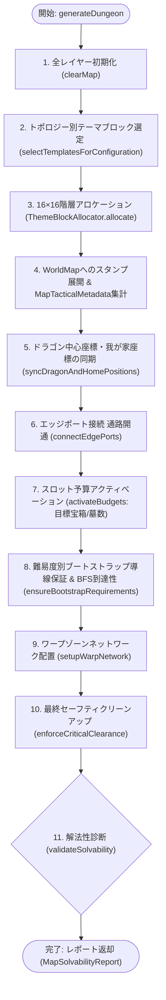
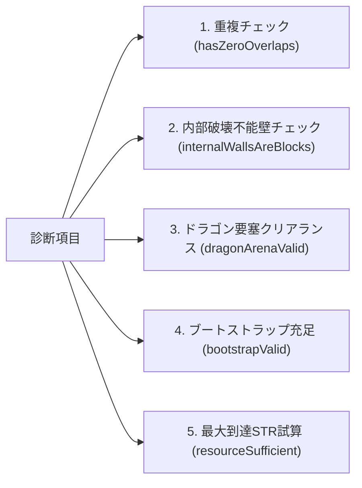
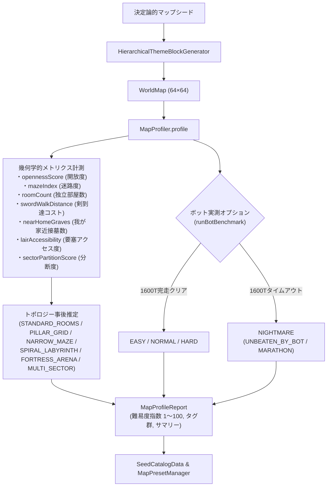

# 『DS1ish』プロシージャルダンジョン生成・攻略バランス設計仕様書

- **文書バージョン**: 1.4.0 (Phase 15 完了時点: Seed Observatory & Challenge Catalog)
- **対象リポジトリ**: `github.com/e3sh/ds1`
- **主要参照実装**:
  - `src/systems/generator/MapProfiler.ts`
  - `scripts/harvest-seeds.ts`
  - `src/systems/generator/HierarchicalThemeBlockGenerator.ts`
  - `src/systems/generator/ThemeBlockAllocator.ts`
  - `src/systems/generator/ThemeBlockTransformer.ts`
  - `src/systems/generator/blocks/index.ts`
  - `src/systems/ProceduralMapGenerator.ts`
  - `src/config/TuningPresetResolver.ts`
  - `src/services/MapPresetManager.ts`
  - `src/models/Types.ts`
  - `src/models/Player.ts`
  - `src/systems/ChestSystem.ts`
  - `src/view/DOMUIManager.ts`
  - `test/test-phase10.ts`
  - `test/test-phase11.ts`
  - `test/test-phase12.ts`

---

## 1. 概要と基本アーキテクチャ

### 1.1 背景と設計哲学
1984年に発売された初代『ドラゴンスレイヤー（PC-8801版 Level 2.0）』は、オープンフィールド風の64×64グリッド内で資源（パワーストーン、金貨、鍵、指輪、十字架、剣）を回収・運搬・強化し、中央のドラゴン要塞を攻略する古典的アクションパズルRPGです。

本プロジェクト『DS1ish』のプロシージャル生成・攻略バランスシステムは、**DS1ishの設計原則**として以下の4点に基づいて設計されています：

1. **完全可動・破壊可能な内部壁 (`BLOCK`) の徹底**:
   外周壁（`WALL_STATIC`）を排除した完全なトーラス世界とし、マップ内部の壁はすべてプレイヤーの指輪（RING）による岩押し、または BREAK 魔法で除去可能な `BLOCK` で構築する。これにより、資源と初期導線さえ正しく担保されていれば、いかなる配置であってもパズル的に必ずクリア可能な状態（Solvable）が保証される。
2. **原作の古典的戦術の完全復刻と拡張**:
   「十字架結界によるゴーストからのクラウン防衛」「十字架・岩による墓封鎖」「複数剣のデポ・予備武器運用」「高密度ワープ迷宮」といった原作のハイレベルな攻略戦術を、アーキタイプ（Archetype）システムによって再現・強化する。
3. **「岩置き完封ハック」の防止**:
   首の正面に岩を置いて火炎弾を完全に無力化する原作の安易な攻略法に対し、宝箱（`CHEST`）と魔法の壺（`POTION`）による幾何学的バリア構造を導入し、正当なリスクとリターンのある戦闘を実現する。
4. **難易度 × プレイ時間ペースの多次元スケーリング**:
   プレイヤーの習熟度（EASY / NORMAL / HARD）とプレイ希望時間（BLITZ / STANDARD / MARATHON）に応じて、重要アイテムの初期配置距離、リソース総量、成長カーブを動的に伸縮させる。

### 1.2 座標系と 64×64 トーラス世界幾何学
- **サイズ**: 幅 64 マス × 高さ 64 マス（0〜63）
- **トーラス構造（ラップアラウンド）**:
  - プレイヤーや敵、ゴースト、アイテムの移動は上下左右の境界でラップする：
    $$x_{\text{wrapped}} = (x \bmod 64 + 64) \bmod 64$$
    $$y_{\text{wrapped}} = (y \bmod 64 + 64) \bmod 64$$
  - マップ上の最短距離（トーラス・マンハッタン距離）は以下で算出される：
    $$\Delta x = \min(|x_1 - x_2|, 64 - |x_1 - x_2|)$$
    $$\Delta y = \min(|y_1 - y_2|, 64 - |y_1 - y_2|)$$
    $$D_{\text{torus}} = \Delta x + \Delta y$$
- **外壁の完全撤廃**:
  従来の四方固定外壁（`WALL_STATIC`）はトーラス境界の連結性を損なうため完全廃止され、全面が `EMPTY`（初期状態）および `BLOCK` で構成される。

---

## 2. ダンジョン生成パイプライン・アルゴリズム仕様

### 2.1 パイプライン全体フロー (`HierarchicalThemeBlockGenerator.generate`)



---

### 2.2 全域9セクター不規則分割 & 動的アンカー選定 (`generateDynamicSectors`)
均等な格子分割（グリッド感）や「いつも左上が家、中央がドラゴン」という固定感を排除するため、64×64空間を3×3の **9つの動的セクター** に分割し、境界に乱数シード依存のジッター（±2マスの揺らぎ）を適用します。

#### 9つの動的セクター構成 (`NORTH_WEST` 〜 `SOUTH_EAST`)
- `NORTH_WEST`, `NORTH_CENTER`, `NORTH_EAST`
- `WEST_CENTER`, `CENTER`, `EAST_CENTER`
- `SOUTH_WEST`, `SOUTH_CENTER`, `SOUTH_EAST`

#### 我が家（Home）とドラゴン要塞（Dragon Lair）の動的セクター配置
1. **離隔保証アンカー選定**:
   - 9セクターの中から「我が家セクター」と「ドラゴンセクター」を動的に選定し、両者のトーラス・マンハッタン距離が十分離れること（$D_{\text{torus}} \ge 20$）を保証します。
2. **プレハブ（スタンプ）構造 (`FORTRESS_7x7` / `COMPACT_5x5` / `COMPACT_3x3`)**:
   - ドラゴン要塞は広間向けの `FORTRESS_7x7` と、回廊や迷路セクター内にも自然に埋め込める省スペース型 `COMPACT_5x5`（王冠出現箱4基＋3首正面の宝箱/ポーションバリア＋南側進入路）に対応。
   - 我が家は `STANDARD_ROOM` と省スペース型 `COMPACT_3x3`（初期ポーション・金貨・遮蔽ブロック同梱）に対応。
   - ドラゴン首の正面3方向（上・左・右）には最低3マスの火炎弾射線クリアランスが確保されます。

#### タイポロジー動的付与アルゴリズム
各セクターのアスペクト比 $R = \frac{w}{h}$ と面積に応じて、以下のセクタータイポロジーを割り当てます：
- $R > 1.8$ または $R < 0.55$: `LONG_CORRIDOR`（細長い連絡回廊）
- $w \ge 16 \land h \ge 16$ かつ角セクター: `GRAND_HALL`（巨大広間）
- その他: シャッフルされたプール（`GRAND_HALL`, `CRANK_CHAMBER`, `LONG_CORRIDOR`, `PILLAR_GRID`, `NARROW_MAZE`, `SPIRAL_LABYRINTH`, `STANDARD_ROOM`）から順次配分

---

### 2.3 トポロジー別構造生成ロジック

1. **`GRAND_HALL` (巨大広間型)**:
   - 広い開口部を持つ外枠ブロック。中央に 2×2 の島ピラー（装飾柱）を配置。
   - 内部に 6〜12 個のピラーをランダム散布し、視界の広さと適度な遮蔽を両立。
2. **`LONG_CORRIDOR` (連絡トンネル型)**:
   - 水平または垂直方向に 1〜2 マス幅のクランク通路を掘削。
   - 3マス周期で障害ブロックを配置し、一直線の射線を分断。
3. **`CRANK_CHAMBER` (クランク部屋型)**:
   - 部屋の中央を L 字・クランク状の壁で 2 つの小部屋に二分割。
   - 出入口を対角に配置し、迂回と岩押しパズルを要求。
4. **`PILLAR_GRID` (ピラー広場型)**:
   - 2マス間隔で格子状にピラーを生成（生成率 85%）。
   - 35%の確率で十字方向に連結柱を伸ばし、迷路的な窪み（岩押し退避路）を形成。
5. **`NARROW_MAZE` (幅1マス迷路型)**:
   - 典型的な通路幅1・壁厚1の古典的迷路。
   - **重要仕様**: 約15%の壁を意図的に間引き、袋小路を減らしてループやT字路を形成。これにより BREAK 魔法で壁1枚を消した時のショートカット価値を極大化。
6. **`SPIRAL_LABYRINTH` (渦巻き要塞型)**:
   - 外周から中心に向かう最大4層の同心円状・渦巻き回廊。
   - 各層の出入口は東西南北に分散。壁厚1マスのため、BREAK 魔法での直通掘削が極めて有効。
7. **`FORTRESS_ARENA` (アリーナ要塞型)**:
   - 外周壁の中央4箇所に幅3のゲートを持つ大部屋。
   - 内部に十字型のトーチカ（遮蔽ブロック群）を中央および四隅に計6基配置し、集団戦の防衛拠点として機能。
8. **`MULTI_SECTOR` (複合セクター型)**:
   - 7つのセクターにそれぞれ異なるタイポロジーをランダムに割り振り、1つのマップ内で多彩な戦術環境を複合。

---

### 2.4 ドラゴン要塞レイアウト & アンチ・ブロック押し込みバリア

#### 幾何学的配置（ドラゴン中心: $cx=32, cy=32$, 半径 $r=6$）
要塞領域は $x \in [cx-6, cx+6], y \in [cy-6, cy+6]$（26〜38×26〜38）です。

```
       [cx-4]       [cx+4]   ← 北辺の出入口（角寄りクランク）
    +----+--+-------+--+----+
    |                       |
    |      (G)     (G)      |   (G): 守護墓 (cx±4, cy-3)
    |         [B]           |   [B]: 遠隔遮蔽ブロック (cx, cy-4/5)
    |         (C)           |   (C): 守護宝箱 (cx, cy-3)
    |         (P)           |   (P): マジックポット (cx, cy-2)
    |       +-----+         |
[cy-4] (C)(P)|  ▲  |(P)(C)  [cy+4] ← 出入口
    |       |◀ ■ ▶|        |   ▲: 中首 (上向き)
    |       +-----+         |   ◀: 左首 (左向き), ▶: 右首 (右向き)
    |                       |   ■: ドラゴン本体 (BODY)
    |                       |
    +----+--+-------+--+----+
       [cx-4]       [cx+4]   ← 南辺の出入口
```

#### アンチ・ブロック押し込みバリアの物理機構
1. **オブジェクトとアイテムの重ね配置**:
   - 中首正面射線: $(cx, cy-2)$ に `POTION`、$(cx, cy-3)$ に `CHEST`。
   - 左首正面射線: $(cx-2, cy)$ に `CHEST`、$(cx-3, cy)$ に `POTION`。
   - 右首正面射線: $(cx+2, cy)$ に `CHEST`、$(cx+3, cy)$ に `POTION`。
2. **岩押し込みの拒絶 (`isPushDestinationValid`)**:
   - `WorldMap.isPushDestinationValid` は、移動先タイルに `BLOCK`, `WALL_STATIC`, `GRAVE`, `CHEST`, `HOME`, またはアイテムが存在する場合に `false` を返します。
   - プレイヤーが指輪を所持していても、首正面の宝箱やポットのマスへ岩を押し込むことは不可能です。
3. **火炎弾の貫通仕様 (`Dragon.updateFireballs`)**:
   - 火炎弾（FIREBALL）は破壊不能な岩や壁で消滅しますが、`CHEST` や `POTION` は貫通して直進します。
   - プレイヤーが宝箱を開錠したりポットを拾うと、そのマスが `EMPTY`（空床）になります。これによりアイテム回収のリターンを得る反面、**火炎弾の直撃射線が完全に開通する**というハイリスク・ハイリターンの駆け引きを生み出します。
4. **直角クランク通路（L字コーナー制約）**:
   - 要塞外壁の開口部を各辺の角寄り（$cx \pm 4, cy \pm 4$）に限定。
   - 首正面への侵入経路を幅1マスのクランク構造にすることで、倉庫番パズルの幾何学的制約により、要塞外部から首正面へ岩を一直線に押し込むルートを完全に遮断しています。

---

### 2.5 重要アイテム初期配置ロジック（難易度・ペーシング連動）

スタートセクター（$x: 2..21, y: 2..21$）、我が家座標 $(7, 7)$、プレイヤー初期座標 $(8, 8)$ を基準とし、難易度とペーシングに応じて主要アイテムのトーラス距離を動的にクランプします。

#### 距離スケーリング係数（ペーシング連動）
$$S_{\text{dist}} = \begin{cases} 0.75 & (\text{BLITZ: 短時間攻略}) \\ 1.00 & (\text{STANDARD: 標準}) \\ 1.25 & (\text{MARATHON: じっくり探索}) \end{cases}$$

#### 難易度別アイテム配置仕様
| 難易度 | スタート部屋内の状況 | 重要アイテム配置位置・距離 | 攻略導入のプレイ体験 |
|---|---|---|---|
| **EASY** | SWORD, RING, KEY, CROSS, POTION(×2), POWER_STONE, COIN(×3) がすべて部屋内に即集結 | 全アイテム距離 $\le 4$（我が家至近） | 全装備が即座に揃い、最初からフルスペックでモンスター討伐や岩押しが可能。初心者向け。 |
| **NORMAL** | RING, CROSS, POTION(×2), POWER_STONE, COIN(×2) を配置 | KEY: 出口付近（距離 6〜14）<br>SWORD: 隣接セクター（距離 $10 \sim 16 \times S_{\text{dist}}$） | 岩押し（RING）でスタート部屋を開拓・脱出し、隣接セクターへ遠征して剣（SWORD）を入手する標準的RPG導線。 |
| **HARD** | **完全素手スタート**<br>POTION 1個と COIN のみ（SWORD/RING/KEY/CROSS は一切なし） | RING: スタート部屋外周（距離 8〜16）<br>KEY: 中間セクター（距離 $\ge 15$）<br>SWORD: 最遠隔セクター（距離 $\ge 20 \sim 55$）<br>CROSS: 墓地深部（距離 20〜50） | 初期ATK=10の素手状態。敵との交戦を避け、戦術脅威マーカー（Tactical Threat Marker）を見極めながら指輪と剣を回収するステルス潜入導線。 |

---

### 2.6 ワープゾーンのペアリング・ネットワーク生成

- **通常生成（3組の基幹ペア）**:
  1. ペア1（北西外縁 $[17..21, 17..21] \longleftrightarrow$ 南東深部 $[46..54, 46..54]$）: 対角線長距離移動
  2. ペア2（南西 $[14..20, 44..52] \longleftrightarrow$ 北東 $[44..52, 14..20]$）: 直交長距離移動
  3. ペア3（南東奥地 $[55..60, 55..60] \longleftrightarrow$ ドラゴン要塞内部 $(cx-5, cy-4)$）: 要塞突入ショートカット
- **`WARP_NEXUS` テーマ生成**:
  - 追加で **10〜12組（計20〜24マス）** のワープゾーンを各セクターから均等に選定した空床へランダム散布。
  - マップ全体で合計 **13〜15ペア（26〜30マス）** の高密度ワープ迷宮を構築。
  - **仕様特性**: ワープマス（`WARP`）上にオブジェクトがなければ、プレイヤーはそのまま通過してテレポートするだけでなく、指輪で岩（`BLOCK`）を押し込んで移動の足場や封鎖に利用することも可能（`isPushDestinationValid` 許容）。

---

## 3. チューニングパラメータ & 定数・計算式リファレンス

### 3.1 トポロジー別基礎値一覧表 (`TuningPresetResolver`)

| パラメータ名 | CLASSIC_FIXED | STANDARD_ROOMS | PILLAR_GRID | NARROW_MAZE | SPIRAL_LABYRINTH | FORTRESS_ARENA | MULTI_SECTOR |
|---|---|---|---|---|---|---|---|
| **首0..3本時敵上限** | [7, 9, 11, 13] | [7, 9, 11, 13] | [9, 11, 13, 15] | [5, 7, 8, 10] | [7, 9, 11, 13] | [8, 10, 12, 14] | [8, 10, 12, 14] |
| **首0..3本時家湧き枠** | [0, 2, 3, 4] | [0, 2, 3, 4] | [0, 3, 4, 5] | [0, 1, 2, 3] | [0, 2, 3, 4] | [0, 3, 4, 5] | [0, 2, 3, 4] |
| **十字架 (初期/上限)** | 1 / 99 | 1 / 2 | 1 / 3 | 1 / 1 | 1 / 2 | 1 / 2 | 1 / 2 |
| **指輪 (初期/上限)** | 2 / 99 | 2 / 2 | 2 / 3 | 2 / 2 | 2 / 3 | 2 / 3 | 2 / 3 |
| **鍵 (初期/上限)** | 2 / 99 | 2 / 3 | 2 / 4 | 2 / 2 | 2 / 3 | 2 / 3 | 2 / 3 |
| **剣 (初期/上限)** | 1 / 99 | 1 / 1 | 1 / 1 | 1 / 1 | 1 / 1 | 1 / 1 | 1 / 1 |
| **ゴースト数** | 2体 | 2体 | 3体 | 1体 | 2体 | 2体 | 2体 |
| **EXPカーブモード** | CLASSIC_LINEAR | DAMPED_POWER | DAMPED_POWER | DAMPED_POWER | PHASE_CAPPED | DAMPED_POWER | DAMPED_POWER |

---

### 3.2 難易度（EASY / NORMAL / HARD）補正表

| 項目 | EASY | NORMAL | HARD | 備考・計算式 |
|---|---|---|---|---|
| **一般敵 ATK 倍率** | **0.85** | 1.00 | **1.15** | 被ダメージ倍率に直結 |
| **ドラゴン首 DEF 倍率** | **0.85** | 1.00 | 1.00 | 中首必要STR: EASY=340,000, NORMAL/HARD=400,000 |
| **十字架 最大所持上限** | トポロジー基準値 **+ 1** | 基準値 | $\max(1, \text{基準値} - 1)$ | 陣地防衛の余裕度に影響 |
| **家湧きリザーブ枠** | 変化なし | 変化なし | 各フェーズ **+ 1** | 家周辺への敵出現圧力が大幅増 |
| **ゴースト移動間隔** | 基準値 $\times 1.15$ (遅い) | 基準値 (90ms) | 基準値 $\times 0.85$ (高速) | アイテム強奪の脅威度 |

---

### 3.3 プレイ時間ペース（BLITZ / STANDARD / MARATHON）補正表

| パラメータ名 | BLITZ (短時間・約10分) | STANDARD (標準・約25分) | MARATHON (じっくり・45分+) |
|---|---|---|---|
| **目標宝箱数 (`chestCount`)** | **65 個** | 100 個 | **130 個** |
| **目標墓数 (`graveCount`)** | **14 基** | 20 基 | **26 基** |
| **パワーストーン成長率 (`growthRate`)** | **0.55** (55%複利) | 0.36 (36%複利) | **0.25** (25%複利) |
| **パワーストーン固定加算 (`flatBonus`)** | **+3,000** | +2,000 | **+1,500** |
| **全体 EXP 獲得倍率 (`expScaleFactor`)** | **1.6 倍** | 1.0 倍 | 1.0 倍 |
| **EXP カーブ方式** | DAMPED_POWER | DAMPED_POWER | **PHASE_CAPPED** (段階制限制) |
| **基本ゴースト移動間隔** | 70 ms (機敏) | 90 ms | 110 ms |

---

### 3.4 4大アーキタイプ（DungeonArchetype）補正表

| アーキタイプ名 | 十字架 (初/上) | 鍵 (初/上) | 指輪 (初/上) | 剣 (初/上) | ゴースト数 | フィールド敵上限 | 特徴と狙い |
|---|---|---|---|---|---|---|---|
| **BALANCED** | 1 / 2 | 2 / 3 | 2 / 3 | 1 / 1 | 2 体 | [7, 9, 11, 13] | 標準的な冒険・探索バランス |
| **SANCTUARY** (聖域) | **3 / 8** | 2 / 3 | 2 / 3 | 1 / 1 | **4 体** | [7, 9, 11, 13] | 十字架が大量に出現。床置き十字架で王冠や拠点を囲み、4体のゴーストから守る結界陣地防衛戦術が主軸。 |
| **WARP_NEXUS** (ワープ迷宮) | 1 / 2 | **3 / 6** | **3 / 5** | 1 / 1 | 2 体 | [7, 9, 11, 13] | 鍵と指輪の制限が緩和。13〜15対の高密度ワープ網を駆使した位置把握と岩押しパズル。 |
| **ARMORY** (武器庫) | 1 / 2 | 2 / 3 | 2 / 3 | **2 / 4** | 2 体 | **[10, 12, 14, 16]** | 剣がマップ上に複数散在。敵数が多く激戦となるが、予備の剣を安全地帯にデポして万一の死神・紛失時に即時復帰可能。 |

---

### 3.5 宝箱排出・パワーストーン成長計算式

#### 宝箱アイテム抽選アルゴリズム (`ChestSystem.rollChestItem`)
1. **8歩周期確定排出**:
   - プレイヤーが前回パワーストーンを入手してから、歩行歩数 `stepCountSinceStone === 8` で宝箱を開封した場合、**100% の確率で POWER_STONE が排出** されます。
2. **通常時抽選テーブル（8等分スロット: 各 $12.5\%$）**:
   - `roll = 0`: **POWER_STONE** (1/8 = 12.5%)
   - `roll = 1..3`: **COIN** (3/8 = 37.5%)
   - `roll = 4..5`: **POTION** (2/8 = 25.0%)
   - `roll = 6`: **DEATH** (1/8 = 12.5%)
   - `roll = 7`: **EQUIPMENT** (CROSS / RING / KEY / SWORD) (1/8 = 12.5%)
3. **装備品上限判定と消耗品フォールバック**:
   - `EQUIPMENT` 当選時、ワールド内総数（床上 ＋ 所持 ＋ ゴースト運搬中）が集計されます。
   - 上限（`maxCap`）未満のアイテムから等確率で選出。
   - **すべての装備品が上限に達している場合**: 50% で `POTION`、50% で `COIN` に自動フォールバック。

#### パワーストーン STR 成長計算式 (`Player.calculatePowerStoneGain`)
我が家（HOME）にパワーストーンを持ち帰った際の STR 増加量計算：
$$\Delta \text{STR} = \begin{cases} 1,000 & (\text{STR} < 1,000) \\ \lfloor \text{STR} \times \text{rate} \rfloor + \text{flat} & (\text{STR} \ge 1,000) \end{cases}$$
$$\text{STR}_{\text{new}} = \min(999,999, \text{STR} + \Delta \text{STR})$$
- 標準時（STANDARD）: $\text{rate} = 0.36$, $\text{flat} = 2,000$
- 序盤（STR=10）での最初の1個は一気に STR=1,010 までジャンプアップし、以降は 36% 複利＋固定2,000ボーナスで急激にスケールします。

---

## 4. 解法性（Solvability）診断・検証仕様

マップ生成直後に `ProceduralMapGenerator.validateSolvability` が実行され、プレイヤーの詰み（Unsolvable Map）を未然に防止します。

### 4.1 診断項目一覧


1. **タイル重複チェック (`hasZeroOverlaps`)**:
   - 同一マスにオブジェクト（`BLOCK`, `CHEST`等）とアイテム（`SWORD`, `KEY`等）が重複していないか。
   - `WALL_STATIC` や `HOME` の上に余計なオブジェクトが乗っていないか。
2. **内部壁 BLOCK 化検証 (`internalWallsAreBlocks`)**:
   - マップ内部（全域）に破壊不能な `WALL_STATIC` が 0 箇所であることを保証。
3. **ドラゴン要塞クリアランス検証 (`dragonArenaValid`)**:
   - ドラゴン5部位（十字: BODY, 3首, TAIL）が `EMPTY` かつオブジェクト `NONE` であること。
   - 首の斜め安全攻撃マス 4 箇所が通行可能であること。
   - 王冠出現マス 4 箇所に余分な障害物がなく、`CHEST_DRAGON` が正しく配置されていること。
4. **ブートストラップ検証 (`bootstrapValid`)**:
   - 我が家が存在すること。
   - マップ上の重要アイテム初期総数が以下を満たすこと：
     - SWORD $\ge 1$
     - KEY $\ge 1$
     - RING $\ge 1$
     - POTION $\ge 2$
     - CROSS $\ge 1$
     - モンスター出現可能な開いた墓（隣接マスに空床あり）$\ge 5$ 基
5. **想定最大到達 STR 算出ロジック (`resourceSufficient`)**:
   - プレイヤーが「8歩周期テクニックを一切使わず」、**純粋なランダム開封（1/8 = 12.5%）のみ** で宝箱を開けたと仮定した場合の期待パワーストーン数を算出：
     $$N_{\text{stones}} = N_{\text{floor\_stones}} + \lfloor \frac{N_{\text{chests}}}{8} \rfloor$$
   - 初期 STR=10 から $N_{\text{stones}}$ 回の持ち帰りをシミュレーションし、想定最大 STR を試算。
   - **判定条件**:
     - 宝箱数 $N_{\text{chests}} \ge \lfloor \text{targetChests} \times 0.75 \rfloor$
     - 想定到達 STR $\ge \lfloor 450,000 \times \text{dragonDefRatio} \rfloor$ (中首 DEF 400,000 を確実に上回ること)

### 4.2 診断レポート型 (`MapSolvabilityReport`)
```typescript
export interface MapSolvabilityReport {
  isSolvable: boolean;             // 全項目クリアで true
  seed: number;                    // 生成シード値
  hasZeroOverlaps: boolean;        // 重複なし
  internalWallsAreBlocks: boolean; // 内部壁がすべてBLOCK
  dragonArenaValid: boolean;       // 要塞内クリアランス正常
  bootstrapValid: boolean;         // 初期必須アイテム充足
  resourceSufficient: boolean;     // ランダム開封1/8でもドラゴン撃破可能
  counts: {
    chests: number;
    graves: number;
    openGraves: number;
    blocks: number;
    swords: number;
    keys: number;
    rings: number;
    potions: number;
    crosses: number;
    floorPowerStones: number;
    warps: number;
  };
  estimatedMaxStr: number;         // 試算された最大到達STR
  issues: string[];                // 不合格時の詳細エラー理由メッセージ
}
```

### 4.3 クリア不能判定時のリカバリ・フォールバック構造
万が一生成シードの偏り等で `isSolvable === false` となった場合：
- タイトル画面の「診断プレビュー」ではエラー内容が赤字で即時リスト表示され、問題箇所が特定されます。
- ゲーム起動時には `isSolvable` が満たされるまで別シードによる再生成、または `TuningPresetResolver.getClassicDefault()` による安定マップへの安全フォールバックが可能な構造になっています。

---

## 5. タイトル画面デバッグツール & リアルタイム検証ガイド

タイトル画面には開発者およびプレイヤーがダンジョン生成とバランスを自在にテスト・検証できる統合デバッグパネルが実装されています（`DOMUIManager.ts`）。

### 5.1 デバッグパネルの機能構成
タイトル画面の **「🛠️ ADVANCED DEBUG & CUSTOM GENERATOR」** ボタンを押下すると、以下の設定フォームが展開されます：

1. **シード値 (`dom-debug-seed`)**:
   任意の整数を指定可能。「🎲 乱数」ボタンでランダムシードを即座に発行。
2. **地形トポロジー (`dom-debug-topology`)**:
   `MULTI_SECTOR`, `STANDARD_ROOMS`, `PILLAR_GRID`, `NARROW_MAZE`, `SPIRAL_LABYRINTH`, `FORTRESS_ARENA`, および開発・回帰テスト用の静的テストベッド `CLASSIC_FIXED`（UI表記: `TESTBED`）から選択可能。
3. **難易度 & ペース & テーマ (`dom-debug-diff`, `pacing`, `archetype`)**:
   難易度（EASY/NORMAL/HARD）、ペース（BLITZ/STANDARD/MARATHON）、アーキタイプ（BALANCED/SANCTUARY/WARP_NEXUS/ARMORY）の全組み合わせをリアルタイムテスト可能。
4. **リソース数・倍率微調整**:
   - 目標宝箱数（40〜200個）
   - 墓の総数（10〜40基）
   - 敵 ATK 倍率（0.5〜2.0倍）
   - ドラゴン首 DEF 倍率（0.5〜1.5倍）

### 5.2 「🔍 診断プレビュー」機能
ゲームを開始することなく、現在のパラメータ設定で裏でダンジョンを仮想生成し、ソルバビリティ診断結果を即時表示します：
- **表示例 (PASS)**:
  ```text
  [PROCEDURAL SOLVABILITY REPORT]
  Seed: 55555 | Topo: MULTI_SECTOR | Diff: NORMAL | Arch: BALANCED
  Solvable: PASS (クリア可能)
  宝箱: 104個 | 墓: 20基 (開放: 19)
  重複ゼロ: OK | 内部BLOCK化: OK
  想定到達STR: 684,210 (撃破基準: 450,000)
  ```
- **表示例 (FAIL)**:
  ```text
  [PROCEDURAL SOLVABILITY REPORT]
  Solvable: FAIL
  Issues:
  - 資源不足(ランダム開封1/8基準): 宝箱=42個, 想定到達STR=238,400 (必要: 宝箱>=75, STR>=450,000)
  ```

### 5.3 「🚀 LAUNCH CUSTOM GAME」とプリセット共有システム (`MapPresetManager`)
- 診断が PASS したパラメータをそのまま反映し、即座にカスタムダンジョンで新規ゲームを開始します。
- **おすすめプリセット (`CURATED_PRESETS`) とユーザー保存**:
  - 初回から選択可能な5種の厳選プリセット（『👑 龍の大広間』『🐉 回廊奥の古龍』『✝️ 聖域の守護者』『⚔️ 四神の武器庫』『🌀 螺旋迷宮の咆哮』）を搭載。
  - プレイ中またはクリア時に「シード値＋トポロジー＋難易度＋ペース＋アーキタイプ＋プレハブ設定」をローカル保存し、いつでも同じ迷宮を再プレイ可能。
- **1行共有コード (`DS1MAP:...`)**:
  - `MapPresetManager.exportShareCode()` / `importShareCode()` により、4,096マスのタイルデータを持たずとも短いテキスト文字列1本で完全同一のダンジョンをエクスポート・インポート可能。

---

## 6. Phase 15: Seed Observatory & Challenge Catalog（シード観測器＆挑戦カタログ）

### 6.1 概要と基本理念
事前の重み付けや人為的パラメータでマップ生成を無理に歪めるのではなく、**「シードから決定論的に生成されたマップの状態を観測・プロファイリングすることで、そのシードのマップタイプ（トポロジー）・難易度・プレイスタイルを事後推定し、観測結果をカタログとして保存・再利用する仕組み（Seed Observatory & Challenge Catalog）」** です。

- **AutoPlayBot 戦術ロジックの不変性**:
  ボットの戦術ロジック（EXP備蓄目標、敵追跡、決戦移行条件など）は変更せず、客観的ベンチマーク計測器として活用します。
- **物理的解法性の尊重と高難度シードの格付け**:
  `validateSolvability` の `isSolvable: true` を満たしている限り、ボットが1600ターン以内にクリアできなかったシードも破綻として切り捨てず、「長時間耐久型（`MARATHON`）」や「ボット未踏破の高難度チャレンジ（`NIGHTMARE` / `UNBEATEN_BY_BOT`）」としてカタログに記録・格付けし、プレイヤーが挑戦してクリア報告できるようにします。

### 6.2 観測器アーキテクチャ (`MapProfiler.ts`)



### 6.3 幾何学的メトリクス仕様
1. **`opennessScore` (0.0〜1.0)**:
   歩行可能マス全体に対する 3×3 広間コアマスの比率。
2. **`mazeIndex` (0.0〜1.0)**:
   歩行可能マスのうち、4近傍の歩行可能マス数が 1（袋小路）または 2（屈折・一本道通路）であるタイルの割合。
3. **`roomCount`**:
   フラッドフィル走査によって検出された独立した広間・閉鎖区画の数。
4. **`swordWalkDistance`**:
   我が家（`map.homePos`）から剣（`SWORD`）までのBFS最短経路コスト。途中の岩（`BLOCK`）破壊・押しを想定したペナルティ（+30/個）を含む。
5. **`nearHomeGraves`**:
   我が家からトーラス・マンハッタン距離 12 以内にある未封鎖（`BLOCK` が載っていない）墓の数。
6. **`lairAccessibility`**:
   ドラゴン要塞外周（半径4リング）の開口部数（`entranceCount`）および 3 首周囲の退避・安全スペース数（`safeSpacesCount`）。

### 6.4 カタログ生成とプリセット連携 (`harvest-seeds.ts`, `MapPresetManager.ts`)
- **バッチ収穫スクリプト (`scripts/harvest-seeds.ts`)**:
  `npm run harvest-seeds --count=30` で複数シードをプロファイリングし、良質シードとボット未踏破チャレンジシードを自動分類して `src/services/SeedCatalogData.json` に出力。
- **公式プリセット (`CURATED_PRESETS`) への未踏破チャレンジ追加**:
  - `curated_unbeaten_nightmare`（Seed: 833139、奈落の深層要塞、`UNBEATEN_BY_BOT` / `NIGHTMARE` / `MARATHON`）
- **クリア報告と共有コード**:
  - プレイヤーが高難度シードやボット未踏破シードをクリアした際、ステージクリア画面に「🏆 難関シード踏破達成！」の特別バッジと所要ターン数が表示される。
  - 共有コード（`DS1MAP:...`）およびローカル保存プリセットに `playerCleared` / `playerClearTurns` / `botStatus` がシリアライズされ、仲間同士でクリアタイムを競い合える。

### 6.5 UI/UX & インスペクタ統合仕様（Phase 15 拡張）
- **タイトル画面 & ステージ選択メニュー (`DOMUIManager.ts`)**:
  - メインタイトル画面の導線ボタンを「🗺️ CHALLENGE CATALOG & SEED OBSERVATORY」に刷新。
  - クイック設定パネル（`#dom-panel-quick`）の最上部にシード値直接入力欄（`#dom-proc-seed`）と🎲乱数ボタンを追加。
  - 挑戦状カタログ（`#dom-panel-preset`）でプリセット選択時、直下に「選択中シードのプロファイル詳細カード（`#dom-preset-detail-card`）」を動的描画（トポロジー、難易度バッジ、チャレンジ指数バー、ボット観測ステータス、プレイヤー踏破記録、特徴タグ）。
  - 詳細設定パネル（`#dom-panel-debug`）で「🎲 乱数」または「🔍 観測プロファイル実行」を押下した際、`MapProfiler.profile` によるリアルタイム幾何メトリクス（開放度・迷路度・剣歩数・家近接墓数・要塞アクセス度・セクター分断度）をカード形式でプレビュー表示（シードガチャ体験）。キーボード手入力時も即座に自動プレビュー更新。
- **ゲーム中INSPECT画面 (`InspectorModal.ts`)**:
  - タブ1「🗺️ マップ俯瞰 & 密度統計」に、`MapProfiler` のリアルタイム幾何構造プロファイルおよび Phase 14 戦術メタデータ（`WorldMap.tacticalMetadata`：要塞スタイル、8歩宝物庫数、墓封鎖パズル数、我が家移転アンカー数）を統合表示。
  - タブ2「⚙️ ゲームチューニング定数 (Active Tuning)」に名称をリファインし、現在ワールドに適用されている物理パラメータ（スポーン上限、家湧き枠、パワーストーン複利成長率、ゴースト速度など）の実効値を完全開示。
- **キーボード入力ガード (`InputManager.ts`)**:
  - `input` や `textarea` 入力中はゲームショートカットやスクロール抑止（`preventDefault`）をバイパスし、テキストボックスや数値入力欄で直接タイピング・編集できるように保護。

---

## 7. 今後のバランス調整・拡張に向けた課題と指針

Phase 10〜11 の完了により、プロシージャルダンジョン生成と古典的攻略戦術の融合は強固な基盤を確立しました。今後の開発・アップデートに向けた拡張ポイントと留意点は以下の通りです：

### 6.1 バランス調整の着眼点
1. **HARD モードにおける初期生存率の微調整**:
   HARD モードは完全素手でスタートし、スタート部屋の外周に指輪、遠隔セクターに剣が配置されます。敵の徘徊AIの初期配置や速度によっては初動数ターンでの事故率が高くなる可能性があるため、我が家から一定距離（トーラス距離 5 以内）への初期湧き禁止半径（Safe Zone Radius）の挙動を必要に応じて監視・調整してください。
2. **MARATHON モードにおけるテンポ感維持**:
   MARATHON（宝箱130個、墓26基、成長率0.25）では、長期戦に耐えうるパズル密度が魅力である一方、終盤のパワーストーン回収が間延びする懸念があります。宝物地帯（Treasure Zones）の密集度や、ゴーストの持ち去り頻度を調整することで、終盤の緊張感を維持するアプローチが有効です。
3. **SANCTUARY テーマにおける十字架の耐久・ゴースト圧の調整**:
   ゴースト4体に対して十字架上限8本は強力な防御陣地を形成できます。将来的にゴーストが十字架を回避しつつ隙間から突入してくるAIルーチンを強化する場合、結界構築に必要な本数バランスを再評価してください。

### 6.2 パラメータ変更時の検証手順ガイド
開発者が `TuningPresetResolver.ts` や `ProceduralMapGenerator.ts` の定数を調整した際は、以下のステップで整合性を確認してください：

1. **自動テストスイートの全実行**:
   ```powershell
   npm test
   ```
   - `test-phase10.ts`（可変セクター、距離スケーリング、アンチ・ブロックバリア）
   - `test-phase11.ts`（十字架結界、墓封鎖、複数剣、ワープ迷宮）
   を含む全テストが 100% 通過することを確認します。
2. **タイトル画面診断プレビューでのランダムシード連続検証**:
   デバッグパネルを開き、「🎲 乱数」→「🔍 診断プレビュー」を複数回（20〜30回程度）実行し、あらゆるシード値において `isSolvable === true` となり `estimatedMaxStr` が中首の必要 DEF を安定して上回っていることを確認します。
