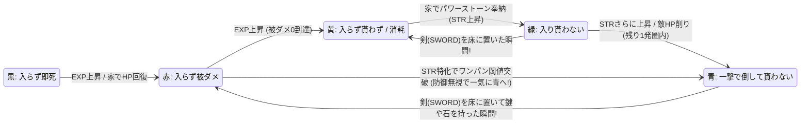
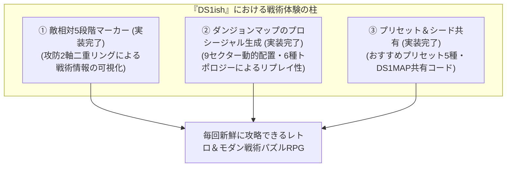

# 『DS1ish』 敵相対5段階マーカー & 戦術可視化UI設計資料

> [!NOTE]
> **実装ステータス**:
> - **敵相対5段階マーカー機能 (`ThreatEvaluator.ts`, Canvas描画, HUD表示, `[T]`トグル)**: **【✅ 実装完了】**（詳細: [`docs/status/current_features.md`](../../status/current_features.md#3-戦闘--タクティカル脅威度マーカーモダン機能-srcsystems-srcview)）
> - **ダンジョンマップのプロシージャル生成（6種トポロジー × 9セクター動的配置 × プリセット共有）**: **【✅ 実装完了】**（詳細: [`docs/procedural_generation_spec.md`](../../procedural_generation_spec.md)）
> - **抽象色マーカーパズルへのスピンオフ検討**: **【📋 将来構想】**

本書は、1984年 PC-8801版『ドラゴンスレイヤー (Level 2.0)』へのリスペクト・オマージュ作品である『DS1ish』において、原作のプレイ体験が持つ**「自己ステータスの動的変化によって敵の意味が5段階に書き換わるリソース管理パズル」**という魅力を分析し、それを視覚化する**「敵相対マーカー（Tactical Threat Marker）」**の設計と、プロシージャル生成マップとの相乗効果をまとめた設計資料である。

---

## 目次

1. [コアコンセプト：アクションRPGから「動的リソース管理パズル」への再定義](#1-コアコンセプトアクションrpgから動的リソース管理パズルへの再定義)
2. [敵の相対評価モデル（攻防2軸 3×3マトリクスと二重マーカー）](#2-敵の相対評価モデル攻防2軸-33マトリクスと二重マーカー)
3. [盤面がリアルタイムに書き換わる「動的相対性」のメカニズム](#3-盤面がリアルタイムに書き換わる動的相対性のメカニズム)
4. [「敵相対マーカー」UI/UX実装仕様案（二重マーカー構造）](#4-敵相対マーカーuiux実装仕様案二重マーカー構造)
5. [「敵相対マーカー × プロシージャルマップ生成」のシナジー](#5-敵相対マーカー--プロシージャルマップ生成のシナジー)
6. [発展構想：純粋な「色マーカーパズル」への抽象化・スピンオフ案](#6-発展構想純粋な色マーカーパズルへの抽象化スピンオフ案)

---

## 1. コアコンセプト：アクションRPGから「動的リソース管理パズル」への再定義

### 1.1 プレイ体験の本質
フィールド探索型アクションRPGに見える本作を深くプレイしていくと、その実態は**「刻々と変化する自己のステータス（`STR` / `EXP` / `HP` / 所持アイテム）に応じて、フィールド上の敵が相対的に5種類の役割（フェーズ）へ変化し、それをどう判断して消化・回避していくかを競うリソース管理パズル」**であることに気づく。

### 1.2 確定計算と「一撃撃破（ワンパン）無反撃」が生むパズル性
本作の戦闘処理（`CombatSystem.ts`）には乱数が存在せず、以下の確定ルールによって支配されている。

1. **プレイヤー与ダメージ**:
   $$\text{DamageToEnemy} = \max(1, \text{EffectiveAtk} - \text{Enemy.def})$$
   （※剣 `SWORD` 所持時は $\text{EffectiveAtk} = \text{STR} + 1000$、非所持時は $\text{EffectiveAtk} = 10$ 固定）
2. **プレイヤー被ダメージ（敵反撃・接触時）**:
   $$\text{DamageToPlayer} = \max(0, \text{Enemy.atk} - \text{Player.experience})$$
3. **先制一撃撃破（ワンパン）時の反撃スキップ**:
   プレイヤーの体当たりで敵の残りHPが $0$ 以下になった場合、**敵の反撃ターンおよび特殊能力（STR吸収・EXP吸収・壺強奪）は一切発生しない**。

この3つのルールにより、すべての敵は「絶対的な強さ（ID順）」ではなく、**「今の自分が触ったときにどうなるか」という相対的な5つの状態**に分類される。

---

## 2. 敵の相対評価モデル（攻防2軸 3×3マトリクスと二重マーカー）

### 2.1 課題と進化の背景：1軸評価の落とし穴と「逃走AI（FLEE）」複合トラップ

従来の1軸5段階判定では、プレイヤーから殴れば1発（`turnsToKill === 1`）の敵を最優先で無条件に「空色 (`ONE_SHOT`)」と判定していました。
しかし、実際のプレイでは以下の重大なUX・設計上の課題が生じていました。

1. **「一撃だが一撃（ガラスの剣）」と「一撃だが貰う」の欠落**:
   - 接近ミスにより**敵から先制攻撃を受けた場合**、敵の通常攻撃がヒットします。
   - 攻撃力特化育成（STR高・EXP低）時に、**「自分から殴れば一撃だが、相手から触れられたら即死する敵（一撃だが一撃）」** や **「一撃だが手痛い反撃・能力吸収を貰う敵」** までが「最も安全そうな空色」と表示され、危険度の錯覚から初見殺しを誘発していました。
2. **逃走AI（`FLEE`）との複合トラップ**:
   - 剣所持でプレイヤー攻撃力が敵DEFを上回ると敵は逃走（`FLEE`）モードに入ります。プレイヤーは「空色＋逃げる＝完全な雑魚」と錯覚して前のめりに追走します。
   - しかし、逃げる敵を追走するシチュエーション（壁際・袋小路での反転やすれ違い、曲がり角）こそが「敵から先に触られる接近ミス」を最も誘発し、不意の一撃即死を招いていました。

---

### 2.2 攻撃視点×防御視点の2軸（3×3マトリクス）再定義

従来の判定を「攻撃視点（倒しやすさ）」と「防御視点（被弾・即死リスク）」の2軸へと拡張します。

```
                       【 防 御 視 点 (被弾・反撃リスク) 】
                 NO_DAMAGE (貰わない)   TAKES_DAMAGE (貰う)     LETHAL (即死)
  ┌────────────┬──────────────────────┬──────────────────────┬──────────────────────┐
攻│ ONE_SHOT   │ ① 一撃・貰わない    │ ② 一撃だが貰う       │ ③ 一撃だが一撃       │
撃│ (一撃撃破) │ (真の安全ボーナス)   │ (追走・被弾注意)     │ (ガラスの剣・先手必須)│
視├────────────┼──────────────────────┼──────────────────────┼──────────────────────┤
点│ EFFECTIVE  │ ④ 安全リソース       │ ⑤ 消耗トレード       │ ⑥ 危険な撃ち合い     │
  │ (有効打あり│ (SAFE: 稼ぎ対象)     │ (HPを払ってEXP獲得)  │ (先に殴り倒せるか?)  │
  ├────────────┼──────────────────────┼──────────────────────┼──────────────────────┤
  │ INEFFECTIVE│ ⑦ 膠着壁             │ ⑧ 高コスト障害物     │ ⑨ 移動する即死壁     │
  │ (通らない) │ (STALEMATE: 邪魔な壁)│ (DANGER: スルー推奨) │ (LETHAL: 絶対回避)   │
  └────────────┴──────────────────────┴──────────────────────┴──────────────────────┘
```

#### 軸の定義
- **攻撃視点 (`AttackThreat`)**:
  - `ONE_SHOT`: 一撃撃破（与ダメ $\ge$ 敵HP）
  - `EFFECTIVE`: 有効打（2〜6発以内で撃破可能 & 与ダメ $> 1$）
  - `INEFFECTIVE`: 通らない（1ダメまたは撃破に7発以上）
- **防御視点 (`DefenseThreat`)**:
  - `NO_DAMAGE`: 貰わない（被ダメ 0 かつ STR/EXP吸収・壺強奪なし）
  - `TAKES_DAMAGE`: 貰う（$0 < \text{被ダメ} < \text{プレイヤーHP}$、または特殊能力被害あり）
  - `LETHAL`: 即死（被ダメ $\ge$ プレイヤーHP）

これにより、同じワンパン圏内でも以下の3状態を完全に識別可能になります。
1. **一撃・貰わない (`ONE_SHOT` × `NO_DAMAGE`)**: 真の安全ボーナス
2. **一撃だが貰う (`ONE_SHOT` × `TAKES_DAMAGE`)**: 追走時の被ダメ・能力吸収に注意が必要（`isRiskyOneShot`）
3. **一撃だが一撃 (`ONE_SHOT` × `LETHAL`)**: ガラスの剣。先手必勝だが、触れられたら即死（`isLethalOneShot`）

---

### 2.3 判定アルゴリズムと詳細評価API（TypeScript）

```typescript
export type AttackThreat = 'ONE_SHOT' | 'EFFECTIVE' | 'INEFFECTIVE';
export type DefenseThreat = 'NO_DAMAGE' | 'TAKES_DAMAGE' | 'LETHAL';

export interface ThreatEvaluationDetails {
  attackThreat: AttackThreat;
  defenseThreat: DefenseThreat;
  isRiskyOneShot: boolean;   // ONE_SHOT かつ TAKES_DAMAGE
  isLethalOneShot: boolean;  // ONE_SHOT かつ LETHAL（一撃だが一撃）
  turnsToKill: number;
  damageToEnemy: number;
  damageToPlayer: number;
  hasDrain: boolean;
  overallThreat: ThreatLevel; // 既存互換（ONE_SHOT / SAFE / STALEMATE / DANGER / LETHAL）
}

export class ThreatEvaluator {
  public static evaluateThreatDetails(
    player: ThreatPlayerStats,
    enemy: ThreatTargetStats,
    mitigationRatio: number = 1.0
  ): ThreatEvaluationDetails {
    // 十字架所持時は攻撃不可・被ダメ0
    if (player.holdItem === 'CROSS') {
      return {
        attackThreat: 'INEFFECTIVE',
        defenseThreat: 'NO_DAMAGE',
        isRiskyOneShot: false,
        isLethalOneShot: false,
        turnsToKill: Infinity,
        damageToEnemy: 0,
        damageToPlayer: 0,
        hasDrain: false,
        overallThreat: 'STALEMATE',
      };
    }

    const dmgToEnemy = Math.max(1, player.effectiveAttack - enemy.def);
    const turnsToKill = Math.ceil(enemy.hp / dmgToEnemy);
    const effectiveDefense = Math.floor(player.experience * mitigationRatio);
    const rawDmgToPlayer = Math.max(0, enemy.atk - effectiveDefense);
    const hasDrain =
      (enemy.drainAtk !== undefined && enemy.drainAtk > 0) ||
      (enemy.drainExp !== undefined && enemy.drainExp > 0) ||
      (Boolean(enemy.stealPotion) && player.magic > 0);

    // 攻撃視点
    let attackThreat: AttackThreat = 'INEFFECTIVE';
    if (turnsToKill === 1) {
      attackThreat = 'ONE_SHOT';
    } else if (dmgToEnemy > 1 && turnsToKill <= 6) {
      attackThreat = 'EFFECTIVE';
    }

    // 防御視点
    let defenseThreat: DefenseThreat = 'NO_DAMAGE';
    if (rawDmgToPlayer >= player.hp) {
      defenseThreat = 'LETHAL';
    } else if (rawDmgToPlayer > 0 || hasDrain) {
      defenseThreat = 'TAKES_DAMAGE';
    }

    const isRiskyOneShot = attackThreat === 'ONE_SHOT' && defenseThreat === 'TAKES_DAMAGE';
    const isLethalOneShot = attackThreat === 'ONE_SHOT' && defenseThreat === 'LETHAL';

    // 既存互換 overallThreat
    let overallThreat: ThreatLevel = 'DANGER';
    if (turnsToKill === 1) {
      overallThreat = 'ONE_SHOT';
    } else if (defenseThreat === 'LETHAL') {
      overallThreat = 'LETHAL';
    } else if (attackThreat === 'EFFECTIVE' && defenseThreat === 'NO_DAMAGE') {
      overallThreat = 'SAFE';
    } else if (
      (attackThreat === 'INEFFECTIVE' && defenseThreat === 'NO_DAMAGE') ||
      (attackThreat === 'EFFECTIVE' && defenseThreat === 'TAKES_DAMAGE')
    ) {
      overallThreat = 'STALEMATE';
    }

    return {
      attackThreat,
      defenseThreat,
      isRiskyOneShot,
      isLethalOneShot,
      turnsToKill,
      damageToEnemy: dmgToEnemy,
      damageToPlayer: rawDmgToPlayer,
      hasDrain,
      overallThreat,
    };
  }
}
```

---

### 2.4 二重マーカー方式（外枠リング ＋ 中心コア/警告脈動エフェクト）

この3×3マトリクスを直感的に伝えるため、足元マーカーを二重構造（外枠リング＋中心警告コア）でレンダリングします。

1. **外枠リング（攻撃視点：倒しやすさ）**:
   - 空色 (`#00eeff`): `ONE_SHOT`（一撃撃破可能）
   - 緑 (`#00dd66`): `SAFE` / `EFFECTIVE`（有効打あり）
   - 黄 (`#ffcc00`): `STALEMATE`（膠着・HPトレード）
   - 赤 (`#ff2244`): `DANGER`（危険）
   - 黒 (`#111111` + 赤枠): `LETHAL`（即死壁）
2. **中心コア / 警告エフェクト（防御視点：被弾リスク）**:
   - `NO_DAMAGE`: 追加コアなし（または安全な白/水色コア）
   - `TAKES_DAMAGE`: 内側に**黄色／アンバーの警告コア**を表示（追走時の被ダメ・能力吸収注意）
   - `LETHAL`: 内側に**赤黒く脈打つ（点滅）警告コア**を表示！
     - 外枠が空色（`ONE_SHOT`）であっても、中心に赤黒の死神コアが明滅することで、**「一撃だが触れられたら即死（ガラスの剣）」** が一目でプレイヤーに伝わります。

---

## 3. 盤面がリアルタイムに書き換わる「動的相対性」のメカニズム

通常のパズルゲームでは「赤いコマは最後まで赤」だが、本作の面白さは**プレイヤーの行動1つで盤面上の敵の色（意味）がリアルタイムに変化する**点にある。



### 3.1 変化を引き起こす4つのトリガー
1. **剣（`SWORD`）の着脱による盤面の一斉反転【最重要メカニクス】**:
   - 本作は「アイテムを1つしか持てない（`holdItem`）」。
   - 剣を持って戦っているときは周囲の敵が「青」や「緑」に見えているが、宝箱を開けるために**剣を床に置いて鍵（`KEY`）やパワーストーン（`POWER_STONE`）を持った瞬間、攻撃力が `10` 固定になるため、周囲の敵が一斉に「黄」「赤」「黒」の障害物へと反転**する。
   - 「どこに剣を置き、どのルートなら赤や黄の敵に塞がれずに家と宝箱を往復できるか」という**運搬パズル**が視覚的に明快になる。
2. **敵にダメージを与えた瞬間の変化（緑/黄 $\rightarrow$ 青）**:
   - 最初は3発かかる「緑」の敵も、2発殴って「あと1発で倒せるHP」になった瞬間、マーカーが「青（次の一手で反撃を受けずに消せる）」に変わる。
3. **パワーストーン奉納・EXP蓄積による成長変化（黒 $\rightarrow$ 赤 $\rightarrow$ 緑 $\rightarrow$ 青）**:
   - 家に帰ってステータスが上がった瞬間、今まで通路を塞いでいた「赤」の敵が「緑」や「青」に変わり、**行動可能エリア（パズルの開拓領域）が広がったこと**が一目で実感できる。
4. **被弾によるHP減少での危険度変化（赤/黄 $\rightarrow$ 黒）**:
   - 自分の残りHPが減ると、それまで耐えられた敵が「黒（次の一撃で即死）」に変わり、家に帰還すべきタイミング（撤退ライン）が視覚的に警告される。

---

## 4. 「敵相対マーカー」UI/UX実装仕様案（二重マーカー構造）

レトロなドット絵の雰囲気を壊さず、かつモダンな戦術パズルとしての視認性を高めるため、以下の二重構造レイヤーで実装する。

### 4.1 フィールド上のモンスター足元マーカー（二重マーカー方式）
足元の黒い楕円シャドウを拡張し、**「外枠リング（攻撃視点）」＋「中心コア／脈動警告（防御視点）」の二重マーカー**として描画する。

1. **外枠リング（攻撃視点：倒しやすさ）**:
   - **青 / 水色 (`ONE_SHOT`)**: シアンブルーの輝くリング (`#00eeff`)。1手で消せる。
   - **緑 (`SAFE`)**: エメラルドグリーンのリング (`#00dd66`)。有効打ありで安全に倒せる。
   - **黄 (`STALEMATE`)**: アンバーイエローのリング (`#ffcc00`)。時間浪費またはHPトレード注意。
   - **赤 (`DANGER`)**: クリムゾンレッドのリング (`#ff2244`)。交戦非推奨・高コスト。
   - **黒 (`LETHAL`)**: 漆黒＋赤枠 (`rgba(12, 12, 12, 0.9)` + `#ff1133`)。即死壁。
2. **中心コア／警告エフェクト（防御視点：被弾・即死リスク）**:
   - **NO_DAMAGE**: クリアな内面（ワンパン時は中央に白/水色の発光ドット）。
   - **TAKES_DAMAGE**: 内側に**黄色／アンバーの警告コア**を表示。追走時の被ダメや能力吸収リスクを明示。
   - **LETHAL**: 内側に**赤黒く明滅・脈動する警告コア**を表示！
     - 特に「一撃だが一撃（ガラスの剣）」では、外枠が空色（一撃撃破可能）のまま内部に赤黒の死神コアが点滅し、**「先手必勝だが、触れられたら即死」** という極限状態を直感的に伝達。

### 4.2 対峙HUD（ターゲットインフォ）のバッジ表示
モンスター接触・対峙時の情報パネルにも、ワンパン時の被弾/即死リスクを明確に反映する。
- `⚡ ONE-SHOT (SAFE)`: 一撃撃破可能（先制被弾なし・完全安全）
- `⚡⚠️ 1-SHOT (RISKY)`: 一撃撃破可能だが、追走時等の被弾・能力吸収あり
- `⚡💀 1-SHOT (LETHAL)`: 一撃撃破可能だが、敵先制攻撃で即死（ガラスの剣・先手必須）

### 4.3 表示モードの切り替え（Retro / Tactical）
プレイヤーの好みに応じて、HUDボタンまたはショートカットキー `[T]` で切り替え可能。
- **TACTICAL（モダン標準）**: 足元二重マーカー＋対峙HUDに詳細評価バッジを表示。
- **RETRO（原作再現）**: 通常の黒シャドウのみ（数値を自分で読んで暗算するクラシック体験）。

---

## 5. 「敵相対マーカー × プロシージャルマップ生成」のシナジー

原作の奥深いゲームルールに、現代的な戦術可視化UIとランダムマップ生成を組み合わせることで、毎回新鮮に遊べるパズル体験を実現している。



### 5.1 なぜ「敵相対マーカー × プロシージャルマップ」の相性が抜群なのか？
- プロシージャル（ランダム自動生成）マップ単体では、「毎回地形や敵配置が違うため、初見でどこを通ればいいか分からず理不尽に感じる」という問題が起きやすい。
- そこに**「敵相対マーカー」**が加わると、ランダム生成された未知のダンジョンであっても**「今は緑の敵がいる北ルートから消化してEXPを稼ぎ、赤の敵が塞ぐ東ルートは後回しにしよう」**という盤面読解が瞬時に行えるようになり、ランダムマップが**毎回納得感を持って解ける戦術パズル**として成立する。

### 5.2 実装状況の整理

| カテゴリ | クラシック体験（RETROモード） | モダン拡張（TACTICALモード / 標準搭載） | ステータス |
| :--- | :--- | :--- | :---: |
| **コアUI / 体験** | 数値表示＋黒シャドウ（暗算による判断） | **攻防2軸・敵相対5段階マーカー（Tactical Ring）**を表示（`[T]` でRETRO表示と切替可） | ✅ 実装完了 |
| **マップ構造** | 固定ステージマップ | **全域9セクター動的配置・6種トポロジー・4種アーキタイプのプロシージャルマップ生成** | ✅ 実装完了 |
| **シード共有** | なし | `MapPresetManager` によるおすすめプリセット5種と `DS1MAP:` 1行共有コード | ✅ 実装完了 |

---

## 6. 発展構想：純粋な「色マーカーパズル」への抽象化・スピンオフ案

さらにこの「5段階の相対変化」という面白さだけを純粋抽出すると、RPGの複雑な数値を完全に隠蔽（または1桁〜2桁に圧縮）した**ミニマルな色マーカーパズルゲーム**としても成立する。

### ルール単純化の骨子
1. **盤面**: 敵はすべて「色付きマーカー（青・緑・黄・赤・黒）」と「タイプ（攻撃型・防御型・特殊型）」を持つコマとして配置される。
2. **成長と色変化**:
   - プレイヤーは「青（1手消化）」と「緑（安全消化）」のコマを回収することでゲージが溜まり、盤面全体のコマの色が1段階ずつ安全側（黒 $\rightarrow$ 赤 $\rightarrow$ 黄 $\rightarrow$ 緑 $\rightarrow$ 青）へシフトする。
3. **剣置きギミック（パズルの核）**:
   - ゴールを開くための「鍵」や「王冠」を持つ間は「剣」を床に置かなければならない。
   - 剣を置いている間、盤面のすべての敵マーカーの色が **2段階危険側（青 $\rightarrow$ 黄、緑 $\rightarrow$ 赤）へシフト**する。
   - 「どの敵をあらかじめ掃除しておけば、剣を置いた帰り道でも詰まらずに拠点までアイテムを運べるか？」を解く、極めて独創的な**往復ルート構築パズル**となる。
