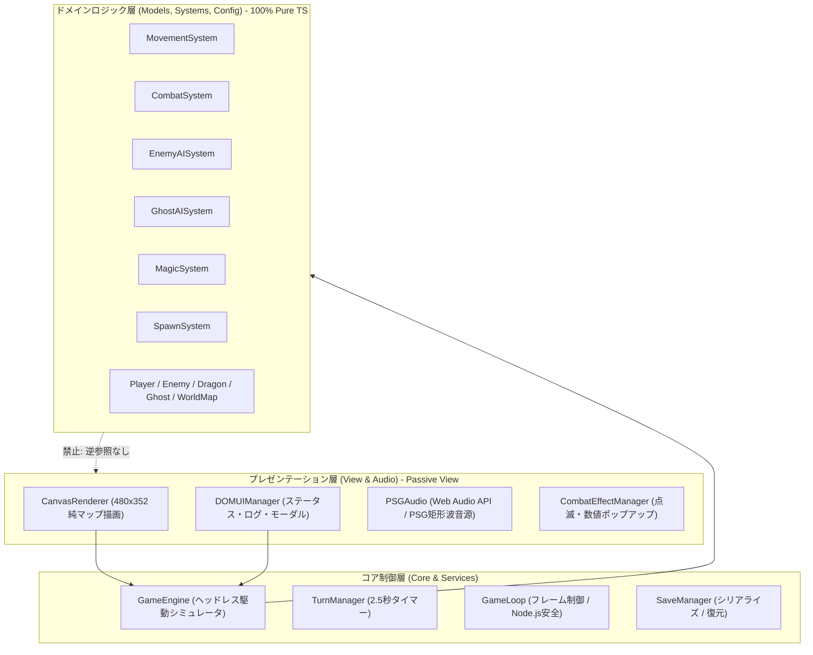
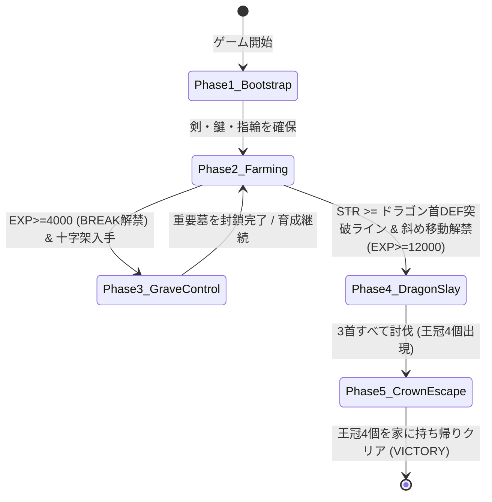
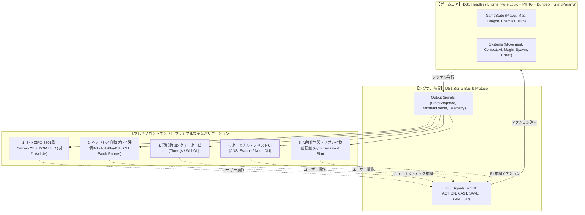

# 『DS1ish』 ヘッドレス評価シミュレータ & マルチフロントエンド構想仕様書

本書は、1984年 PC-8801版『ドラゴンスレイヤー (Level 2.0)』をベースとした拡張Web実装『DS1ish』における**「ゲームロジック・状態評価（コアエンジン・モデル・システム）」と「UI・描画・演出（DOM, Canvas, Web Audio）」の完全な関心事分離（Headless Decoupling）の実績**、**「自動プレイBotによる定量バランス評価シミュレータ基盤」**、および今後のマルチフロントエンド展開に向けた**リファクタリング仕様**を体系的にまとめた技術資料である。

---

## 1. ヘッドレス分離の実績と現状評価 (Current Architecture Status)

### 1.1 達成されたアーキテクチャ境界
2026年10月のアーキテクチャ検証により、以下の健全性が実証・担保されています。



### 1.2 ヘッドレス保証のポイント
1. **ドメインロジック層 (`src/models/`, `src/systems/`, `src/config/`) の完全純粋性**:
   - DOM API（`window`, `document`, `HTMLElement`, `HTMLCanvasElement`, `AudioContext` 等）への直接参照およびインポートが一切存在しない（0件）。
   - 全戦闘計算・反撃調停・モンスターAI・魔法効果・世界変化が Node.js 上で完全に独立実行可能。
2. **`GameEngine` の完全オプショナル結合**:
   - コンストラクタ引数 `canvas?: HTMLCanvasElement | null` のオプショナル化により、Canvas 要素が未指定（`new GameEngine()`）でも一切のモックなしで自律稼働。
   - `stepFrame(deltaMs)` メソッドにより、リアルタイム要素（ゴーストの滑空、ターンタイマー）を手動ステップ進行可能。
3. **継続的リント・自動検証テスト**:
   - `test/test-architecture-rules.ts`: モデル・システム層への DOM/View インポート混入を恒常的にブロック。
   - `test/test-headless-evaluation.ts`: 120ターン以上の連続自動駆動、戦闘・火炎弾被弾・撃破・死因トラッキング・ゲームオーバー判定を完全ノーモックで実証。

---

## 2. シミュレーション＆AI評価基盤に向けたコア・リファクタリング仕様 (Core Refactorings)

ヘッドレス環境での自動プレイシミュレーション（100〜1,000回規模の高速実行）や完全再現リプレイを実現するため、以下の3つの基盤リファクタリングを実施する。

---

### 提案 1: `GameEventBus` / `ViewNotifier` による完全イベント駆動化

#### 背景と課題
現在、`GameEngine` はビュー層への直接依存を避けているものの、内部コードで以下のようにプレゼンテーション層のメソッドを直接呼び出している：
```typescript
// 現在の GameEngine.ts 内の呼び出し
this.domUI?.addLog(`⚔ 体当たり攻撃命中！`, 'combat');
this.audio.playBumpCombat();
this.combatEffects.triggerPlayerAttack(targetPos, ...);
```
これにより、エンジンが「UIにログを出す」「音を鳴らす」「視覚エフェクトを発生させる」という具体的な演出手段を知ってしまっており、ヘッドレスシミュレーション時にドメインイベント（スポーン試行やアイテム排出結果など）を正確にフック・集計する上でもイベントバス化が望ましい。

#### 設計仕様
エンジンは純粋なドメインイベント（`GameEvent`）を発行（Publish）する責務のみを持ち、UI・描画・音声および**テレメトリ収集器（`SimulationTelemetry`）**はそれを購読（Subscribe）するイベント駆動アーキテクチャ（Pub/Sub）へ移行する。

```mermaid
flowchart LR
    Engine["GameEngine (Logic)"] -->|emit(event)| EventBus["GameEventBus"]
    EventBus -->|on(combat)| DOMUI["DOMUIManager (ログ追記)"]
    EventBus -->|on(combat)| PSGAudio["PSGAudio (効果音再生)"]
    EventBus -->|on(combat)| Effect["CombatEffectManager (エフェクト)"]
    EventBus -->|on(*)| Telemetry["SimulationTelemetry (統計・KPI収集)"]
```

```typescript
// イベント型定義 (src/core/GameEvents.ts)
export type GameEventMap = {
  'combat:playerAttack': { attacker: Player; target: EnemyInstance | DragonPart; damage: number; killed: boolean; expGained: number };
  'combat:enemyAttack': { enemy: EnemyInstance; damage: number; mitigatedByExp: number; killed: boolean; specialEffects?: string[] };
  'spawn:grave': { pos: Position; enemyTypeId: number; success: boolean; blockedByCap: boolean };
  'spawn:home': { pos: Position; headsKilled: number; success: boolean; blockedByCap: boolean; usedReserveSlot: boolean; evictedDistantEnemy: boolean };
  'chest:open': { pos: Position; stepMod8: number; itemSpawned: TileType; cappedFallbackFrom?: TileType };
  'ghost:action': { type: 'PICKUP' | 'DROP' | 'STEAL_FROM_PLAYER'; item: TileType; pos: Position };
  'player:move': { from: Position; to: Position; dir: Direction };
  'player:homeReturn': { result: HomeEventResult; turn: number; playerStr: number; playerExp: number };
  'dragon:headKilled': { headType: DragonPartType; remainingHeads: number; turn: number };
  'game:stateChange': { prev: GameState; current: GameState; turn: number; deathInfo?: DeathInfo };
};
```

---

### 提案 2: `SaveStorageDriver` インターフェースの導入（インメモリセーブ対応）

#### 背景と課題
従来の [`SaveManager.ts`](../../../src/services/SaveManager.ts) はブラウザの `localStorage` に依存していたため、純粋な Node.js 環境でも動作するよう抽象化を行う。

#### 設計仕様
ストレージ操作を抽象化するインターフェース（`SaveStorageDriver`）を導入し、ブラウザ環境では `BrowserLocalStorageDriver`、Node.js ヘッドレス環境では `InMemoryStorageDriver` を自動選択（またはDI）できるようにする。これにより、`SAVE` 魔法や中断再開のライフサイクルをヘッドレスシミュレーション内でも100%検証可能とする。

---

### 提案 3: 決定論的擬似乱数生成器 (PRNG / SeedRandom) の DI

#### 背景と課題
現在、敵の墓からのスポーン位置、ゴーストの乱数反射、初期敵配置の決定などに JavaScript 標準の `Math.random()` が直接使用されている。
このため、マップ生成シード（`ProceduralMapGenerator` の Mulberry32）を固定しても、プレイ中のモンスターの湧き方や動きが毎回変化してしまい、厳密なA/Bテスト（パラメータ変更前後の比較検証）やリプレイ再現ができない。

#### 設計仕様
シード付き擬似乱数生成器（`XorShiftRandom` / `Mulberry32`）を `GameEngine` および各システム（`SpawnSystem`, `EnemyAISystem`, `GhostAISystem`, `ChestSystem`）へ DI する。
- **同一マップシード ＋ 同一プレイ乱数シード ＋ 同一Botアルゴリズム（またはキー入力列）** を与えれば、何万ターンのシミュレーションであっても1ミリ秒の狂いもなく100%同一の結果が再現される決定論的（Deterministic）エンジンとする。

---

## 3. ヘッドレス自動プレイシミュレータ & 定量バランス評価基盤 (Headless Bot & Telemetry)

### 3.1 導入目的：感覚頼りの微調整から「データ駆動の全体バランス設計」へ
『ドラゴンスレイヤー』は「序盤の剣・鍵探索」「パワーストーン奉納による複利STR育成」「EXPによる魔法アンロックと被ダメ軽減」「首討伐後の家からの敵ラッシュと王冠4個運搬」という複数のフェーズが絡み合うゲームである。
[`procedural_variety_and_sandbox.md`](./procedural_variety_and_sandbox.md) で定義したトポロジー別の難易度パラメータ（`DungeonTuningParams`）を適正化するため、**描画なしのヘッドレス環境で自動プレイボット（`AutoPlayBot`）を100〜1,000回規模で高速実行し、統計メトリクス（KPI）からゲームバランスを定量診断する仕組み**を構築する。

---

### 3.2 ルールベース探索・戦闘AIボット (`AutoPlayBot`) のアーキテクチャ

強化学習（RL）のような学習コストをかけず、マップ生成直後やエディタ上で即座（数秒以内）にバランス評価を行えるよう、人間の攻略セオリーをステートマシン化した**フェーズ駆動型ヒューリスティックAI (`AutoPlayBot`)** を実装する。



#### 各フェーズの行動ロジック概要
1. **`Phase1_Bootstrap`（初期ブートストラップ）**:
   - BFS（幅優先探索）で最寄りの `SWORD` → `KEY` → `RING` の順に探索・回収。
   - 剣未所持時はすべての敵から逃走（距離最大化）。通路がブロックで塞がれている場合は指輪でプッシュ開拓。
2. **`Phase2_Farming`（育成＆宝箱開拓ループ）**:
   - `ThreatEvaluator`（5段階脅威度判定）を内部利用し、`ONE_SHOT`（青）または `SAFE`（緑）判定の敵のみを積極的に攻撃してEXPを稼ぐ。`DANGER`（赤）・`LETHAL`（黒）の敵からは退避または `FREEZE` 魔法で足止め。
   - 鍵所持時は未開封の宝箱へ向かい、可能な限り8歩周期（パワーストーン出現）を意識して開錠。パワーストーン入手時、または `HP < MaxHP * 0.35`（ピンチ時）、あるいは死神（`DEATH`）憑依時は直ちに我が家（`HOME`）へ帰還（`RETURN` 魔法解禁後は魔法帰還も活用）。
   - `EXP >= 4,000` で `BREAK` 魔法が解禁された後は、密室宝物庫やショートカットのブロック壁を掘削して行動範囲を広げる。
3. **`Phase3_GraveControl`（十字架による墓封鎖・陣取り）**:
   - `CROSS` を入手した場合、我が家〜ドラゴン間の主要導線近く、または墓密集地帯（パンドラゾーン）の開いた墓の上に十字架（または岩）を設置して湧き潰しを行う。
4. **`Phase4_DragonSlay`（ドラゴン首討伐フェーズ）**:
   - プレイヤーの `STR` がドラゴンの首DEFを上回り（有効打が通り）、かつ `EXP >= 12,000`（斜め移動習得済み）に到達したらドラゴン要塞へ進軍。
   - 火炎弾の直線射線（十字方向）を避け、安全地帯である斜め4マス `(cx±1, cy±1)` に陣取って3本の首を順次撃破する。HP減少時は `RETURN` 等で家に帰還して回復。
5. **`Phase5_CrownEscape`（王冠回収・クライマックス脱出フェーズ）**:
   - 全首撃破後に出現する4個の王冠（`CROWN`）を順次拾い、我が家へ運搬して奉納する。
   - **重要ルール検証**: 王冠所持中は全魔法が封印されるため、我が家から湧き出すモンスター群（`spawnFromHome`）を徒歩・斜め移動・事前開拓したトンネルだけで突破して家に辿り着けるかがテストされる。

#### プレイヤースキル別プロファイル (`BotSkillProfile`)
調整対象のターゲット層に合わせて、Botの判断精度を3段階で切り替え可能にする：
- `'NOVICE'`（初心者モデル）: 8歩周期調整を行わず、斜め移動の活用や墓封鎖が甘い。
- `'STANDARD'`（標準プレイヤーモデル）: 脅威度マーカーに従い安全に戦い、適度にパワーストーンと魔法を活用する（バランス調整の基準）。
- `'EXPERT'`（熟練者モデル）: 8歩周期で確実にパワーストーンを引き、`BREAK` 最短掘削と十字架封鎖を最適に行う。

---

### 3.3 定量評価指標（KPI / テレメトリ項目）の仕様

100〜1,000回のバッチシミュレーション実行時、`SimulationRunner` は以下の統計データ（`SimulationReport`）を集計・出力する。特に**直近の3大課題を検証するための専用メトリクス**を重点計測する。

```typescript
export interface SimulationSummaryReport {
  config: {
    topology: string;
    difficulty: string;
    runs: number;
    maxTurnsLimit: number;
    botProfile: 'NOVICE' | 'STANDARD' | 'EXPERT';
    tuningParams: DungeonTuningParams;
  };

  // 1. 全体クリア・進行度・推定プレイ時間KPI
  overall: {
    winRate: number;                  // クリア率 (0.0 〜 1.0)
    avgClearTurns: number;            // クリア時の平均ターン数 (中央値・P10/P90含む)
    estimatedPlayTimeMinutes: number; // 人間がプレイした場合の推定クリア時間 (分) ※平均ターン数×操作テンポ係数から算出
    milestoneReachRates: {
      gotSword: number;               // 剣入手到達率
      unlockedBreakMagic: number;     // BREAK魔法(EXP 4,000)到達率
      unlockedDiagonalMove: number;   // 斜め移動(EXP 12,000)到達率
      killedHead1: number;            // 首1本目撃破率
      killedAllHeads: number;         // 全3首撃破率
      deliveredAtLeastOneCrown: number; // 王冠1個以上奉納率
    };
    deathCauses: Record<DeathCauseType | 'TIMEOUT_STALL', number>; // 死因・時間切れ内訳
  };

  // 2. 【課題1検証】スポーン＆「我が家からの敵湧き」健全性メトリクス
  homeSpawnMetrics: {
    totalHomeSpawnAttempts: number;   // 首討伐後の spawnFromHome 総試行回数
    homeSpawnSuccessRate: number;     // 実際に家から敵が湧いた成功率 (%)
    blockedByGlobalCapRate: number;   // 全体上限でブロックされた割合 (%) ★改善指標(目標: 0%)
    evictedDistantEnemyCount: number; // 遠方敵パージによる入れ替え湧き発動回数
    escapePhaseHomeThreatDensity: number; // 王冠運搬中の家周囲5マス以内の平均敵存在数
  };

  // 3. 【課題2検証】EXP / STR 成長カーブ＆戦闘二極化メトリクス
  progressionMetrics: {
    turnSeries: Array<{               // 200ターン刻みの成長推移スナップショット
      turn: number;
      medianExp: number;
      p90Exp: number;
      medianStr: number;
    }>;
    maxSingleKillExpJump: number;     // 1回の敵撃破で跳ね上がった最大EXP量 ★インフレ階段の検出
    combatOutcomeDistribution: {      // 全戦闘ターンの結果内訳
      zeroDamageTakenRatio: number;   // 被ダメージ0（完全無双）の割合
      moderateDamageRatio: number;    // 適度な削り合い（MaxHPの1%〜30%被弾）の割合 ★目標指標
      lethalOneShotDeathRatio: number;// 満タン近くから1〜2発で即死した割合
    };
  };

  // 4. 【課題3検証】非消耗アイテム排出＆ゴースト影響メトリクス
  resourceAndGhostMetrics: {
    avgItemsSpawnedPerRun: {
      cross: number;                  // 1プレイあたりの十字架総出現数（初期＋宝箱）
      ring: number;
      key: number;
      powerStone: number;
    };
    chestCapFallbackCount: number;    // 総数上限(maxCap)により装備品排出が抑制された回数
    gravesSealedByCrossRatio: number; // 全墓のうち十字架で封鎖された割合 (%)
    ghostInteractions: {
      itemsPickedUp: number;          // ゴーストが床アイテムを運搬した回数
      itemsStolenFromPlayer: number;  // プレイヤーから手持ちをひったくった回数
      sealedItemsRescued: number;     // 密室からゴーストが外へ運び出した回数
    };
  };
}
```

---

### 3.4 バランス合格基準（ターゲットKPIレンジ）とCLI実行

ヘッドレスシミュレータ（`npm run sim:balance` 等）を用いて、各トポロジーと `DungeonTuningParams` の組み合わせが以下の健全性レンジに収まるよう調整を行う：

| 評価項目 | 健全な目標レンジ (STANDARD Bot基準) | 異常値の兆候と調整アクション |
| :--- | :---: | :--- |
| **クリア率 (`winRate`)** | `40% 〜 70%` | 90%超なら簡単すぎ、10%未満なら初期導線詰みまたはSTR不足。 |
| **家湧き上限ブロック率 (`blockedByGlobalCapRate`)** | **`0% 〜 5% 以下`** | 現行仕様ではここが80%以上に張り付いて家が安全地帯化している。`homeSpawnReserveSlots` と遠方敵パージで 0% 近くへ改善する。 |
| **王冠脱出期の死亡割合** | 全死亡の `20% 〜 35%` | 首討伐後の脱出フェーズが適度にスリリングであることの証明。0%なら後半の湧きが温すぎる。 |
| **戦闘の適度な削り合い率 (`moderateDamageRatio`)** | `30% 以上` | 0%に近く「被ダメ0か即死か」しか無い場合は、`expCurveMode: 'DAMPED_POWER'` の減衰指数を調整して中間層を作る。 |
| **十字架による墓封鎖率 (`gravesSealedByCrossRatio`)** | `15% 〜 35% 以下` | 50%以上の墓が封鎖されている場合は十字架が出すぎているため、`cross.maxCap` を `1〜2` に引き下げる。 |
| **推定プレイ時間 (`estimatedPlayTimeMinutes`)** | `BLITZ`: **5〜10分** (`400〜800T`)<br/>`STANDARD`: **15〜25分** (`1,200〜2,000T`)<br/>`MARATHON`: **35〜60分** (`3,000〜5,000T`) | ユーザーが指定した「プレイ時間イメージ（`PlayPacingMode`）」と実測ターン数が乖離している場合、パワーストーン成長率やEXP倍率のプリセット係数を自動校正（キャリブレーション）する。 |

---

## 4. 『NetHack-wasm-webUI』型シグナル駆動・マルチフロントエンド構想 (Signal-Driven Multi-Frontend Architecture)

### 4.1 NetHack-wasm-webUI モデルとの対応
NetHackのWeb移植プロジェクト（`NetHack-wasm-webUI` 等）では、ゲームコアと入出力インターフェースをシグナル・メッセージストリームとして抽象化することで、2D、3D、ターミナル、AI学習環境など任意のクライアントを自在に差し替え可能としています。
本プロジェクトにおいても、上記の `GameEventBus`・決定論的PRNG・ヘッドレスBot評価基盤をさらに推し進め、入出力を純粋なデータシグナル（`DS1InputSignal` / `WorldStateSnapshot` / `TransientEventSignal`）として標準化することで、同一のマルチクライアント・アーキテクチャを実現します。



### 4.2 シグナルプロトコル（Signal Protocol）の基本設計

ゲームコアとクライアント間のやり取りは、すべて**直列化可能（Serializable）な純粋データシグナル**で完結します。

#### ① 入力シグナル (Input Signals)
クライアント（人間プレイヤーまたはAIボット）からコアへ送信されるコマンド：
```typescript
export type DS1InputSignal =
  | { type: 'MOVE'; dir: Direction }
  | { type: 'SPACE_ACTION' }
  | { type: 'CAST_MAGIC'; index?: number }
  | { type: 'STEP_FRAME'; deltaMs: number }
  | { type: 'GIVE_UP' }
  | { type: 'SAVE' }
  | { type: 'RESET'; preset?: MapPresetData };
```

#### ② 出力シグナル (Output Signals: StateSnapshot & Events)
コアからクライアントへ毎ターン・毎フレームブロードキャストされる情報：
```typescript
// 1. 静的・構造的状態スナップショット（レンダリングおよびBot観測用）
export interface WorldStateSnapshot {
  turn: number;
  state: GameState;
  player: {
    pos: Position;
    dir: Direction;
    hp: number;
    maxHp: number;
    exp: number;
    str: number;
    gold: number;
    holdItem: HoldItemType;
    hasSword: boolean;
    isFlying: boolean;
    hasDeath: boolean;
  };
  visibleTiles: { pos: Position; base: TileType; obj: TileType; item: TileType }[];
  enemies: { id: string; pos: Position; typeId: number; symbol: string; color: string; hp: number; maxHp: number }[];
  dragon: { centerPos: Position; heads: { type: DragonPartType; pos: Position; hp: number; isAlive: boolean }[]; fireballs: Position[] };
  ghosts: { pos: Position; holdingItem?: TileType }[];
  targetEnemy: TargetEnemyInfo | null;
}

// 2. 瞬間的過渡イベント（演出・効果音・ログ・テレメトリ集計用）
export type TransientEventSignal =
  | { type: 'COMBAT_HIT'; pos: Position; damage: number; isPlayerAttacker: boolean; killed: boolean }
  | { type: 'FIREBALL_SHOT'; pos: Position; dir: Direction }
  | { type: 'WARP_TRIGGERED'; from: Position; to: Position }
  | { type: 'HOME_HEAL'; newHp: number; goldConverted: number; strGained: number }
  | { type: 'SOUND_EFFECT'; cue: 'bump' | 'damage' | 'magic' | 'home' | 'fireball' | 'gameover' | 'fanfare' }
  | { type: 'LOG_APPEND'; text: string; level: 'info' | 'combat' | 'magic' | 'warn' | 'fatal' | 'success' };
```

### 4.3 実現可能となる具体的な展開

1. **超高速バランス検証＆強化学習環境 (Bot Sim / Gym Environment)**:
   - レンダリングやFPS制限（16.6ms）を一切行わず、メモリ上だけで数万ターン/秒の超速シミュレーションを実行。
   - `AutoPlayBot` による100〜1,000試合の統計バランス診断や、MCTS/強化学習によるパズル最短解法の自動発見が可能。
2. **完全リプレイ＆タイムトラベル（Undo / Rewind）**:
   - ダンジョンプリセット設定（`MapPresetData`）＋プレイ乱数シード＋入力シグナル列を保存するだけで、わずか数KBのデータで何万ターンものゲームプレイを完全再現。
   - Botシミュレーションで発見された「特異な詰みパターン」や「極端なインフレ挙動」のシード＆リプレイをブラウザ上で視覚的に再生・デバッグ可能。
3. **モダン 3D / Isometric クライアント・CUI クライアント**:
   - Canvas 2D描画コードに手を加えることなく、Three.js を使ったクォータービュー3Dフロントエンドや、Node.js コンソール上で動くレトロな ANSI CUI クライアントを別コンポーネントとして容易に実装可能。
