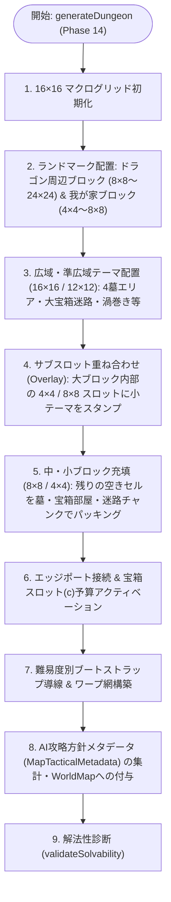
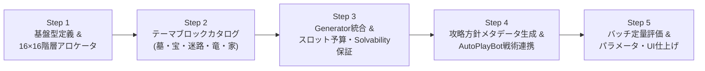

# 『DS1ish』 マルチスケール・テーマブロック階層合成 ＆ AI攻略方針メタデータ連携 設計書・実装ロードマップ

- **対象フェーズ**: Phase 14 (Hierarchical Theme Block Generation & Tactical Metadata Integration)
- **関連モジュール**:
  - `src/systems/ProceduralMapGenerator.ts`
  - `src/models/WorldMap.ts`
  - `src/models/Types.ts`
  - `src/ai/AutoPlayBot.ts`
  - `src/ai/tactics/GraveSealTactics.ts`
  - `src/ai/tactics/HomeRelocationTactics.ts`

---

## 1. 背景と目的

### 1.1 現行プロシージャル生成（Phase 9〜12）の課題
現行の `ProceduralMapGenerator` は、64×64空間を3×3（9セクター）に分割した上で、以下の処理を別々のパスで実行している：
1. セクター単位の均一なトポロジー（部屋枠、柱グリッド、迷路等）の描画
2. 座標ランダム抽選による墓（`GRAVE`）と隣接1ブロックの散布（`placeGravesWithBlocks`）
3. 座標ランダム抽選による宝箱（`CHEST`）の補充（`placeChestsAcrossMap`）
4. 空き空間へのランダムな岩塊散布（`densifyOpenAreas`）

この方式はクリア可能性（Solvability）を確実に満たす一方で、**「地形（壁）とオブジェクト（墓・宝箱）が無関係にランダム配置されるため、プロシージャル特有のランダムブロック感（ノイズ感）が強い」**という課題があった。

### 1.2 Phase 14 のコアコンセプト
`AutoPlayBot` の自律攻略・評価能力が成熟したことを受け、マップ生成を**「人間が意図を持って設計したようなパズル性と構造美を持つダンジョン」**へと進化させる。

1. **4×4最小単位・全体16×16グリッドのマルチスケール・テーマブロック合成**:
   - 64×64マスを最小単位 `4×4`（全体 `16×16` セル＝256セル）の基準グリッドとして定義。
   - `24×24`, `16×16`, `12×12`, `8×8`, `4×4` の各サイズの「テーマブロック（墓・宝箱部屋・迷路・ドラゴン要塞・拠点）」を用意し、**広域テーマを大きく配置した後に細かいテーマを重ねて埋める（階層パッキング＆サブスロット・オーバーレイ）**方式へ刷新する。
2. **「ランダム散布」から「意味のある構造スロット配置」への転換**:
   - 墓の周囲にあらかじめ数手で封鎖できるブロック群をセットしたり、宝箱部屋と迷路を組み合わせて凹凸のある複雑な外形を形成し、無意味なランダム岩・ランダム宝箱の散布を排除する。
3. **生成時における `AutoPlayBot` への攻略方針（戦術メタデータ）付与**:
   - ジェネレータが配置したテーマブロックの設計意図（全体の推奨戦略チューニング、および各墓ブロックの封鎖チョークポイント・岩押し手順ヒント・推奨引越しアンカー等）を `MapTacticalMetadata` として `WorldMap` に同梱し、`AutoPlayBot` の攻略・評価精度を飛躍的に高める。

---

## 2. 空間グリッド体系と階層合成アーキテクチャ

### 2.1 16×16 マクロセル座標系（基準単位: 4×4 タイル）
- **ワールド全体**: $64 \times 64$ タイル（トーラス構造）
- **最小ブロック単位**: $4 \times 4$ タイル ＝ マクログリッド上の $1 \times 1$ セル
- **マクログリッド全体**: $16 \times 16$ セル（`cellX: 0..15`, `cellY: 0..15`、タイル座標 $(x, y) = (\text{cellX} \times 4 + dx, \text{cellY} \times 4 + dy)$）

| ブロックサイズ (タイル) | セル換算 (4×4基準) | 主な用途・テーマ分類 |
| :---: | :---: | :--- |
| **`24×24`** | `6×6` セル | **超広域ランドマーク**: 大宝物殿ドラゴン城塞、複合大迷宮エリア |
| **`16×16`** | `4×4` セル | **広域テーマ**: 4墓複合ネクロポリス、宝部屋鎮座ドラゴン要塞、大渦巻き迷宮、大宝物庫＋外周迷路 |
| **`12×12`** | `3×3` セル | **準広域テーマ**: L字/T字の複雑外形宝箱部屋＋迷路、中規模迷路潜伏ドラゴンコア |
| **`8×8`** | `2×2` セル | **中規模ギミック**: L字4角・4出口の箱型墓（通路含む）、中規模8歩チェーン宝箱部屋、小型迷路ドラゴン、拡張スタート拠点 |
| **`4×4`** | `1×1` セル | **最小ギミック**: 数手封鎖パズル墓、小宝箱部屋（アルコーブ）、幅1マス迷路ピース、十字路・クランク通路、ワープ小祠 |

### 2.2 「大→中→小」階層アロケーション＆オーバーレイ（重ね合わせ）フロー



1. **マクロ配置（大ブロック優先）**:
   - まず16×16セル空間上に、ドラゴン周辺テーマ（`24×24`, `16×16`, `12×12`, `8×8` から選出）と我が家テーマ（`4×4` または `8×8`）を十分なトーラス離隔距離（$D_{\text{torus}} \ge 20$）を確保して配置する。
   - 続けて `16×16` や `12×12` の大型テーマブロック（4墓テーマ、大宝箱部屋＋迷路、スパイラル等）を配置する。
2. **サブスロット・オーバーレイ（大テーマの中に小テーマを重ねる）**:
   - `24×24` や `16×16`、`12×12` の広域テンプレートは、内部に **`SUB_SLOT`（4×4 または 8×8 の入れ子領域）** を持つことができる。
   - 例：`16×16` の「複合迷路ブロック」の中にある2つの `4×4` サブスロットに対し、後から「`4×4` 数手封鎖墓ブロック」や「`4×4` 宝箱小部屋」を重ねてスタンプする。これにより、巨大な構造物の中に緻密なミクロパズルが自然に融合する。
3. **エッジ接続ポート規約（Edge Ports）**:
   - 各 `4×4` セル境界（4マス幅：インデックス `0, 1, 2, 3`）において、中央寄りの **`1` または `2`** を標準通路ポートとして設計する。
   - ブロックの回転（0°/90°/180°/270°）・反転時にもポート整合性を保つことで、ブロック間の通路が自然に繋がり、既存の壁をランダムに破壊する後処理を最小化する。

---

## 3. テーマブロック別の詳細設計カタログ

### 3.1 墓テーマブロック（4×4 / 8×8 / 16×16）

> [!IMPORTANT]
> **モンスターの8方向移動と封鎖条件の整合性**
> `EnemyAISystem` では敵は斜めを含む8方向へ移動し、斜めの角隙間（`# . / . #`）もすり抜ける。また `SpawnSystem` では墓の上に敵が1体居座る（周囲8マスすべてが塞がれて外へ出られない）か、箱の出口がすべて塞がれることで追加スポーンや外への流出が完全に止まる。そのため、墓テーマの囲い壁は**角マスを閉じたL字・箱型**を基本とする。

#### (A) `4×4` 墓テーマ：数手順で埋められるミニ倉庫番パズル
墓の周囲8マスのうち、最初から5〜7マスが `BLOCK` や `CHEST` で囲まれており、残りの開口部のすぐ外側に「押し込み用の可動 `BLOCK`」が用意されている構造。

```text
【パターンA1: 1手押し＋1十字架封鎖】    【パターンA2: 2手L字プッシュ封鎖】
  0 1 2 3                                0 1 2 3
0 . # . .  ← (1,0)の#を南へ押すと        0 . . # .  ← (2,0)を南へ、(0,2)を東へ
1 # . # .    (1,1)が埋まる               1 . # . #    押せば墓(2,2)の周囲が
2 # G # .  ← 残る(1,3)は下から岩を押すか 2 # . G #    すべて埋まる！
3 # . # .    CROSS設置で完全封鎖         3 . # # #
```

#### (B) `8×8` 墓テーマ：L字4つ角・4方向出口の箱型墓（外周通路つき）
中央に墓があり、斜め抜けを防ぐ**L字の4つ角（計12マスの箱壁）**で囲まれ、上下左右の4箇所に幅1マスの出口がある構造（最外周1マスは周回通路）。

```text
【パターンB1: 8×8 四方出口・L字角ボックス墓】
  0 1 2 3 4 5 6 7
0 . . . # . . . .   ← 外周は通路（.）と栓用の可動ブロック（#）
1 . # # . # # . .   ← 四隅は必ず角を閉じたL字壁（斜め抜け防止）
2 . # . . . # . #   ← 北(3,1)・南(3,5)・西(1,3)・東(5,3)の4箇所が出口
3 # . . G . . . .   ← 【攻略法1】外周の4つの#を押して4出口に栓をする（4手で箱ごと隔離！）
4 . # . . . # . .   ← 【攻略法2】箱の中に入ってGの周囲や出口にCROSS/FREEZEを置く
5 . # # . # # . .
6 . . . . # . . .
7 . . . . . . . .
```

#### (C) `16×16` 墓テーマ：全体枠の中に4つ墓がある複合墓地（ネクロポリス）
- `16×16`（4×4セル）の大枠の中に、`8×8` または `4×4` 相当の墓ユニットを4基（四隅または風車状）配置。
- 中央の交差点や奥の小部屋に `POWER_STONE` や高密度宝箱を配置し、「4つの墓の出口を順番に封鎖しながら中央の宝を奪う」中盤の攻略山場を形成する。

---

### 3.2 宝箱部屋（小・中・大）× 迷路テーマ（複雑外形）

単調な四角い部屋をなくすため、**「宝箱部屋ブロック」と「幅1マス迷路ブロック」を複合・隣接配置**し、L字型・T字型・回廊型などの複雑な外形を作る。

1. **宝箱部屋（小：`4×4`）**:
   - 迷路の奥や墓部屋の隣に埋め込まれる小宝物庫（宝箱3〜5個）。入口1マスに岩押しギミックや密閉壁（`BREAK` 用）を配置可能。
2. **宝箱部屋（中：`8×8`）**:
   - `EightStepController`（8歩周期確定排出チェーン）が最も機能しやすい、**「通路1マスを挟んだ2列ギャラリー」**または**「市松模様配置」**（宝箱8〜14個）。
3. **宝箱部屋（大・複雑外形：`12×12` / `16×16`）**:
   - ブロック内の領域を「L字型の宝物室」＋「それを取り囲む幅1マス迷路」で構成し、さらに一部に `4×4` サブスロット（小墓や密室）を持つ複合構造。
   - これにより、マップ全体を見渡した際に「単純な正方形の部屋」ではなく「迷路と宝物庫が有機的に噛み合ったダンジョン」となる。

---

### 3.3 ドラゴン周辺テーマ（大：宝部屋鎮座パターン ／ 小：迷路潜伏パターン）

※ すべてのパターンにおいて、中心5×5のコア規約（十字5部位、斜め4箇所の王冠出現箱 `CHEST_DRAGON`、および3首正面の `CHEST` / `POTION` による**アンチ・ブロック押し込みバリア**）は共通維持する。

1. **大サイズ（`16×16` / `24×24`）：大宝物殿に鎮座するドラゴン**
   - 広大な宝物部屋の中心にドラゴン要塞が鎮座し、その周囲を二重の宝箱回廊や四隅の宝物小部屋、守護墓が取り囲むレイアウト。
   - 首の正面方向に長い火炎弾射線が通るため、周辺の宝箱を回収する際にもドラゴンの火炎弾を意識する緊張感が生まれる。
   - **ボット方針**: 宝物殿の外縁入口（火炎弾射線外の安全マス）に「我が家の推奨引越しアンカー」が設定され、家を横付けして王冠を高速回収する戦術が輝く。
2. **小・中サイズ（`8×8` / `12×12`）：迷路の中に潜むドラゴン**
   - 広い部屋を持たず、周囲の迷路ブロックとシームレスに繋がった幅1マス迷路の真っ只中に `COMPACT_5x5` ドラゴンが鎮座するレイアウト。
   - 火炎弾はすぐ近くの迷路壁（`BLOCK`）で止まるため遠距離被弾は少ないが、斜め攻撃マスへの進入や王冠4個の持ち出しには迷路の把握と `BREAK` による壁掘削が不可欠となる。
   - **ボット方針**: 狭い迷路内への無理な「我が家引越し（`RELOCATE_HOME`）」は自動でOFFとなり、代わりにMPを温存して `BREAK` で迷路を直線開削し、徒歩＋露払いで王冠を運ぶ戦術が選択される。

---

## 4. 生成時に付与するボット攻略方針メタデータ (`MapTacticalMetadata`)

マップ生成完了時、`ProceduralMapGenerator` は配置した全テーマブロックの情報から以下の `MapTacticalMetadata` を構築し、`WorldMap` インスタンスに保持させる。`AutoPlayBot` はマップ評価時（`assessMap`）にこれを読み取ることで、人間が設計意図を理解してプレイするのと同じ精度で自律攻略を行う。

```typescript
export interface GravePuzzleHint {
  gravePos: Position;
  themeId: string;
  /**
   * DIRECT_8WAY: 墓の周囲8マスを直接埋めるタイプ (4x4パズル墓など)
   * BOX_EXITS: 外枠の出口（チョークポイント）を塞げば箱ごと隔離できるタイプ (8x8 L字箱型墓など)
   */
  sealMode: 'DIRECT_8WAY' | 'BOX_EXITS';
  /** 塞ぐべきターゲット座標（開口部または箱の4出口） */
  sealTargetPositions: Position[];
  /** 1手〜数手で塞げる初期配置ブロックのプッシュ指示ヒント */
  recommendedPushes: {
    blockPos: Position;
    dir: Direction;
    destinationPos: Position;
  }[];
  /** 序盤に優先封鎖すべきか（拠点近傍・幹線沿い等） */
  priority: 'HIGH' | 'NORMAL' | 'LOW';
}

export interface TreasureZoneHint {
  id: string;
  bounds: { x1: number; y1: number; x2: number; y2: number };
  entryPorts: Position[];
  chestCount: number;
  /** 8歩周期チェーンに適した密集配置か */
  isEightStepOptimal: boolean;
}

export interface MapTacticalMetadata {
  /** ドラゴン周辺の構造タイプ */
  dragonLairStyle: 'GRAND_TREASURE_HALL' | 'MAZE_LAIR' | 'STANDARD_FORTRESS';
  /** ボットへの推奨戦略チューニング上書き */
  recommendedBotTuning: Partial<BotStrategyTuning>;
  /** 拠点引越し（HOME_RELOCATE）の推奨アンカー座標リスト（優先順） */
  recommendedRelocateAnchors: Position[];
  /** 各墓のパズル封鎖ヒント一覧 */
  gravePuzzleHints: GravePuzzleHint[];
  /** 優先ファーム対象の宝物部屋リスト */
  treasureZoneHints: TreasureZoneHint[];
  /** 密閉宝物庫や迷路ドラゴン攻略時にBREAKで破壊すると直通になる壁座標 */
  breachShortcutPositions: Position[];
}
```

### `AutoPlayBot` 側の活用ポイント
1. **`GraveSealTactics` の強化**:
   - `gravePuzzleHints` に `recommendedPushes` がある場合、周囲を総当たり探索する前にそのプッシュ手順を最優先で実行する。
   - `sealMode === 'BOX_EXITS'`（8×8箱型墓）の場合、墓の直近8マスではなく `sealTargetPositions`（箱の4つの出口）がすべて `BLOCK` / `CROSS` / `FREEZE` で塞がれた時点で「その墓は完全封鎖済み」と判定する。
2. **`HomeRelocationTactics` の精度向上**:
   - `dragonLairStyle === 'MAZE_LAIR'` の場合は `enableHomeRelocation: false` により無駄な迷路内プッシュをスキップ。
   - `recommendedRelocateAnchors` が指定されている場合は、その座標を最優先の引越し先ゴールとしてロックする。
3. **`POWER_RUSH`（宝箱ファーム）の効率化**:
   - `treasureZoneHints` のうち `isEightStepOptimal: true` の宝物部屋を優先ターゲットとして巡回し、8歩周期チェーンの継続率を高める。

---

## 5. ステップバイステップ実装ロードマップ（全5ステップ）

複雑なシステム変更を安全かつ着実に進め、各段階でテストと動作確認を行えるよう、以下の **5つのステップ（マイルストーン）** に分割して実装を進める。



---

### 【Step 1】 基盤データ構造と 16×16 グリッド階層アロケータの構築 【✅ 完了】
- **目的**: 4×4を最小単位とする16×16グリッド空間上で、`24×24`, `16×16`, `12×12`, `8×8`, `4×4` のブロックを配置・回転・反転・重ね合わせ（オーバーレイ）するコアエンジンを作る。
- **実装ファイル**:
  - `src/systems/generator/ThemeBlockTypes.ts`
  - `src/systems/generator/ThemeBlockTransformer.ts`（90度単位の回転・反転と、戦術ピン座標の自動変換）
  - `src/systems/generator/ThemeBlockAllocator.ts`（16×16セル管理、大→中→小の空間パッキング、サブスロットへのインセット合成）
- **完了検証**:
  - `test/test-theme-block-allocator.ts`（回転・反転後の戦術ピン変換、100%パッキング充填、サブスロット重ね合わせ合格）

---

### 【Step 2】 テーマブロック・カタログ（墓・宝箱部屋・迷路・ドラゴン・家）の実装 【✅ 完了】
- **目的**: 手作業で作られたようなプレイ感を生む具体的なテーマブロックのテンプレート群を作成する。
- **実装ファイル**:
  - `src/systems/generator/blocks/GraveThemeBlocks.ts`
    - `4×4` 数手封鎖パズル墓（A1, A2, A3）、`8×8` L字4出口箱型墓（B1, B2）、`16×16` 4墓複合ネクロポリス（C1）
  - `src/systems/generator/blocks/TreasureAndMazeBlocks.ts`
    - `4×4` 小宝物室、`8×8` ギャラリー＆市松模様宝物庫、`12×12` / `16×16` 複合・大宝物庫
    - `4×4` クランク/十字路、`8×8` 蛇行迷路、`12×12` 渦巻き迷路
  - `src/systems/generator/blocks/DragonAndHomeBlocks.ts`
    - ドラゴン（`16×16` 宝物殿鎮座型、`24×24` 城塞型、`8×8` / `12×12` 迷路潜伏型：5x5中心コア規約厳守）
    - 我が家スタートブロック（`4×4` / `8×8`）
- **完了検証**:
  - `test/test-theme-block-catalog.ts`（全21ブロックの寸法・コア不変量・アイテム完全性合格）

---

### 【Step 3】 `ProceduralMapGenerator` への統合とスロット予算・解法性保証 【✅ 完了】
- **目的**: 既存のセクターランダム散布処理を新しいテーマブロック合成パイプラインへ置き換え、難易度・ペース（目標宝箱数・目標墓数）・アーキタイプと連動させる。
- **主な作業**:
  - `HierarchicalThemeBlockGenerator.ts` を作成し、`ProceduralMapGenerator.generateDungeon` からの委譲統合。
  - スロット予算（BLITZ=65 / STANDARD=100 / MARATHON=130）に基づく候補宝箱スロット（`c`）の動的アクティベーション。
  - 難易度別（EASY/NORMAL/HARD）ブートストラップ導線距離制御とBFS到達性保証。
  - `validateSolvability` による全シード100%クリア可能性保証。
- **完了検証**:
  - `test/test-hierarchical-generator.ts`（全6トポロジー・全難易度・全ペーシングで `isSolvable === true` 100%合格）

---

### 【Step 4】 生成時ボット攻略方針メタデータ (`MapTacticalMetadata`) と `AutoPlayBot` の連携 【✅ 完了】
- **目的**: 生成器が持つマップ構造の正解データ（攻略方針）を `WorldMap` 経由で `AutoPlayBot` に渡し、箱型墓の出口封鎖やドラゴンタイプ別の引越し判断を行わせる。
- **主な作業**:
  - `WorldMap` に `tacticalMetadata?: MapTacticalMetadata` プロパティを追加。
  - `GraveSealTactics`: `BOX_EXITS` モードの4出口封鎖判定、および `recommendedPushes` による最短手即座岩押しに対応。
  - `HomeRelocationTactics`: `recommendedRelocateAnchors` の最優先アンカー選定に対応。
  - `AutoPlayBot` / `BotNavigator`: `MAZE_LAIR` での移転スキップ、`isEightStepOptimal: true` 部屋の未ロック時優先選定に対応。
- **完了検証**:
  - `test/test-autoplay-tactical-metadata.ts`（BOX_EXITS出口封鎖・推奨プッシュ・アンカー選定・8歩ゾーン優先合格）

---

### 【Step 5】 ヘッドレス・バッチシミュレーション評価とバランス・ブロック微調整 【✅ 完了】
- **目的**: 実際にボットを走らせて定量評価（勝率、クリアターン数、墓封鎖率、8歩開錠率、死因内訳）を行い、テーマブロックの形状や攻略方針パラメータを仕上げる。
- **主な作業**:
  - `SimulationRunner` / `scripts/simulate.ts` によるトポロジー別バッチシミュレーション評価。
  - `TREASURE_8x8_CHECKER` の四方出入口開口・エントリーポート整合性調整。
  - `ensureBootstrapRequirements` における我が家からのBFS到達性フィルタ追加（孤立部屋への重要アイテム配置事故を完全防止）。
  - 公式おすすめプリセット `curated_hierarchical_citadel`（宝物殿城塞の巨龍）の追加。
  - ロードマップおよび決定版仕様書の更新。
- **完了検証**:
  - 全トポロジーでのバッチシミュレーション完走および `FORTRESS_ARENA` での STAGECLEAR 達成確認。
  - 全41テストスイート100%パス、本番ビルド（`npm run build`）ノーエラー通過。
