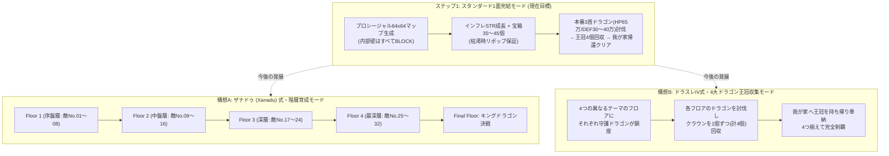

# 『DS1ish』 プロシージャルマップ生成 & ローグライク風発展構想資料

本書は、1984年 PC-8801版『ドラゴンスレイヤー (Level 2.0)』のコアメカニクスをベースとした拡張Web実装『DS1ish』において、**プロシージャル（自動）マップ生成**および**ローグライク風の新ゲーム進行モード（Xanadu式 / ドラスレIV式）**へと発展させるための設計・アイデア資料である。

---

## 1. 基本原理：なぜドラスレ1は「地形の形」に依存せずクリア可能なのか？

一般的なローグライク（『トルネコの大冒険』『風来のシレン』等）では、「スタート地点からゴール（階段）まで徒歩で通行可能な経路が最初から繋がっていること」がマップ生成の絶対条件となる。
しかし、初代『ドラゴンスレイヤー』においては以下のメカニクスが存在するため、**初期状態でスタート地点とドラゴンの場所が通路として接続されている必要がない**。

### 1.1 5つの地形突破メカニクス
本作における64×64トーラス世界の壁はすべて**「可動・破壊可能なブロック（`BLOCK`）」**で構成されており、破壊不能な固定外壁は存在しない。

| 突破手段 | 解禁・発動条件 | 地形に対する作用 |
| :--- | :--- | :--- |
| **指輪 (`RING`)** | 床または宝箱から入手 | 進行方向の `BLOCK` や `HOME` を1マスずつ押して移動させる（倉庫番パズル） |
| **`JUMP` 魔法** | `EXP ≥ 1,000` + `MAGIC ≥ 1` | 壁を無視して直線滑空するゴースト（`Ghost`）の現在位置へワープする |
| **`BREAK` 魔法** | `EXP ≥ 4,000` + `MAGIC ≥ 1` | 目の前の `BLOCK` を消滅させる。**実質MAGIC消費0**のため、解禁後は無限にトンネルを掘削可能 |
| **`KICK` 魔法** | `EXP ≥ 5,000` + `MAGIC ≥ 1` | 目の前の `BLOCK` を蹴り飛ばす／粉砕する。敵に命中した場合は即死させ、空間がない場合は岩を消滅させる |
| **`FLY` 魔法** | `EXP ≥ 10,000` + `MAGIC ≥ 1` | 一定ターンの間、鳥に変身して `BLOCK`・`GRAVE`・モンスターをすべてすり抜けて飛行する |

さらに、仮に重要アイテムが壁で囲まれた閉鎖空間内に配置されていても、リアルタイムで壁をすり抜ける**ゴースト（おばけ）**が床アイテムを自動的に拾い上げ、別の空床（`EMPTY`）へと運搬・ポイ捨てする（`GhostAISystem`）。

### 1.2 クリア可能性（Solvability）を支配する「真の条件」
したがって、地形が迷路であろうと文字パターンであろうと、クリア可能性は以下の **3つの条件** だけで100%保証される。

1. **序盤のブートストラップ（初期導線）**:
   - 魔法（特に `BREAK` / `JUMP`）が使えるようになる前の最序盤に限り、プレイヤーは壁を壊せない。
   - 我が家（`HOME`）からの初期到達圏内（または指輪での1〜2回の岩押し圏内）に、**剣（`SWORD`）・鍵（`KEY`）・指輪（`RING`）・魔法の壺（`POTION` 最低1個）・開いた墓（`GRAVE`）** が存在すること。
   - ※この「初期の剣と鍵の位置（家からの距離や間に挟まるブロック数）」を調整するだけで、マップの序盤難易度を自在にコントロールできる。
2. **資源総量（宝箱の数とSTR成長曲線）**:
   - 本来の3首ドラゴン（`HP 650,000 / ATK 500,000〜600,000 / DEF 300,000〜400,000`）を討伐するには、プレイヤーの `STRENGTH` を **400,000〜500,000以上** に育成し、かつ `EXP ≥ 12,000` で**斜め移動**を習得する必要がある。
   - マップ上の宝箱（`CHEST`）が適切な数（35〜45個＋枯渇時の周期リポップ）設置されており、パワーストーン奉納時のSTR上昇曲線がインフレ設計になっていれば、確実にドラゴン討伐ラインへ到達できる。
3. **ドラゴン周辺の局所空間（7×7 予約領域）**:
   - ドラゴンの十字5マス（胴体・3首・尻尾）、斜め攻撃用の安全地帯4マス `(cx±1, cy±1)`、および全首撃破時に王冠が出現する4マス `(cx±2, cy±2)` が外周壁（`WALL_STATIC`）と重ならないこと。

---

## 2. 多彩なギミックとプロシージャル生成パターン（アーキタイプ設計）

単なる部屋や迷路にとどまらないユニークなフロア構成を、プロシージャル生成の「トポロジー」および「アーキタイプ（戦術テーマ）」として導入する。

### 2.1 地形（`BLOCK`）レイアウトのバリエーション
1. **スタンダード部屋＆回廊型 (`STANDARD_ROOMS`)**
   - マップを複数セクターに分割し、ブロックで囲まれた大小の部屋、連絡回廊、内部の柱（倉庫番パズル要素）を生成する王道ダンジョン。
2. **幾何学・対称模様型 (`PILLAR_GRID` / `SPIRAL_LABYRINTH` / `FORTRESS_ARENA`)**
   - **同心四角形・渦巻き（スパイラル）**: セクター外周から中心に向かって何重ものブロック回廊が囲む構造。
   - **市松模様（ピラーグリッド）**: 1マスまたは2マスおきの格子状にブロックが並ぶ構造（斜め移動や岩押しのパズル性が非常に高い）。
   - **アリーナ要塞**: トーチカ（遮蔽ブロック群）を備えた大広間構造。
3. **シンボル・スタンプ型 (`PREFAB_STAMP`)**
   - 5×5 や 7×7 のドラゴン要塞、3×3 のコンパクト拠点、密閉宝物庫などの幾何学ビットマップを64×64空間の任意セクターにスタンプ配置するパターン。

### 2.2 オブジェクト配置の特殊ギミック（4大アーキタイプへの展開）
フロアごとの攻略戦術を変化させるアーキタイプ（`DungeonArchetype`）および特殊構造の設計：

| ギミック / アーキタイプ | 特徴 | プロシージャル生成での実装・パズル効果 |
| :--- | :--- | :--- |
| **聖域結界 (`SANCTUARY`)** | 十字架が多数配置され、ゴーストが4体徘徊する構成 | ・床置き十字架で王冠や拠点を包囲し、4体のゴーストによる強奪を防ぐ結界陣地防衛戦術や、墓の十字架封鎖が主軸となる。 |
| **武器庫 (`ARMORY`)** | マップ上に剣（`SWORD`）が複数落ちている構成 | ・フィールド敵の同時出現上限が増加して激戦となる一方、予備の剣を拠点近くにデポして万一の紛失時にも即座に戦線復帰できる。 |
| **ワープ迷宮 (`WARP_NEXUS`)** | マップ全域に13〜15ペアの高密度ワープゾーンが張り巡らされた構成 | ・鍵と指輪の上限が緩和され、ワープネットワークの把握とワープ上への岩押し封鎖を組み合わせた高度な空間パズルが楽しめる。 |
| **宝物庫クラスター (`TREASURE_VAULT`)** | ブロックの塊の中に多数の宝箱が密集している区画 | ・8歩周期（パワーストーン確定排出）を連続チェーンで決めやすいボーナス構造。 ・死神（`DEATH`）が出現した際も、近くに置いた十字架（`CROSS`）や我が家への帰還で除霊しながら高速育成が可能。 |

---

## 3. 複数面を渡り歩くローグライク発展モード構想

1面完結のスタンダードモードが確立した後の発展形として、以下の**マルチフロア進行モード**を構想する。

### 3.1 構想A：ザナドゥ（Xanadu）式 ―「階層を渡り歩いてクラウンを集め、最後にドラゴン決戦」
- **概要**:
  - ステータス（`HP`, `STR`, `EXP`, `GOLD`, `MAGIC`, 装備）を維持したまま、プロシージャル生成される複数のフロア（例：全4〜5階層）を階段（特殊ワープゲート）で降りていく方式。
- **特徴とメリット**:
  1. **全32種モンスターの階層別生態系**:
     - 1フロア目では `skeleton` 〜 `tamori`（No.01〜08）、2フロア目では `dora` 〜 `flanc`（No.09〜16）というように、フロアごとに墓から湧くモンスターランク帯を固定・段階化できる。これにより全32種のモンスターとじっくり戦える。
  2. **フロアごとの地形テーマ変化**:
     - Floor 1 はスタンダード部屋型、Floor 2 は迷路・ワープ列型、Floor 3 は幾何学リング型、Floor 4 は文字パターン型など、階層ごとに異なるマップ構造を楽しめる。
  3. **クラウン収集と最終決戦**:
     - 各階層で試練（中ボスまたは封印宝箱）を突破してクラウンを集め、最終フロアで3首ドラゴンを討伐して脱出する。

### 3.2 構想B：ドラスレIV（ドラゴンスレイヤーIV）式 ―「複数のドラゴンからクラウンを集める」
- **概要**:
  - 4つのフロア（または東・西・南・北の4大領域）それぞれに固有のドラゴン（または分身竜：炎の竜、氷の竜、石の竜、闇の竜など）が配置され、各ドラゴンが1つずつ王冠（`CROWN`）を守っている。
- **「王冠所持中の魔法封印ルール」を活かしたゲーム性**:
  - 初代ドラスレの「王冠を1個でも所持していると全魔法が使用不可になる」というルールを活かすため、**「王冠を拾ったら魔法なしで我が家（またはフロア帰還ゲート）まで生還し、家に王冠を保管（奉納）すると再び魔法が使えるようになる」**というサイクルを導入する。
  - これにより、「行きは `FLY` や `BREAK` でルートを開拓しながらドラゴンを倒し、帰りは魔法封印状態でモンスターの猛攻をかいくぐって家まで王冠を運ぶ」という緊張感あふれる脱出劇が4回楽しめる。

---

## 4. 段階的ロードマップ（実装フェーズ整理）

1. **Step 1（今回の実装目標）：スタンダード・プロシージャルマップ生成 & 本番ドラゴン1面完結バランスの確立**
   - `Dragon` のパラメータを Level 2.0 本番仕様（`HP 650,000 / DEF 300,000〜400,000`）へ引き上げ。
   - `Player.healAtHome()` におけるパワーストーンのSTR成長をインフレ曲線化し、1面内の宝箱（約40個＋枯渇時リポップ保証）で本番ドラゴンを討伐可能にする。
   - 内部壁をすべて `BLOCK` としたスタンダードな部屋・回廊型プロシージャル生成器（`ProceduralMapGenerator`）とクリア可能性検証機構を実装し、実際のゲームプレイで選択・遊べるようにする。
2. **Step 2（今後の拡張）：多彩な地形パターン＆原作ギミック変異の導入**
   - 幾何学パターン、文字パターン、多数剣、多数家、ワープ列などの生成アルゴリズム追加。
3. **Step 3（今後の拡張）：マルチフロア進行モード（Xanadu式 / ドラスレIV式）の実装**
   - フロア間遷移、階層別モンスターテーブル、王冠奉納システムの導入。
