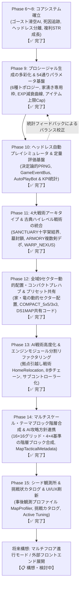

# 『DS1ish』 開発ロードマップ & アーキテクチャ進化記録 (Roadmap)

本書は、『DS1ish』(Dragon Slayer-like Procedural Action-Puzzle RPG) における**基本設計方針、達成済みマイルストーン（Phase 6〜12）、および今後の発展構想**を管理するドキュメントである。

※ 現在稼働・動作保証されている全機能の一覧は [`docs/status/current_features.md`](../status/current_features.md) を参照。

---

## 1. 基本コンセプトと設計方針

### 1.1 「固定マップを持たない」プロシージャルマップ生成への一本化
本作は1984年 PC-8801版『ドラゴンスレイヤー (Level 2.0)』へのリスペクト・オマージュとして原作の基本ルール・メカニクスを継承しつつ、マップ構造については**「固定ステージマップを作成・収録せず、毎回クリア可能性（Solvability）が構造的に保証された64×64トーラス迷宮のダンジョンマップをプロシージャル（自動）生成する」**方式を採用している。

手動で1マスずつ配置する固定マップやタイルエディタを採用しない理由は以下の通りである：
1. **ルール自体が生む無限のパズル性**:
   - マップ内部の壁がすべて「可動・破壊可能なブロック（`BLOCK`）」であり、「指輪による岩・我が家の倉庫番プッシュ」「`BREAK` / `KICK` による掘削」「`JUMP` / `FLY` による立体機動」「ゴーストによるアイテム運搬」という突破メカニクスが揃っているため、初期導線と資源量さえ担保すれば、どのようなトポロジーでも毎回新鮮な攻略ルート開拓が成立する。
2. **攻防2軸「敵相対タクティカルマーカー」とのシナジー**:
   - 未知のランダム生成マップであっても、プレイヤーの現在ステータスに対する敵の相対的意味（一撃撃破・安全稼ぎ・膠着壁・危険・即死、および「一撃だが触れられたら即死するガラスの剣」）がリアルタイムに可視化されるため、初見マップでも納得感のある戦術判断が可能となる。
3. **シード値＆設定プリセットによる軽量共有 (`DS1MAP:`)**:
   - 4,096マスのタイルデータを保持せずとも、「乱数シード値 ＋ トポロジー ＋ 難易度 ＋ ペース ＋ アーキタイプ ＋ プレハブ設定」のメタデータだけで同一迷宮を100%決定論的に再現でき、1行のテキストコード（`DS1MAP:...`）で瞬時に保存・共有・再挑戦できる。

### 1.2 3軸統合の開発サイクル
1. **プロシージャル生成の多彩化 × トポロジー連動パラメータ (`DungeonTuningParams`)**
2. **自律攻略AI (`AutoPlayBot`) × ヘッドレス定量シミュレーション (`SimulationRunner`)**
3. **厳選おすすめプリセット (`CURATED_PRESETS`) × 1行共有コード (`MapPresetManager`)**

---

## 2. 達成済みフェーズの詳細記録 (Phase 9 〜 Phase 15)

### Phase 9: プロシージャル生成の多彩化 & トポロジー連動パラメータ基盤
- **ステータス**: 【✅ 完了】
- **決定版仕様書**: [`docs/procedural_generation_spec.md`](../procedural_generation_spec.md)
- **主な実装内容**:
  - 6種のダンジョントポロジー（`STANDARD_ROOMS`, `PILLAR_GRID`, `NARROW_MAZE`, `SPIRAL_LABYRINTH`, `FORTRESS_ARENA`, `MULTI_SECTOR`）および戦略ギミック（「パンドラの墓場」「閉鎖された宝物庫」）の生成アルゴリズム実装。
  - 3大バランス課題を解決する `DungeonTuningParams` の導入：
    1. 首討伐後の「我が家スポーン専用枠（`homeSpawnReserveByPhase`）」と最遠非交戦敵の自動パージ（`evictDistantEnemyOnHomeSpawn`）。
    2. 終盤高DEF敵撃破時のEXP急騰を抑えるべき乗減衰（`DAMPED_POWER`）および段階キャップ（`PHASE_CAPPED`）。
    3. 非消耗アイテム（十字架・指輪・鍵・剣）のワールド内総数キャップと消耗品への自動フォールバック。
  - 「トポロジー(6) × 難易度(3) × プレイ時間ペース(3) ＝ 54通り」の自動プリセット解決器（`TuningPresetResolver`）とリアルタイム解析モーダル（`InspectorModal`）の実装。

---

### Phase 10: ヘッドレス自動プレイシミュレータ & 定量バランス評価基盤
- **ステータス**: 【✅ 完了】
- **決定版仕様書**: [`docs/autoplay_and_simulation_spec.md`](../autoplay_and_simulation_spec.md)
- **主な実装内容**:
  - Mulberry32 アルゴリズムによる決定論的擬似乱数生成器（`SeedRandom`）の全システム DI と、同一シードでの100%動作再現性の確立。
  - 型安全 Pub/Sub ドメインイベントバス（`GameEventBus`）およびストレージ抽象化（`SaveStorageDriver`）の実装。
  - 自律攻略ボット（`AutoPlayBot`）とヘッドレスバッチ実行基盤（`SimulationRunner` / `SimulationTelemetry` / `scripts/simulate.ts` / `scripts/evaluate-params.ts`）の構築。
  - タイトル放置時の「アトラクションデモモード」およびインゲームでの「可変速自走検証モード ＆ 手動操作とのシームレス相互引き継ぎ（`[A]` / `[Tab]`）」の統合。

---

### Phase 11: 4大戦術アーキタイプ & ハイレベル戦術システムの統合
- **ステータス**: 【✅ 完了】
- **決定版仕様書**: [`docs/procedural_generation_spec.md`](../procedural_generation_spec.md)
- **主な実装内容**:
  - 外周固定壁（`WALL_STATIC`）を全廃した完全な **64×64 トーラス世界（上下左右ループ空間）** の確立と、`KICK` 魔法による岩蹴り飛ばし・モンスター即死ギミックの実装。
  - ドラゴン首正面への安易な岩押し込み完封を防ぐ「アンチ・ブロック押し込みバリア（宝箱・ポーションとクランク開口部による幾何学的防衛構造）」の導入。
  - 攻略戦術の個性を際立たせる **4大アーキタイプ（`DungeonArchetype`）** の実装：
    - `BALANCED`: 標準バランス型
    - `SANCTUARY`: 十字架多数配置 × ゴースト4体（床置き十字架結界によるクラウン防衛・墓封鎖が主軸）
    - `WARP_NEXUS`: 13〜15ペア（26〜30マス）の高密度ワープ迷宮 × 鍵・指輪上限緩和
    - `ARMORY`: マップ上に複数の剣が散在 × フィールド敵上限増加（予備剣のデポ運用と激戦）

---

### Phase 12: 全域9セクター動的配置・コンパクトプレハブ & プリセット共有システム
- **ステータス**: 【✅ 完了】
- **決定版仕様書**: [`docs/procedural_generation_spec.md`](../procedural_generation_spec.md)
- **主な実装内容**:
  - **全域9セクター不規則分割 (`generateDynamicSectors`)**: 64×64空間をジッター付きの9セクター（3×3グリッドベース）に分割し、これまで固定座標だった「我が家」と「ドラゴン要塞」をシードごとに異なるセクターへ動的配置（トーラスマンハッタン距離 $\ge 20$ の離隔保証つき）。
  - **コンパクト・プレハブ (`COMPACT_5x5` / `COMPACT_3x3`)**: 大広間だけでなく細長い回廊や迷路セクター内部にもドラゴンや我が家を自然に埋め込める省スペーススタンプ構造と、火炎弾射線クリアランス保証の実装。
  - **シード＆設定プリセット管理 (`MapPresetManager`)**:
    - 初回から遊べる5種の「公式おすすめプリセット（`CURATED_PRESETS`：龍の大広間、回廊奥の古龍、聖域の守護者、四神の武器庫、螺旋迷宮の咆哮）」。
    - 気に入った生成マップのローカルプリセット保存・クリア実績記録、および Base64 圧縮による **1行共有コード（`DS1MAP:...`）** のエクスポート／インポート機能。

---

### Phase 13: AI戦術モジュール化（拠点引越し戦術）& コアエンジン分割リファクタリング
- **ステータス**: 【✅ 完了】
- **決定版仕様書**: [`docs/autoplay_and_simulation_spec.md`](../autoplay_and_simulation_spec.md), [`docs/architecture/technical_design.md`](../architecture/technical_design.md)
- **主な実装内容**:
  - **`AutoPlayBot` の戦術モジュール分割と新フェーズ `HOME_RELOCATE`**:
    - 経路探索（`BotNavigator`）、8歩周期開錠制御（`EightStepController`）、墓封鎖戦術（`GraveSealTactics`）、およびドラゴン討伐前に指輪で「我が家」をドラゴン要塞の近傍アンカーへ押し運んで王冠4個の脱出距離を劇的に短縮する **拠点引越し戦術（`HomeRelocationTactics`）** を独立モジュール化。
    - 連続ワープチェイン探索や、首討伐後に初期位置の家（`spawnHomePos`）から敵が湧き出す仕様と移動後の本物の家（`homePos`）の分離に対応。
  - **`GameEngine` のサブコントローラー分割 (`src/core/engine/`)**:
    - 肥大化していた `GameEngine.ts` をファサード化し、`TargetTrackingController`, `TurnExecutionController`, `DemoAndAutoPlayController`, `SessionController`, `EngineUIAndInputBinder` の5つの単一責務コントローラーへ分割（全35テストスイート100%パス）。

---

### Phase 14: マルチスケール・テーマブロック階層合成 & AI攻略方針メタデータ連携
- **ステータス**: 【✅ 完了】
- **詳細設計・実装ロードマップ**: [`docs/roadmap/proposals/hierarchical_theme_block_generation.md`](./proposals/hierarchical_theme_block_generation.md)
- **主な実装内容**:
  - **16×16グリッド（最小単位4×4）のマルチスケール・テーマブロック合成エンジン (`ThemeBlockAllocator`, `ThemeBlockTransformer`)**:
    - `24×24`, `16×16`, `12×12`, `8×8`, `4×4` のブロック体系と90度単位の回転・反転、戦術ピン座標自動変換、ランドマーク離隔（マンハッタン距離>=20）パッキング、大ブロック内サブスロット（4x4/8x8）のインセット合成を実装。
  - **テーマブロック・カタログ (`src/systems/generator/blocks/`)**:
    - 数手封鎖パズル墓、L字4つ角4出口箱型墓、16x16ネクロポリス、8歩周期市松模様宝物庫、L字複合宝物庫、大宝物殿ドラゴン、迷路潜伏ドラゴン、我が家スタートブロックなど全21テンプレートを定義。
  - **スロット予算アクティベーション & 100%解法性保証 (`HierarchicalThemeBlockGenerator`)**:
    - 目標宝箱数（BLITZ=65 / STANDARD=100 / MARATHON=130）に応じた宝箱スロット動的アクティベーション、難易度別（EASY/NORMAL/HARD）ブートストラップ導線距離制御とBFS到達性保証、全6トポロジー・全ペーシングでのクリア可能性保証。
  - **ボット攻略方針メタデータ (`MapTacticalMetadata`) と `AutoPlayBot` の戦術連携**:
    - `BOX_EXITS` モードの箱型墓における4出口チョークポイント封鎖判定、`recommendedPushes` による最短手即時岩押し、`MAZE_LAIR` での我が家移転スキップ、`isEightStepOptimal: true` の密集部屋優先探索連携。
  - **ヘッドレス・バッチシミュレーション評価**:
    - `SimulationRunner` による各トポロジーでの定量検証、出入口開口・ブートストラップ到達性調整、公式おすすめプリセット `curated_hierarchical_citadel` の追加。全41テストスイート100%パス。

---

### Phase 15: シード観測所 & 挑戦状カタログ & UI/UX刷新
- **ステータス**: 【✅ 完了】
- **決定版仕様書**: [`docs/specs/seed_observatory_and_ui_spec.md`](../specs/seed_observatory_and_ui_spec.md), [`docs/procedural_generation_spec.md`](../procedural_generation_spec.md)
- **主な実装内容**:
  - **事後観測プロファイラー (`MapProfiler.ts`)**:
    - 生成済みマップの幾何学的スキャン（開放度 `opennessScore`、迷路度 `mazeIndex`、部屋数 `roomCount`、初期剣到達歩数 `swordWalkDistance`、家近接未封鎖墓 `nearHomeGraves`、要塞侵入路/安全マス `lairAccessibility`、セクター分断度 `sectorPartitionScore`）を実装。
    - 事前パラメータにとらわれず、幾何実態からトポロジー・難易度・ペーシング・チャレンジ指数（1〜100）を事後判定し、客観的プロファイルレポート（`MapProfileReport`）を生成。
  - **シード収穫・分類バッチ (`scripts/harvest-seeds.ts`)**:
    - ヘッドレスボット検証と組み合わせ、1600ターン未踏破の難関シードを自動検出・格付けし、公式挑戦状プリセット（`curated_unbeaten_nightmare` Seed: 833139）を収録。
  - **ステージ選択 & シード観測UI刷新 (`DOMUIManager.ts`)**:
    - 「CHALLENGE CATALOG & SEED OBSERVATORY」への導線刷新。
    - クイック設定でのシード値直接入力と🎲乱数ボタンの追加。
    - プリセット選択時の「プロファイル詳細カード（`#dom-preset-detail-card`）」動的描画（難易度バッジ、チャレンジ指数バー、ボット観測ステータス、踏破記録、特徴タグ）。
    - リアルタイム観測プレビュー（シードガチャ体験）とキー入力連動（手入力時の自動プレビュー更新）。
  - **ゲーム中INSPECT画面の機能拡充 (`InspectorModal.ts`)**:
    - マップ俯瞰タブでの幾何構造プロファイルおよび Phase 14 戦術メタデータ（要塞スタイル、8歩宝物庫、墓封鎖パズル、我が家移転アンカー）の可視化。
    - タブ2「⚙️ ゲームチューニング定数 (Active Tuning)」に名称をリファインし、現在セッションの物理パラメータ（スポーン上限、家湧き枠、パワーストーン複利成長率、ゴースト速度など）の実効値を完全開示。
  - **キーボード入力ガード (`InputManager.ts`)**:
    - テキストボックス入力中にゲーム側ショートカットやスクロール抑止（`preventDefault`）が横取りされる不具合を修正し、安定した直接入力を実現。全42テストスイート100%パス。

---

## 3. 今後の発展構想 (Future Directions)

単一64×64マップのプロシージャル生成・バランス調整・AI自律攻略基盤が完成したことを受け、今後の拡張テーマとして以下を構想している：

1. **マルチステージ／ローグライト周回モード（連続階層進行）**:
   - 王冠4個を持ち帰ってステージクリアした際、異なるトポロジー・アーキタイプ・段階的パラメータを持つ次フロア（Stage 2, 3, ...）へ進行するキャンペーン／エンドレス周回モード（詳細は [`docs/roadmap/proposals/procedural_and_roguelike_concepts.md`](./proposals/procedural_and_roguelike_concepts.md) 参照）。
2. **王冠脱出フェーズ (`CROWN_ESCAPE`) におけるAIステルス回避の高度化**:
   - 全魔法が封印される王冠運搬中に、距離場（Distance Field）を用いて高火力モンスターやゴーストの進路を先読み回避するナビゲーションの強化。
3. **シグナル駆動・マルチフロントエンド展開**:
   - 確立済みのヘッドレスエンジンと `GameEventBus` を活かし、CUI（ターミナルANSI表示）クライアントやリプレイ再生・巻き戻し（Rewind）機能への展開（詳細は [`docs/roadmap/proposals/headless_and_multi_frontend.md`](./proposals/headless_and_multi_frontend.md) 参照）。

---

## 4. 関連コンセプト・提案書一覧 (Feature Proposals)

- **マルチスケール・テーマブロック階層合成 & AI攻略方針連携 設計書 (Phase 14)**:
  [`docs/roadmap/proposals/hierarchical_theme_block_generation.md`](./proposals/hierarchical_theme_block_generation.md)
- **プロシージャル多彩化・チューニング基盤・プリセット共有構想**:
  [`docs/roadmap/proposals/procedural_variety_and_sandbox.md`](./proposals/procedural_variety_and_sandbox.md)
- **ヘッドレス評価シミュレータ & マルチフロントエンド構想**:
  [`docs/roadmap/proposals/headless_and_multi_frontend.md`](./proposals/headless_and_multi_frontend.md)
- **プロシージャル生成原理 & ローグライク発展構想**:
  [`docs/roadmap/proposals/procedural_and_roguelike_concepts.md`](./proposals/procedural_and_roguelike_concepts.md)
- **敵相対5段階マーカー（攻防2軸3×3マトリクス）& モダン・パズルRPG化構想**:
  [`docs/roadmap/proposals/enemy_marker_and_modernization.md`](./proposals/enemy_marker_and_modernization.md)
